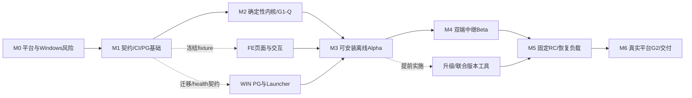

# Windows原生本地部署＋轻量公网中继：开发计划

归档说明（2026-10-25）：资料迁入词温WordHeat Live仓库；本次仅整理路径、链接和来源摘要，架构、接口与验收语义不变。

> **供实施人员与执行代理：** 本文件为工作包与里程碑计划，当前全部待执行。获得实施授权后，可按 `superpowers:subagent-driven-development` 或 `superpowers:executing-plans` 逐包实施；`- [ ]`是待办步骤，不表示已开发或验收。本轮仅编制计划。

**Goal / 目标：** 将已批准的v1.1 P-W方案实现为可安装、可恢复、能完成真实平台闭环的单直播间Windows软件。

**Architecture / 架构：** Windows保留唯一权威业务、PostgreSQL、模型与账本；公网中继负责验签持久接收、租约、窗口时序、可靠投递和履约任务。React展示页与主播台分离，正式判胜不交给模型自由裁决。

**Tech Stack / 技术栈：** React/TypeScript；Python 3.12/FastAPI；独立BGE CPU进程；PostgreSQL 16；Windows x64安装器、onedir运行包与Launcher；HTTPS/WSS轻量中继；真实PG事务测试、Windows/OBS实机与平台验收。

计划版本：1.0 · 日期：2026-10-25 · 来源方案：v1.1。

## 01｜基线、范围与完成定义

依据同目录[落地解决方案v1.1](../solution/20261025%20-%20%E7%9B%B4%E6%92%AD%E8%AF%AD%E4%B9%89%E7%8C%9C%E8%AF%8D%20-%20%E8%90%BD%E5%9C%B0%E8%A7%A3%E5%86%B3%E6%96%B9%E6%A1%88.md)编制。源文档SHA-256为`e95b592d0401e41daff0e170dad8aabc9d98adb7f484d430c22df161041ccc54`。实施前复核版本，变更方案时先更新任务影响和验收映射，不能在旧计划下静默替换协议。

首发范围严格为 **F01–F60＋W01–W18**，覆盖8类Web页面、Launcher、真实评分、回合与账本、Windows安装升级和中继闭环。F61–F71为后续P1，F72–F80为P2，均不计入首发估工；不并行建设P-A远端核心产品、不做多房间、付费玩法、RAG或跨电脑无缝接管。

完成首发需要四项分别成立：G0平台输入/发布形态可行、G1中文评分与资源合格、G2真实直播闭环通过、固定发行候选通过T01–T27及WT01–WT24共51项验收。存在mock、演练Alpha或技术测试日志不能代替正式通过。51项完整描述仍以v1.1为准，本计划负责将它们分配到实施阶段。

本工作区当前只有设计与研究文档，Git为尚无提交的master。下列R指**已创建的项目仓库根**，其下产品源码仍为拟建，不表示已经存在：

`R = wordheat-live仓库根`

文中`R/...`均表示该绝对根下的计划文件；机器可读清单的planned_files均按仓库根解析相对路径。本轮不创建工程、工作树或分支，不安装依赖、不执行平台试验或部署。实际实施时依据用户明确授权确定代码工作区和Git交付方式；平台/云资源操作另按当时权限执行，禁止服务器SSH。

### 实施单元

| 单元 | 计划路径 | 责任边界 |
|---|---|---|
| 前端 | R/apps/web | 准备、主播、OBS、题库、评分、诊断、复盘、设置；消费契约，不持有未揭晓答案 |
| 本机业务 | R/apps/api | 场次、回合、输入、身份、账本、快照事件、回放、统计与恢复 |
| 推理 | R/apps/scorer | 单模型、离线加载、批量编码与资源边界；不决定胜负 |
| 中继 | R/apps/relay | 官方入口、独立持久库、设备租约、窗口/屏障、WSS、履约与停任务 |
| Windows交付 | R/apps/windows-launcher、R/deploy/windows-native | PG专用实例、目标SID/DPAPI、Job Objects、安装、升级、模型包与卸载 |
| 共同契约 | R/packages/contracts | OpenAPI、事件/帧Schema、manifest、错误码、退出码、兼容范围与fixture |
| 评测和验收 | R/packages/evaluation、R/tests、R/docs/acceptance | 模型盲评、真实事务、故障注入、Windows/OBS和真实平台证据 |

## 02｜角色、投入与排期假设

| 角色 | 基线配置 | 分工与限制 |
|---|---|---|
| BE 本机后端与中继 | 1名开发 | 同一人承担本机业务、评分集成、relay和平台适配，不能按两人并行计算 |
| FE 前端 | 1名开发 | 契约后可先做fixture页面，真实接线与故障状态另验收 |
| WIN Windows/交付 | 1名开发 | Windows CI、PG、Launcher、连接组件、安装升级与正式EXE产物 |
| QA 独立测试 | 约0.5人投入，关键关口集中 | 不以开发自测代替；QA不足会推迟验收日历 |
| CONTENT 内容与标注 | 独立负责人，阶段性投入 | 题目、别名、提示、权属、双人盲评；不默认由开发者顺手完成 |
| 项目/平台负责人 | 由项目指定 | 账号、能力、样机、签名证书、测试与云资源、平台等待和最终范围裁定 |

这些是逻辑责任和估算假设，并非已经分配到实际人员。角色兼任时对应工作包串行；单名开发不能套用三泳道日历。

36个工作包的工程基准估算合计 **73–109开发人日**：BE37–56、FE15–21、WIN21–32；另预留 **8–16开发人日**用于跨端返修与候选复验，工程预算约 **81–125人日**。独立QA约15–22人日、内容与标注约8–12人日单列，不重复加进上述开发人日。

按三个开发角色、每周5个工作日、依赖就绪、角色单任务占用推算，纯工程区间约45–69个工作日，中值57日；它不含独立QA放行、额外返修及外部等待。建议以 **12–17周＋平台/证书/资源等待时间**作为首轮排期窗口，M0后按实测与实际人员重算，不能承诺固定上线日。人日不是把总量除以3就得到日历。

v1.1中的63–96人日是前期双形态粗估。本计划针对尚无产品代码的P-W首发，逐包显式计入Windows安全引导、双端协议、8类页面与正式包体，因此采用新的拆包估算；它不是直接套用“在成熟核心上增加Windows”的22–34人日增量。

## 03｜里程碑与验收门槛

M表示最终验收归属，具体任务可在依赖满足后提前开发。例如FE页面可以先用冻结fixture，Windows升级工具可以在Alpha后、BE建设中继期间推进；不意味着全部按里程碑串行开工。

| 里程碑 | 主要工作包 | 核心交付 | 必须满足的放行条件 |
|---|---|---|---|
| M0 可行性与风险试验 | WP01–02 | 平台真实试词/最小正式包体路径；Windows最小冻结包、PG/SID、模型与OBS试验 | G0有实际证据；Win关键组合可运行；失败时仅允许重新确认后的离线范围，不承诺自动直播 |
| M1 契约与工程基础 | WP03–06 | 协议、manifest、schema/迁移、Windows CI、前端壳 | 字段/版本/错误码、五状态确认和所有权边界冻结，真实PG基础通过；三条实施泳道可依据同一契约工作 |
| M2 确定性内核 | WP07–11 | 题库发布、真实评分、回合、账本、权限和公私DTO | G1-Q评分质量子项合格；14项核心主归属用例通过；没有mock假分或相似阈值判胜 |
| M3 可安装离线Alpha | WP12–21 | 8类页面接线、快照/回执、诊断复盘、PG/Launcher和安装Alpha | 在干净Windows安装后，用真实PG/模型完成多轮手动/回放；T15–17正式归属通过；不宣称平台接通 |
| M4 中继与平台适配Beta | WP22–30 | 两端持久流、租约/窗口/中断、履约、完整EXE入口与UI状态 | 15项传输/故障主归属用例通过；本机ACK不冒充端侧processed；端到端测试环境可逐条对账 |
| M5 可恢复发布候选RC | WP31–34 | 升级、双端恢复、资源/故障报告、成套签名与manifest | 本阶段15项正式验收通过；G1-R目标机/OBS资源子项合格，与G1-Q合并放行G1；最终候选前置47项均有证据 |
| M6 真实直播与交付 | WP35–36 | 真实多用户、认可包体/履约、目标手机与主播独立操作 | T01/T24/T25/WT24通过，G2成立，51项及G1完整；交付安装、开停播、修复与恢复手册 |

图中的实线是验收放行关系，不是所有任务的开工串行关系；精确依赖由工作包表与JSON清单定义。

### 各阶段可展示什么

- M0：可以判断“接入/打包是否可行”，尚无完整产品。
- M2：可以通过API/测试证明规则正确，尚无可交付直播工具。
- M3：可以安装并离线演练，仍不能说已经自动获取抖音评论。
- M4：可以在测试环境证明两端可靠性，仍不等于正式直播/包体审核通过。
- M6：固定候选的真实平台、Windows和用户操作证据齐全，才能按实际通过范围交付。

## 04｜工作包总览

下表估工为主责工程工作，独立QA和内容投入见第07节；跨端缺陷修复使用前述8–16人日缓冲，不在每包另加同一份协作时间。所有状态均为“待执行”。文件详细范围和包内验收见第05节；机器清单提供相同ID、依赖和仓库相对计划路径。

| 工作包 | 交付主题 | 归属 | 主责/人日 | 硬依赖 |
|---|---|---|---|---|
| WP01 | 平台输入与正式包体可行性 | M0 | BE 2–3 | 无；需外部前提就绪 |
| WP02 | Windows原生交付风险验证 | M0 | WIN 2–3 | 无；需外部前提就绪 |
| WP03 | 冻结跨模块契约和发行清单 | M1 | BE 2–3 | WP01, WP02 |
| WP04 | 工程骨架与Windows构建CI | M1 | WIN 1–2 | WP03 |
| WP05 | 本机数据模型与迁移基础 | M1 | BE 2–3 | WP03, WP04 |
| WP06 | 前端工程与公共交互基础 | M1 | FE 1–2 | WP03, WP04 |
| WP07 | 题库发布与CSV校验 | M2 | BE 2–3 | WP05 |
| WP08 | 真实评分进程、校准与G1-Q | M2 | BE 3–4 | WP02, WP05, WP07 |
| WP09 | 回合状态机与有序入场 | M2 | BE 3–4 | WP05, WP07, WP08 |
| WP10 | 积分账本与事务outbox | M2 | BE 2–3 | WP09 |
| WP11 | 身份、只读票据与公私DTO | M2 | BE 2–3 | WP05, WP03 |
| WP12 | 快照、WebSocket与端侧回执 | M3 | BE 2–3 | WP10, WP11 |
| WP13 | OBS展示页与反馈组件 | M3 | FE 3–4 | WP06 |
| WP14 | 准备页、主播台与设置 | M3 | FE 3–4 | WP06 |
| WP15 | 题库与评分实验室页面 | M3 | FE 3–4 | WP06, WP07, WP08 |
| WP16 | 回放、消息追踪、基础复盘 | M3 | BE 2–3 | WP10, WP12 |
| WP17 | 诊断回放与复盘页面 | M3 | FE 3–4 | WP06, WP16 |
| WP18 | Launcher进程与状态机 | M3 | WIN 3–4 | WP04, WP08, WP12, WP19 |
| WP19 | 专用PG服务与SID/DPAPI引导 | M3 | WIN 3–4 | WP02, WP04, WP05, WP11 |
| WP20 | 基础可安装Alpha与离线交付 | M3 | WIN 2–3 | WP18, WP19, WP13, WP14 |
| WP21 | 本机离线纵向闭环集成 | M3 | BE 1–2 | WP12, WP13, WP14, WP15, WP16, WP17, WP20 |
| WP22 | 中继官方回调与持久收件箱 | M4 | BE 2–3 | WP21, WP01, WP03 |
| WP23 | 设备绑定与房间租约 | M4 | BE 1–2 | WP22, WP11 |
| WP24 | WSS投递、连续游标和gap | M4 | BE 2–3 | WP22, WP23 |
| WP25 | Windows本机中继连接组件 | M4 | WIN 2–3 | WP24, WP18 |
| WP26 | 正式窗口、可信时间与关闭屏障 | M4 | BE 2–3 | WP24, WP09 |
| WP27 | 双端回合、故障中断与恢复联调 | M4 | BE 2–3 | WP25, WP26, WP21 |
| WP28 | 正式平台适配、履约与停任务 | M4 | BE 2–3 | WP27, WP12, WP01 |
| WP29 | 正式EXE入口与平台包体产物 | M4 | WIN 2–3 | WP28, WP20 |
| WP30 | 真实连接与故障状态接线 | M4 | FE 2–3 | WP27, WP17 |
| WP31 | 升级、模型联合切换与受控回滚 | M5 | WIN 3–4 | WP20, WP08, WP05 |
| WP32 | 负载与协议故障证据收敛 | M5 | BE 2–3 | WP27, WP28, WP29, WP30 |
| WP33 | 双端备份恢复与安装安全复验 | M5 | WIN 1–2 | WP31, WP27 |
| WP34 | 冻结发布候选与复验清单 | M5 | WIN 1–2 | WP31, WP32, WP33, WP29, WP30 |
| WP35 | 真实平台多用户与G2验收 | M6 | BE 1–2 | WP34, WP01, WP28, WP29 |
| WP36 | 主播独立安装开停播与交付 | M6 | WIN 1–2 | WP35, WP34 |

## 05｜工作包实施卡

步骤为实施顺序，当前均未执行。先固化对应的失败场景或验收fixture，再实现最小行为，再取得包内实际证据；并发/事务/权限/故障必须使用真实依赖或故障注入。纯样式与文案采用UI检查，不为凑数量写镜像测试。包内完成不要求尚未产生的下游Alpha/RC：完整8页安装Alpha由WP21聚合，最终RC与47项复验由WP34聚合。

### WP01｜平台输入与正式包体可行性

主责：BE；估工：2–3人日；最终归属：M0；前置：外部资源就绪。

计划文件：`R/docs/feasibility/platform.md`；`R/spikes/platform-probe/probe.py`；`R/spikes/platform-probe/sample-contract.json`。

- [ ] 固化验收输入及反例：T01, WT24；核对前置制品、契约与版本。
- [ ] 完成实施范围：G0取得真实回调：自由词/短码、用户和消息ID、包体启动token、房间核验、题库类别与履约反馈口径；不足时只允许离线范围。
- [ ] 包内验证：在已授权资源执行最小平台探针及包体启动，保存脱敏实际输入/回调/房间核验记录。

期望完成证据：平台控制台记录、脱敏源消息、最小EXE启动与能力结论；不能只交mock日志。需求追踪：F03, F04, W18。证据包括明确候选版本/配置、实际输入输出、执行日志与失败处理，不能仅勾选本卡或要求下游先完成。

### WP02｜Windows原生交付风险验证

主责：WIN；估工：2–3人日；最终归属：M0；前置：外部资源就绪。

计划文件：`R/spikes/windows-native/launcher.py`；`R/spikes/windows-native/runtime.spec`；`R/docs/feasibility/windows-native.md`。

- [ ] 固化验收输入及反例：WT01, WT02, WT03, WT04, WT06, WT09；核对前置制品、契约与版本。
- [ ] 完成实施范围：冻结最小API/模型进程和静态页；干净机离线加载BGE、spawn、PG专用服务与跨管理员SID引导；OBS CEF最小展示。
- [ ] 包内验证：在干净Windows运行最小冻结目录包，验证离线模型、spawn、最小PG/SID流程和OBS，不等待完整业务。

期望完成证据：wheel/DLL/模型清单与真实安装/运行日志；最小包证明技术可行，仍非完整产品验收。需求追踪：W01, W02, W03, W04, W05, W18。证据包括明确候选版本/配置、实际输入输出、执行日志与失败处理，不能仅勾选本卡或要求下游先完成。

### WP03｜冻结跨模块契约和发行清单

主责：BE；估工：2–3人日；最终归属：M1；前置：WP01, WP02。

计划文件：`R/packages/contracts/openapi.yaml`；`R/packages/contracts/relay.schema.json`；`R/packages/contracts/runtime-manifest.schema.json`；`R/docs/contracts/decisions.md`；`R/packages/contracts/check_contracts.py`。

- [ ] 固化验收输入及反例：T14, WT13, WT16, WT19, WT20；核对前置制品、契约与版本。
- [ ] 完成实施范围：OpenAPI/事件JSON Schema；五状态确认、stream/generation/epoch、关闭竞态、错误码；schema迁移、health、安装器与launcher退出码。
- [ ] 包内验证：运行Schema/fixture和兼容性检查，交付可供其他角色独立使用的契约；不要求完整产品端到端。

期望完成证据：同一组正常/重复/失联/截止fixture通过契约校验；前后端/WIN共同签认字段与版本。需求追踪：F28, F45, F46, F47, W03, W06, W08, W09, W11, W13。证据包括明确候选版本/配置、实际输入输出、执行日志与失败处理，不能仅勾选本卡或要求下游先完成。

### WP04｜工程骨架与Windows构建CI

主责：WIN；估工：1–2人日；最终归属：M1；前置：WP03。

计划文件：`R/apps/api/pyproject.toml`；`R/apps/scorer/pyproject.toml`；`R/apps/web/package.json`；`R/deploy/windows-native/build.ps1`；`R/docs/build.md`。

- [ ] 固化验收输入及反例：WT01, WT04, WT06；核对前置制品、契约与版本。
- [ ] 完成实施范围：建立单仓工程、锁依赖、Windows x64构建和制品摘要；最小API/评分/Web包可重复构建；签名证书申请同步开始。
- [ ] 包内验证：运行最小工程的Windows构建，输出依赖锁、摘要与可运行骨架；不要求后续业务已完成。

期望完成证据：两次构建有锁定依赖与可核查manifest；不把签名申请完成等同已获证书。需求追踪：W01, W04, W18。证据包括明确候选版本/配置、实际输入输出、执行日志与失败处理，不能仅勾选本卡或要求下游先完成。

### WP05｜本机数据模型与迁移基础

主责：BE；估工：2–3人日；最终归属：M1；前置：WP03, WP04。

计划文件：`R/apps/api/app/infrastructure/db/models.py`；`R/apps/api/migrations/versions/initial.py`；`R/apps/api/app/health.py`；`R/apps/api/tests/integration/test_schema.py`；`R/apps/api/tests/conftest.py`。

- [ ] 固化验收输入及反例：T18, T19, T23, WT02, WT03, WT11；核对前置制品、契约与版本。
- [ ] 完成实施范围：实现业务表、唯一键与锁顺序；运行/迁移账号分离；迁移状态、实例标识和ready接口；备份格式与schema兼容范围；测试库校验实例标识与测试命名空间，拒绝生产DSN。
- [ ] 包内验证：在专用测试PG验证schema、权限、迁移和最小备份还原，不依赖Launcher或完整安装器。

期望完成证据：真实PG验证约束、事务回滚、最小迁移与还原；不以SQLite或内存测试替代。需求追踪：F06, F07, F36, F54, F55, W02, W13。证据包括明确候选版本/配置、实际输入输出、执行日志与失败处理，不能仅勾选本卡或要求下游先完成。

### WP06｜前端工程与公共交互基础

主责：FE；估工：1–2人日；最终归属：M1；前置：WP03, WP04。

计划文件：`R/apps/web/src/app/router.tsx`；`R/apps/web/src/api/client.ts`；`R/apps/web/src/api/events.ts`；`R/apps/web/src/styles/tokens.css`。

- [ ] 固化验收输入及反例：T16, T17, T24；核对前置制品、契约与版本。
- [ ] 完成实施范围：8类Web路由、类型客户端、事件解码、错误边界、单套高可读主题；建立演练fixture；公开与私有入口分离。
- [ ] 包内验证：构建前端壳并验证路由、类型解码及冻结fixture，不要求尚未实现的后端/安装Alpha。

期望完成证据：构建和契约解码通过；fixture有明确演练标记，不宣称已接真后端。需求追踪：F38, F43, F48, F51。证据包括明确候选版本/配置、实际输入输出、执行日志与失败处理，不能仅勾选本卡或要求下游先完成。

### WP07｜题库发布与CSV校验

主责：BE；估工：2–3人日；最终归属：M2；前置：WP05。

计划文件：`R/apps/api/app/modules/wordbank/service.py`；`R/apps/api/app/modules/wordbank/imports.py`；`R/apps/api/tests/integration/test_wordbank.py`。

- [ ] 固化验收输入及反例：T17, T21；核对前置制品、契约与版本。
- [ ] 完成实施范围：草稿/审核/发布/禁用、不可变版本、别名/提示/来源；CSV逐行报告，发布受模型校准状态约束。
- [ ] 包内验证：运行实际题库API与PG的导入/发布用例；正式质量清单由WP08及CONTENT共同提供。

期望完成证据：坏行不静默发布，未审核/无校准题不能抽取；已开局版本不可修改。需求追踪：F22, F23, F24。证据包括明确候选版本/配置、实际输入输出、执行日志与失败处理，不能仅勾选本卡或要求下游先完成。

### WP08｜真实评分进程、校准与G1-Q

主责：BE；估工：3–4人日；最终归属：M2；前置：WP02, WP05, WP07。

计划文件：`R/apps/scorer/app/encoder.py`；`R/apps/scorer/app/batcher.py`；`R/apps/api/app/modules/scoring/service.py`；`R/packages/evaluation/evaluate.py`；`R/resources/model-manifest.json`。

- [ ] 固化验收输入及反例：T06, T07, T08, T21, T22, WT04, WT08；核对前置制品、契约与版本。
- [ ] 完成实施范围：固定BGE/预处理/维度、离线加载、批处理/有界缓存；精确判胜独立；分离校准/盲评集完成G1-Q质量子项，独立进程资源初测不能代替M5的G1-R。
- [ ] 包内验证：在固定Windows评分候选上跑G1-Q与独立进程初测，不以此替代M5的OBS共机G1-R。

期望完成证据：原分与展示分分离；相关/无关排序质量目标分组报告达标；模型缺失禁止正式开局；G1整体待M5资源子项完成。需求追踪：F16, F17, F18, F19, W04, W14, W16。证据包括明确候选版本/配置、实际输入输出、执行日志与失败处理，不能仅勾选本卡或要求下游先完成。

### WP09｜回合状态机与有序入场

主责：BE；估工：3–4人日；最终归属：M2；前置：WP05, WP07, WP08。

计划文件：`R/apps/api/app/modules/rounds/service.py`；`R/apps/api/app/modules/inbox/admission.py`；`R/apps/api/tests/integration/test_round_races.py`。

- [ ] 固化验收输入及反例：T03, T04, T05, T06, T09, T10, T11, T12, T13, T14, T18；核对前置制品、契约与版本。
- [ ] 完成实施范围：场次/回合、规范化、用户身份/去重/限流、题目冻结、判胜/超时/暂停/作废/续局、三水位和恢复。
- [ ] 包内验证：运行本机API与真实PG的回合竞态、去重、旧轮和恢复定向用例；双端子项留WP27。

期望完成证据：并发100条正确输入仅一个赢家；旧结果/旧短码不入新轮；重启待确认。需求追踪：F01, F08, F09, F10, F12, F15, F20, F25, F26, F28, F29, F30, F31, F32, F33, F34, F54, F60。证据包括明确候选版本/配置、实际输入输出、执行日志与失败处理，不能仅勾选本卡或要求下游先完成。

### WP10｜积分账本与事务outbox

主责：BE；估工：2–3人日；最终归属：M2；前置：WP09。

计划文件：`R/apps/api/app/modules/ranking/ledger.py`；`R/apps/api/app/infrastructure/outbox.py`；`R/apps/api/tests/integration/test_settlement.py`。

- [ ] 固化验收输入及反例：T09, T19, T27；核对前置制品、契约与版本。
- [ ] 完成实施范围：固定档位奖、首位奖励、VOID冲销；结算/账本/事件原子提交；失败重试与出站投影。
- [ ] 包内验证：运行真实PG结算/账本/outbox事务和返回乱序用例，不依赖前端或安装Alpha。

期望完成证据：不同评分返回顺序档位总分相同；事务前后杀进程无部分积分/双结算。需求追踪：F35, F36, F59。证据包括明确候选版本/配置、实际输入输出、执行日志与失败处理，不能仅勾选本卡或要求下游先完成。

### WP11｜身份、只读票据与公私DTO

主责：BE；估工：2–3人日；最终归属：M2；前置：WP05, WP03。

计划文件：`R/apps/api/app/modules/auth/service.py`；`R/apps/api/app/modules/realtime/dto.py`；`R/apps/api/tests/integration/test_access.py`。

- [ ] 固化验收输入及反例：T16, T17, WT21；核对前置制品、契约与版本。
- [ ] 完成实施范围：主播/运营角色、展示票据兑换/撤销、白名单DTO；昵称纯文本与安全导出；敏感字段脱敏。
- [ ] 包内验证：通过HTTP/WS授权与DTO检查验证隔离/撤销；不要求尚未实现的最终展示页。

期望完成证据：展示票据不能读答案/改管理状态；撤销对既有连接生效；公开网络/静态包无未揭晓答案。需求追踪：F48, F49, F50, F51。证据包括明确候选版本/配置、实际输入输出、执行日志与失败处理，不能仅勾选本卡或要求下游先完成。

### WP12｜快照、WebSocket与端侧回执

主责：BE；估工：2–3人日；最终归属：M3；前置：WP10, WP11。

计划文件：`R/apps/api/app/modules/realtime/gateway.py`；`R/apps/api/app/modules/realtime/receipts.py`；`R/apps/api/tests/integration/test_reconnect.py`。

- [ ] 固化验收输入及反例：T15, T20, WT09, WT20；核对前置制品、契约与版本。
- [ ] 完成实施范围：一致as_of_seq、持久补发、动画游标、received/processed验证；为launcher提供就绪与停止接口。
- [ ] 包内验证：用真实API/PG与受控WS客户端验证快照、补发、回执和health，不依赖WP20安装Alpha。

期望完成证据：快照/订阅间无缺口；刷新不重播旧获胜；落盘不能伪造渲染完成。需求追踪：F45, F46, F53, F59, W03, W11, W12。证据包括明确候选版本/配置、实际输入输出、执行日志与失败处理，不能仅勾选本卡或要求下游先完成。

### WP13｜OBS展示页与反馈组件

主责：FE；估工：3–4人日；最终归属：M3；前置：WP06。

计划文件：`R/apps/web/src/pages/obs/ObsPage.tsx`；`R/apps/web/src/features/guesses/Feedback.tsx`；`R/apps/web/src/features/round/Reveal.tsx`；`R/apps/web/tests/obs.spec.ts`。

- [ ] 固化验收输入及反例：T15, T17, T24, WT09；核对前置制品、契约与版本。
- [ ] 完成实施范围：规则/短码/词格/时间/榜单/最新反馈/提示/揭晓；双画布安全区与减少动态效果；接线在WP21验收。
- [ ] 包内验证：构建组件并跑冻结fixture及目标画布检查；真实API/安装Alpha接线在WP21验证。

期望完成证据：fixture状态可读；真实快照接线与手机/OBS验收不能用组件截图替代。需求追踪：F11, F21, F37, F38, F39, F40, F41, F42, F43, F59。证据包括明确候选版本/配置、实际输入输出、执行日志与失败处理，不能仅勾选本卡或要求下游先完成。

### WP14｜准备页、主播台与设置

主责：FE；估工：3–4人日；最终归属：M3；前置：WP06。

计划文件：`R/apps/web/src/pages/setup/SetupPage.tsx`；`R/apps/web/src/pages/studio/StudioPage.tsx`；`R/apps/web/src/pages/settings/SettingsPage.tsx`；`R/apps/web/tests/studio.spec.ts`。

- [ ] 固化验收输入及反例：T13, T14, T25, WT07, WT23；核对前置制品、契约与版本。
- [ ] 完成实施范围：输入模式/试词、开始/暂停/恢复/跳题/提示/结束；状态与失败原因；活动轮配置下一轮生效。
- [ ] 包内验证：使用冻结fixture与已具备API验证控制状态；安装Alpha全链路在WP21验证。

期望完成证据：操作可追踪、冲突可理解；模型未就绪/演练模式不能显示已正式开播。需求追踪：F02, F03, F14, F27, F30, F31, F53, F60, W12。证据包括明确候选版本/配置、实际输入输出、执行日志与失败处理，不能仅勾选本卡或要求下游先完成。

### WP15｜题库与评分实验室页面

主责：FE；估工：3–4人日；最终归属：M3；前置：WP06, WP07, WP08。

计划文件：`R/apps/web/src/pages/words/WordsPage.tsx`；`R/apps/web/src/pages/scoring/ScoringPage.tsx`；`R/apps/web/tests/wordbank.spec.ts`。

- [ ] 固化验收输入及反例：T17, T21；核对前置制品、契约与版本。
- [ ] 完成实施范围：搜索/草稿/CSV报告/审核发布；原分/展示分/模型版本与人工对照；禁止改正在使用版本。
- [ ] 包内验证：连接实际题库/评分API验证页面与版本，当前前端构建即可，不要求安装Alpha。

期望完成证据：坏CSV可定位错误；未通过质检题无法发布；UI与实际模型/校准版本一致。需求追踪：F19, F22, F23, F24, W14。证据包括明确候选版本/配置、实际输入输出、执行日志与失败处理，不能仅勾选本卡或要求下游先完成。

### WP16｜回放、消息追踪、基础复盘

主责：BE；估工：2–3人日；最终归属：M3；前置：WP10, WP12。

计划文件：`R/apps/api/app/modules/operations/trace.py`；`R/apps/api/app/modules/analytics/service.py`；`R/apps/api/app/modules/replays/service.py`；`R/apps/api/tests/integration/test_replay.py`。

- [ ] 固化验收输入及反例：T26, WT14, WT22；核对前置制品、契约与版本。
- [ ] 完成实施范围：隔离manual/replay/test/official；消息处理时间线、配置操作审计、场次统计与脱敏导出。
- [ ] 包内验证：运行真实PG的回放/追踪/统计接口与数据隔离用例，不要求WP17页面已完成。

期望完成证据：测试不混正式指标；每条已接收消息可定位终态；无平台观看分母不造漏词率/停留指标。需求追踪：F13, F52, F56, F57, F58。证据包括明确候选版本/配置、实际输入输出、执行日志与失败处理，不能仅勾选本卡或要求下游先完成。

### WP17｜诊断回放与复盘页面

主责：FE；估工：3–4人日；最终归属：M3；前置：WP06, WP16。

计划文件：`R/apps/web/src/pages/replay/ReplayPage.tsx`；`R/apps/web/src/pages/analytics/AnalyticsPage.tsx`；`R/apps/web/tests/diagnostics.spec.ts`。

- [ ] 固化验收输入及反例：T17, T26, WT22；核对前置制品、契约与版本。
- [ ] 完成实施范围：消息ID搜索、原因/时间线、隔离回放控制、场次统计/导出、空/加载/失败状态。
- [ ] 包内验证：用当前前端构建与WP16实际API验证诊断/复盘，不要求完整安装Alpha。

期望完成证据：正式只读追踪与演练回放清楚分区；统计能与后端账本对账。需求追踪：F13, F52, F56, F57, F58, W17。证据包括明确候选版本/配置、实际输入输出、执行日志与失败处理，不能仅勾选本卡或要求下游先完成。

### WP18｜Launcher进程与状态机

主责：WIN；估工：3–4人日；最终归属：M3；前置：WP04, WP08, WP12, WP19。

计划文件：`R/apps/windows-launcher/process_host.py`；`R/apps/windows-launcher/state.py`；`R/apps/windows-launcher/health_client.py`；`R/apps/windows-launcher/tests/test_lifecycle.py`。

- [ ] 固化验收输入及反例：WT05, WT06, WT07, WT10, WT23；核对前置制品、契约与版本。
- [ ] 完成实施范围：安装实例互斥、健康身份检查、Job Objects、有限退避、预热、可演练/可开播、停止排空和异常恢复。
- [ ] 包内验证：用真实PG及已就绪API/评分目录包验证Job与启动停止，不要求下游WP20安装器。

期望完成证据：不杀未知进程；不托管/终止PG服务和用户OBS；无无限spawn；故障待确认。需求追踪：W03, W04, W12, W13, W17。证据包括明确候选版本/配置、实际输入输出、执行日志与失败处理，不能仅勾选本卡或要求下游先完成。

### WP19｜专用PG服务与SID/DPAPI引导

主责：WIN；估工：3–4人日；最终归属：M3；前置：WP02, WP04, WP05, WP11。

计划文件：`R/deploy/windows-native/database.ps1`；`R/apps/windows-launcher/bootstrap.py`；`R/apps/windows-launcher/credentials.py`；`R/docs/windows/database.md`。

- [ ] 固化验收输入及反例：WT02, WT03, WT11, WT12；核对前置制品、契约与版本。
- [ ] 完成实施范围：实例归属清单、服务/端口/目录ACL、运行/迁移角色；目标SID一次性凭据交接与首次修复。
- [ ] 包内验证：在干净Windows用最小schema测试专用PG服务、目标SID和DPAPI，不要求完整Launcher/Alpha。

期望完成证据：已有PG不受影响；另一管理员UAC后普通用户可启动；不使用trust/明文密码捷径。需求追踪：W02, W05, W13, W15。证据包括明确候选版本/配置、实际输入输出、执行日志与失败处理，不能仅勾选本卡或要求下游先完成。

### WP20｜基础可安装Alpha与离线交付

主责：WIN；估工：2–3人日；最终归属：M3；前置：WP18, WP19, WP13, WP14。

计划文件：`R/deploy/windows-native/installer.iss`；`R/resources/model-manifest.json`；`R/deploy/windows-native/verify.ps1`；`R/docs/windows/install.md`。

- [ ] 固化验收输入及反例：WT01, WT02, WT03, WT04, WT05, WT12；核对前置制品、契约与版本。
- [ ] 完成实施范围：onedir+安装器、模型独立目录/摘要、静态基础页面、依赖/SBOM、修复/卸载默认留数据；CI生成基础Alpha，只打包WP08批准的模型manifest及同摘要资源；不声称8页整体已就绪。
- [ ] 包内验证：构建并安装基础Alpha，验证PG/API/评分与准备/OBS基础页、修复卸载；8页整体重建在WP21完成。

期望完成证据：干净机无开发工具可启动PG/API/真实评分与准备/OBS基础页并修复卸载；不是正式平台包体，也不是最终8页Alpha。需求追踪：W01, W04, W05, W15, W18。证据包括明确候选版本/配置、实际输入输出、执行日志与失败处理，不能仅勾选本卡或要求下游先完成。

### WP21｜本机离线纵向闭环集成

主责：BE；估工：1–2人日；最终归属：M3；前置：WP12, WP13, WP14, WP15, WP16, WP17, WP20。

计划文件：`R/tests/e2e/offline-session.spec.ts`；`R/tests/fixtures/replays/offline.json`；`R/docs/acceptance/local-alpha.md`。

- [ ] 固化验收输入及反例：T13, T15, T18, T19, T26, WT01, WT06, WT09；核对前置制品、契约与版本。
- [ ] 完成实施范围：收齐全部依赖的同一代码/模型/契约版本，重新运行WP20已验证构建器生成包含8页的完整Alpha，再执行手动/回放→入场→评分→反馈→结算→下一轮→重启恢复。
- [ ] 包内验证：在全部依赖同一版本上重新触发WP20构建器，取得包含WP15/17的完整8页Alpha，再执行真实本机多轮端到端。

期望完成证据：记录含WP15/17最新页面的实际安装Alpha摘要与多轮闭环，不能复用早于这些依赖完成的基础包或mock分数。需求追踪：F01, F13, F20, F37, F54, F58, W01, W03。证据包括明确候选版本/配置、实际输入输出、执行日志与失败处理，不能仅勾选本卡或要求下游先完成。

### WP22｜中继官方回调与持久收件箱

主责：BE；估工：2–3人日；最终归属：M4；前置：WP21, WP01, WP03。

计划文件：`R/apps/relay/app/ingress.py`；`R/apps/relay/app/models.py`；`R/apps/relay/migrations/initial.py`；`R/apps/relay/tests/test_ingress.py`；`R/apps/relay/tests/conftest.py`。

- [ ] 固化验收输入及反例：T02, T20, T26, WT14, WT18, WT21；核对前置制品、契约与版本。
- [ ] 完成实施范围：独立relay数据库、验签/来源/大小校验、提交后HTTP确认；源ID去重、配额/保留/告警与原始模式隔离；测试库与本机/正式中继库隔离并校验实例。
- [ ] 包内验证：仅对中继入口/真实中继PG运行签名、落盘崩溃、模式与配额用例，不要求下游WSS/本机/履约已实现。

期望完成证据：中继落盘前失败不能HTTP成功；不保存谜底/模型，不执行shell/任意下载。需求追踪：F05, F06, F12, F58, W07, W17。证据包括明确候选版本/配置、实际输入输出、执行日志与失败处理，不能仅勾选本卡或要求下游先完成。

### WP23｜设备绑定与房间租约

主责：BE；估工：1–2人日；最终归属：M4；前置：WP22, WP11。

计划文件：`R/apps/relay/app/leases.py`；`R/apps/relay/app/pairing.py`；`R/apps/relay/tests/test_ownership.py`。

- [ ] 固化验收输入及反例：WT13, WT21；核对前置制品、契约与版本。
- [ ] 完成实施范围：配对、installation身份、app/room唯一活动owner、generation/TTL；提前撤销无重叠提交期。
- [ ] 包内验证：用真实租约表和受控设备身份fixture验证并发授权/代次，不要求完整Windows连接组件。

期望完成证据：同room不同session/设备不能重叠运行；自报room不授予权限，旧代次拒绝。需求追踪：W05, W06。证据包括明确候选版本/配置、实际输入输出、执行日志与失败处理，不能仅勾选本卡或要求下游先完成。

### WP24｜WSS投递、连续游标和gap

主责：BE；估工：2–3人日；最终归属：M4；前置：WP22, WP23。

计划文件：`R/apps/relay/app/streams.py`；`R/apps/relay/app/checkpoints.py`；`R/apps/relay/tests/test_redelivery.py`。

- [ ] 固化验收输入及反例：T03, WT14, WT15, WT18, WT22；核对前置制品、契约与版本。
- [ ] 完成实施范围：事件/控制同stream_seq、原owner不可变、当前delivery代次、至少一次重投、落盘ACK、保留缺口告警。
- [ ] 包内验证：用受控WS测试客户端与真实中继PG验证投递/ACK/gap，不要求尚未实现的WP25/26/28。

期望完成证据：ACK丢失不双计；同序号不同内容暂停；过期gap不能静默跳到最新。需求追踪：F07, W08, W11, W17。证据包括明确候选版本/配置、实际输入输出、执行日志与失败处理，不能仅勾选本卡或要求下游先完成。

### WP25｜Windows本机中继连接组件

主责：WIN；估工：2–3人日；最终归属：M4；前置：WP24, WP18。

计划文件：`R/apps/api/app/modules/connectors/relay_client.py`；`R/apps/api/app/modules/connectors/relay_store.py`；`R/tests/windows/test_relay_client.py`。

- [ ] 固化验收输入及反例：WT10, WT13, WT14, WT15, WT17, WT22；核对前置制品、契约与版本。
- [ ] 完成实施范围：主动WSS、DPAPI授权、relay_deliveries/checkpoints、心跳/健康、代次验证与本机持久ACK。
- [ ] 包内验证：连接WP24或冻结协议测试中继验证本机落盘/ACK/重连；正式窗口整合在WP27验证。

期望完成证据：本机无公网监听；落盘后才ACK，旧连接/错误代次/未知帧不推进正式状态。需求追踪：W06, W08, W10, W11, W17。证据包括明确候选版本/配置、实际输入输出、执行日志与失败处理，不能仅勾选本卡或要求下游先完成。

### WP26｜正式窗口、可信时间与关闭屏障

主责：BE；估工：2–3人日；最终归属：M4；前置：WP24, WP09。

计划文件：`R/apps/relay/app/windows.py`；`R/apps/relay/tests/test_window_races.py`；`R/packages/contracts/window-cases.json`。

- [ ] 固化验收输入及反例：T10, T11, T14, WT16, WT19；核对前置制品、契约与版本。
- [ ] 完成实施范围：开/暂停/恢复/截止与接收同锁；relay时间；timeout屏障与合法winner竞争；版本冲突返回原终态。
- [ ] 包内验证：用真实中继PG和受控控制/事件客户端验证窗口与关闭竞态；双端整合留WP27。

期望完成证据：截止前接收但后解析的合法命中仍可结算；winner_seq越界拒绝，不重开窗口。需求追踪：F15, F29, F30, W09。证据包括明确候选版本/配置、实际输入输出、执行日志与失败处理，不能仅勾选本卡或要求下游先完成。

### WP27｜双端回合、故障中断与恢复联调

主责：BE；估工：2–3人日；最终归属：M4；前置：WP25, WP26, WP21。

计划文件：`R/apps/api/app/modules/connectors/relay_rounds.py`；`R/tests/integration/test_two_side_failures.py`；`R/docs/acceptance/relay-beta.md`。

- [ ] 固化验收输入及反例：T09, T10, T12, T18, T19, WT13, WT16, WT17, WT18, WT19, WT22；核对前置制品、契约与版本。
- [ ] 完成实施范围：RECONNECTING冻结提交；短重连与6秒中断、5秒运输收尾、租约过期、INTERRUPTED/VOID、积压隔离。
- [ ] 包内验证：使用实际relay和Windows本机原生目录包验证两端故障/水位；前端最终故障展示由WP30补齐。

期望完成证据：完整入场/终态水位可对账；中断后旧积压不追记；不因本机时钟回拨延时。需求追踪：F33, F34, F44, F54, W09, W10, W17。证据包括明确候选版本/配置、实际输入输出、执行日志与失败处理，不能仅勾选本卡或要求下游先完成。

### WP28｜正式平台适配、履约与停任务

主责：BE；估工：2–3人日；最终归属：M4；前置：WP27, WP12, WP01。

计划文件：`R/apps/relay/app/platform.py`；`R/apps/relay/app/fulfillment.py`；`R/apps/api/app/modules/realtime/ack_outbox.py`；`R/apps/relay/tests/test_fulfillment.py`。

- [ ] 固化验收输入及反例：T20, T25, WT20, WT23, WT24；核对前置制品、契约与版本。
- [ ] 完成实施范围：包体token核验room、启动/查询/停止任务、五种确认与ack_outbox/relay_ack_jobs、stop_job重试。
- [ ] 包内验证：在完整代码链和受控平台测试端验证五种确认、token核验和失败重试；真实平台整体证据在WP35取得。

期望完成证据：落盘ACK不冒充processed；未渲染不伪报；停任务失败可见并持久重试。需求追踪：F03, F04, F47, W11, W13, W18。证据包括明确候选版本/配置、实际输入输出、执行日志与失败处理，不能仅勾选本卡或要求下游先完成。

### WP29｜正式EXE入口与平台包体产物

主责：WIN；估工：2–3人日；最终归属：M4；前置：WP28, WP20。

计划文件：`R/apps/windows-launcher/platform_entry.py`；`R/deploy/windows-native/platform-package.ps1`；`R/docs/platform/package.md`。

- [ ] 固化验收输入及反例：WT06, WT23, WT24；核对前置制品、契约与版本。
- [ ] 完成实施范围：与自有安装器分开构建，处理平台启动/退出/授权，采集认可路径与许可/包结构；CI留两类产物。
- [ ] 包内验证：构建产品级平台EXE并按G0确认入口做Windows启动/授权/停止验证，不等待最终RC或G2先通过。

期望完成证据：完整产品包体按G0确认形式构建；早期最小包体验证不能替代此包验收。需求追踪：W01, W03, W18。证据包括明确候选版本/配置、实际输入输出、执行日志与失败处理，不能仅勾选本卡或要求下游先完成。

### WP30｜真实连接与故障状态接线

主责：FE；估工：2–3人日；最终归属：M4；前置：WP27, WP17。

计划文件：`R/apps/web/src/features/connection/status.ts`；`R/apps/web/src/features/connection/StatusPanel.tsx`；`R/apps/web/tests/relay-state.spec.ts`。

- [ ] 固化验收输入及反例：T20, WT07, WT10, WT17, WT18, WT23；核对前置制品、契约与版本。
- [ ] 完成实施范围：准备/演练/正式、重连冻结/故障中断/停止待确认、租约冲突与gap；字段与版本错误明确。
- [ ] 包内验证：用实际双端状态及故障fixture验证前端，区分重连/中断/停止待确认；不依赖最终RC。

期望完成证据：无授权、租约失效或缺口不能显示正常开播；短重连不偷偷延长回合。需求追踪：F03, F44, F53, W06, W10, W12, W17。证据包括明确候选版本/配置、实际输入输出、执行日志与失败处理，不能仅勾选本卡或要求下游先完成。

### WP31｜升级、模型联合切换与受控回滚

主责：WIN；估工：3–4人日；最终归属：M5；前置：WP20, WP08, WP05。

计划文件：`R/deploy/windows-native/upgrade.ps1`；`R/apps/windows-launcher/maintenance.py`；`R/tests/windows/test_upgrade.py`；`R/docs/windows/recovery.md`。

- [ ] 固化验收输入及反例：T21, T23, WT04, WT11, WT12, WT22；核对前置制品、契约与版本。
- [ ] 完成实施范围：维护态、签名/摘要/空间、备份→迁移→预热→切换；至少两代实际应用/schema；数据不兼容时独立实例恢复。
- [ ] 包内验证：用两代明确摘要的预候选应用/schema验证升级/模型切换/恢复；正式RC由下游WP34冻结后复验。

期望完成证据：不能只换EXE冒充DB回滚；跨机重绑；卸载留数据；既有PG仍不受影响。需求追踪：F55, W13, W14, W15。证据包括明确候选版本/配置、实际输入输出、执行日志与失败处理，不能仅勾选本卡或要求下游先完成。

### WP32｜负载与协议故障证据收敛

主责：BE；估工：2–3人日；最终归属：M5；前置：WP27, WP28, WP29, WP30。

计划文件：`R/tests/load/relay_profile.py`；`R/tests/faults/scenarios.yaml`；`R/docs/acceptance/capacity.md`。

- [ ] 固化验收输入及反例：T22, WT08, WT13, WT14, WT15, WT16, WT17, WT18, WT19, WT20, WT21, WT23；核对前置制品、契约与版本。
- [ ] 完成实施范围：持续/突发真实模型+OBS；中继/本机/展示逐段指标；崩溃、租约、屏障、回执、配额失效组合。
- [ ] 包内验证：在成套预候选上执行真实模型/PG/Windows/CEF联合负载与故障，记录全部摘要；不反向依赖WP34。

期望完成证据：真实PG/模型/Windows/CEF运行；不以单函数mock或平台流量宣称容量。需求追踪：F12, F33, F34, F52, F53, W09, W10, W11, W16, W17。证据包括明确候选版本/配置、实际输入输出、执行日志与失败处理，不能仅勾选本卡或要求下游先完成。

### WP33｜双端备份恢复与安装安全复验

主责：WIN；估工：1–2人日；最终归属：M5；前置：WP31, WP27。

计划文件：`R/tests/windows/test_restore.py`；`R/tests/integration/test_checkpoint_restore.py`；`R/docs/acceptance/recovery.md`。

- [ ] 固化验收输入及反例：T23, WT01, WT02, WT03, WT04, WT05, WT06, WT07, WT10, WT11, WT12, WT22；核对前置制品、契约与版本。
- [ ] 完成实施范围：本机/relay分别恢复、旧备份超出保留窗、SID/ACL/Defender、安装卸载/重装、凭据重绑。
- [ ] 包内验证：在明确版本的预候选上执行双端恢复与安装安全矩阵，不要求最终RC已冻结；RC复验由WP34组织。

期望完成证据：恢复到独立实例，缺口明确终止旧场；不静默删数据、不要求关闭安全保护。需求追踪：F55, W05, W13, W15, W17。证据包括明确候选版本/配置、实际输入输出、执行日志与失败处理，不能仅勾选本卡或要求下游先完成。

### WP34｜冻结发布候选与复验清单

主责：WIN；估工：1–2人日；最终归属：M5；前置：WP31, WP32, WP33, WP29, WP30。

计划文件：`R/deploy/release/release-manifest.json`；`R/docs/acceptance/rc-checklist.md`；`R/docs/release-notes.md`。

- [ ] 固化验收输入及反例：T22, T23, WT01, WT08, WT09, WT11, WT12；核对前置制品、契约与版本。
- [ ] 完成实施范围：冻结安装器/正式包体/前端/API/scorer/relay/schema/model/题库manifest、摘要/签名、47项前置用例与G1报告。
- [ ] 包内验证：先冻结并签署成套RC/manifest，再组织此前47项与G1最终复验；失败修复后重冻结，不能把旧候选证据沿用为通过。

期望完成证据：唯一RC编号和成套版本可追溯，G1-Q与G1-R合并放行；修改任一候选后重冻结并重跑受影响用例。需求追踪：W01, W13, W14, W18。证据包括明确候选版本/配置、实际输入输出、执行日志与失败处理，不能仅勾选本卡或要求下游先完成。

### WP35｜真实平台多用户与G2验收

主责：BE；估工：1–2人日；最终归属：M6；前置：WP34, WP01, WP28, WP29。

计划文件：`R/docs/acceptance/platform-live.md`；`R/docs/acceptance/source-to-render-report.json`。

- [ ] 固化验收输入及反例：T01, T24, T25, WT24；核对前置制品、契约与版本。
- [ ] 完成实施范围：使用已授权测试/试播资源，真实词/短码/身份、真实包体和双阶段履约；正式/演练统计分开。
- [ ] 包内验证：使用固定RC执行真实平台多用户G2采证；若需改代码则回到修复和WP34重冻结/复验。

期望完成证据：固定RC的真实接入/直播画面/履约证据；模拟通过不放行，改代码需回退到RC复验。需求追踪：F03, F04, F47, F58, W18。证据包括明确候选版本/配置、实际输入输出、执行日志与失败处理，不能仅勾选本卡或要求下游先完成。

### WP36｜主播独立安装开停播与交付

主责：WIN；估工：1–2人日；最终归属：M6；前置：WP35, WP34。

计划文件：`R/docs/operator/install.md`；`R/docs/operator/start-stop.md`；`R/docs/operator/troubleshooting.md`；`R/docs/acceptance/handover.md`。

- [ ] 固化验收输入及反例：T25, WT01, WT10, WT11, WT12, WT23, WT24；核对前置制品、契约与版本。
- [ ] 完成实施范围：按手册在目标机安装/开播/暂停/结束/备份/恢复，交付支持日志、回滚边界与未过项。
- [ ] 包内验证：用最终固定RC让主播按手册独立安装开停播与恢复，核验完整51项证据及交付边界。

期望完成证据：主播无需开发者改配置完成操作；未过G0/G1/G2或关键51项不能签为正式可用。需求追踪：F02, F52, F55, W12, W13, W15, W18。证据包括明确候选版本/配置、实际输入输出、执行日志与失败处理，不能仅勾选本卡或要求下游先完成。

## 06｜实施顺序、并行边界与关键路径

### BE泳道：一个责任人，先本机后中继

建议执行优先序为：

`WP01 → WP03 → WP05 → WP11 → WP07 → WP08 → WP09 → WP10 → WP12 → WP16 → WP21 → WP22 → WP23 → WP24 → WP26 → WP27 → WP28 → WP32 → WP35`

WP11提前是为了让WIN尽早验证运行/迁移账号、凭据引导与权限，不是等完整题库做完才提供安装契约。WP21需等待FE与安装Alpha完成；这段等待可以整理relay的已冻结fixture和测试设计，不能据此把完整relay实现算作另一名后端的并行产能。WP22的正式实现仍以离线Alpha闭环验收为前置。

### FE泳道：契约后先页面，真实接线单独验

建议顺序为`WP06 → WP13 → WP14 → WP15 → WP17 → WP30`。WP13/14可以依据WP03的fixture提前做；其UI组件完成不代表后端联调已完成。WP21必须把8类页面与真实PG、真实模型、实际快照/事件/回执接起来；WP30再接入真正的中继故障状态。只做好看的正常态、漏掉暂停/失败/冲突/空数据，不算该包完成。

### WIN泳道：首次构建前置，Alpha之后完善升级

建议顺序为`WP02 → WP04 → WP19 → WP18 → WP20 → WP31 → WP25 → WP29 → WP33 → WP34 → WP36`。满足依赖时可调整同角色顺序，但不能同时占满同一人；例如WP31虽归属M5，可在M3安装Alpha后、BE建设relay时提前实现，再在M5正式复验。

WP02已经验证最小冻结包与PG/SID风险，WP20交付的是完整可安装Alpha，WP29交付的是不同于安装器的正式平台EXE产物，WP34冻结RC。不能把这四种成果合并成最后一个“打包”任务。

### 关键交接物

| 交接 | 上游必须先给什么 | 下游才能做什么 |
|---|---|---|
| BE→FE | OpenAPI/事件fixture、错误码、公开/私有DTO、时间与状态语义 | 开始页面和组件；真实联调仍等待WP12/16/27 |
| BE→WIN | schema/迁移/health、实例身份、角色权限、退出码、兼容manifest | PG安装、SID引导、Launcher、安装器和恢复工具 |
| WIN→BE/FE | 可复现Windows运行包、固定本地入口和进程生命周期 | 真实原生联调，不能只在开发命令行验证 |
| relay→本机 | stream/窗口/租约Schema、连续序号、五状态确认、错误与gap fixture | 主动WSS、落盘ACK、窗口和断流状态接线 |
| CONTENT→BE/QA | 已审题目、独立盲评词对、别名/提示和来源 | 锁正式评分清单、发布题库并验G1-Q |
| 全开发→QA | 成套候选摘要、配置、测试种子、预期失败路径 | 独立故障、恢复、负载与真实平台验收 |

共同的OpenAPI、JSON Schema、数据库迁移和依赖锁文件分别指定一个主写入者；其他角色通过变更请求协调，不并行覆盖。协作基于获授权的隔离分支/工作区或受控交付制品，不能在同一checkout让多个写入者同时改共享文件。本计划不创建这些工作区。

### 相对日历参考

D0表示实施已获授权且首轮账号、样机与最小测试资源到位的启动点，不是本次编写计划的日期。下表来自工作包依赖＋每角色同一时刻只做一包的计算，取低/高估工和中值；未计平台等待、独立QA放行及返修缓冲，不能直接作为交付承诺。

| 验收节点 | 纯工程低–高工作日 | 中值参考 | 实施意义 |
|---|---|---|---|
| M0 | D2–D3 | D3 | 能判断平台和Windows技术路径 |
| M1 | D7–D11 | D9 | 契约、CI与PG基础形成 |
| M2 | D19–D28 | D24 | 本机确定性内核与评分质量子项 |
| M3 | D27–D40 | D34 | 第一版可安装离线Alpha |
| M4 | D40–D60 | D50 | 中继、正式平台适配代码与测试环境闭环 |
| M5 | D43–D65 | D54 | 成套RC与资源/恢复报告 |
| M6 | D45–D69 | D57 | 工程任务可完成；最终日期仍由QA、真实平台和返修决定 |

最容易拉长总工期的不是FE正常页面，而是BE单人串行工作、WIN的PG/SID与冻结包兼容、真实平台审批、G1不达标后的题库/模型返工。加前端人手不会自动缩短这些关键路径。

## 07｜题库、QA与外部前提

### 内容工作独立排期

| 工作 | 主责 | 交付时间依赖 | 完成条件 |
|---|---|---|---|
| C01 初始样本 | CONTENT | WP02/08技术验证前提供 | 20题、约200词对及题意/来源；包含歧义、同字不同义、无关与相关词 |
| C02 质量与校准集 | CONTENT，双人标注 | WP08最终放行前；可先独立标注，计算结果不泄给盲评人员 | 100题、约1000词对，校准与盲评集分离，分歧复核；答案/别名/提示逐项审定 |
| C03 首发题库 | CONTENT | M3前完成 | 约100道已发布题及来源/审核版本，无坏题/未质检题进入自动抽取 |
| C04 试播反馈与操作手册核对 | CONTENT/主播 | M6前完成 | 解释可读、规则清楚、卡题与提示质量记录；调整导致评分变更则重做受影响评测 |

G1在计划中拆为两个证据子项：**G1-Q**在M2证明固定Windows候选模型与题库质量，**G1-R**在M5证明目标Windows与OBS共机资源/吞吐。最终G1仍是v1.1的一个整体门槛，必须两项都合格；M2不能仅凭质量分数宣布正式容量已验证。

### QA工作独立于开发自测

| 工作 | 预计QA人日 | 重点 |
|---|---|---|
| Q01 契约与早期风险复核 | 1–2 | G0采证和Win最小构建证据是否真实完整 |
| Q02 内核与离线Alpha | 3–4 | 真实PG、回合竞态、权限、公私数据和安装演练 |
| Q03 双端中继与故障 | 4–5 | ACK、租约、关闭屏障、短重连/gap、停止与履约 |
| Q04 Windows安装/恢复/资源 | 4–6 | 干净机、跨管理员、Defender、升级/回滚与OBS共机 |
| Q05 真实平台与交付 | 3–5 | 固定RC、真实多用户、手机画面、履约及主播独立操作 |

合计15–22QA人日。开发包中的定向测试与这里的独立验收不是同一工作；QA用固定候选复核结果，不能只转抄开发者自测结论。

### 启动与里程碑的外部前提

| 前提 | 责任角色 | 最迟需要 | 当前计划中的处理 |
|---|---|---|---|
| 平台应用/能力、测试主播与观众、包体和题库分类口径 | 项目/平台负责人 | WP01/M0 | 本会话未取得通过证据；排为前置条件，不假定已开通 |
| 干净Windows构建机及目标直播电脑、OBS参数 | WIN/项目负责人 | WP02/M0 | 记录CPU/RAM/GPU/系统/编码配置；CI虚拟机不代替目标机容量验收 |
| 可达HTTPS测试入口、域名/TLS、中继与独立PG测试资源 | 项目负责人/BE | M0最小回调；M4完整中继 | 用获授权控制台/CI/CD配置；不能用mock证明平台可达，禁止服务器SSH |
| 发行身份与代码签名证书 | 项目负责人/WIN | WP04开始流程，WP34前具备 | 申请等待独立暴露；不以关闭安全检查替代签名和干净机验证 |
| 模型、词库、依赖与素材来源条件 | BE/CONTENT/WIN | M0识别，M2/RC冻结前完成 | 独立实现R1–R5设计思想；来源不明资源不进入正式分发包 |
| 独立QA与真实试播窗口 | 项目负责人/QA | M3开始固定时段，M6完成 | 没有可用窗口时阶段保持未验收，不以工程提交替代 |

若平台必须在完整包体后才开放所需数据，M0的G0尚未通过：应明确重估“平台验证原型”的额外范围，不能把尚无证据的自动输入当已解决。等待期间仅推进经确认可复用的离线工作，不自动切换到未经确认的抓取方式。

## 08｜51项验收的唯一主归属与复验规则

下表为正式主归属，每项只出现一次；工作包可多次引用同一用例用于早期子项或回归，不重复计数。T10、T18在M2先验证本机事务子项，P-W完整语义要等M4中继后才正式验收。

| 正式主归属 | 用例 | 数量 |
|---|---|---|
| M2 | T03、T04、T05、T06、T07、T08、T09、T11、T12、T13、T14、T19、T21、T27 | 14 |
| M3 | T15、T16、T17 | 3 |
| M4 | T02、T10、T18、T20、T26；WT13–WT21、WT23 | 15 |
| M5 | T22、T23；WT01–WT12、WT22 | 15 |
| M6 | T01、T24、T25、WT24 | 4 |
| 合计 | T01–T27＋WT01–WT24 | 51 |

### 完成证据标准

- 每个工作包记录实现版本、来源方案hash、配置/模型/题库/schema/协议版本、测试输入、预期与实际、日志/截图/录屏及未过项。
- 并发、事务、租约、回执、恢复用例必须落到真实PG与实际进程/连接；只用mock的用例明确标“契约联调”，不记正式通过。
- M5在固定RC上复验前置47项并合并G1-Q/G1-R；M6补4项真实平台主归属，且确认同一候选的51项证据完整。
- M6出现缺陷需回到相应WP修复，重冻结候选并重跑受影响用例；涉及schema/模型/协议/进程或安装链路时扩大相应回归。不能拿旧RC的验收报告覆盖新二进制。
- 为采集G2而授权的受控测试/试播，不等于已经正式上线；正式可用声明在G0/G1/G2与51项完成后作出，避免“先G2通过才能执行G2”的循环。
- 平台能力未通过、模型质量或目标机容量不合格、任何关键回合/账本/权限/恢复缺陷未关闭时，不放行为正式自动直播。只可按已验证范围交付演练Alpha，并明确产品边界。

### 拟建工程的验收入口

以下为WP03–06需要固定并实现的命令契约，均在后续实施阶段于仓库根R执行，本轮没有运行这些产品命令，也不表示相应文件已经存在。参数/退出码必须写入工程README并由CI使用，避免每人各用一套手工命令。

| 阶段 | 拟定命令 | 预期输出与退出含义 |
|---|---|---|
| 契约 | `python packages/contracts/check_contracts.py` | 校验Schema、fixture与版本兼容；成功退出0，错误指出具体字段/样例 |
| 本机事务 | `python -m pytest apps/api/tests/integration -q` | 对受控真实PG运行定向测试；失败列出回合/事务证据，不用静默跳过依赖 |
| 模型 | `python packages/evaluation/evaluate.py --manifest resources/model-manifest.json --split blind` | 输出分组排序质量、原分/展示分和资源记录；质量未达阈值退出非0 |
| 中继 | `python -m pytest apps/relay/tests -q` | 受控PG、连接与故障注入；覆盖重复/代次/屏障/回执，不调用真实生产房间 |
| 前端 | `pnpm --dir apps/web test`、`pnpm --dir apps/web build` | 组件/契约检查和生产静态构建；8类页面实际接线另由端到端验收证明 |
| 离线端到端 | `pnpm --dir apps/web test:e2e:offline` | 指定安装Alpha、本机API/PG/真实模型/OBS目标尺寸，保存多轮证据 |
| Windows构建 | `powershell -File deploy/windows-native/build.ps1 -Channel alpha` | 目录式包/安装器/manifest/摘要；失败不留“可分发”标记 |
| Windows验证 | `powershell -File deploy/windows-native/verify.ps1 -Mode offline` | 只验证本机离线环境，不伪称平台接通；完整WT由对应验收记录覆盖 |

CI/自动化测试命令不能代替真实OBS、手机、Windows干净机、权限引导与平台包体的人工/系统级证据。测试所需数据库、主机、账号与资源应在执行时按授权准备；本计划不批准创建运行时容器或服务器访问。

## 09｜首批实施顺序与变更控制

获实施授权后的首批顺序：

1. 核对本计划与v1.1 hash，确认BE/FE/WIN/QA/CONTENT实际责任人、样机与平台资源；决定实际代码工作区，不动既有未提交文档。
2. BE启动WP01平台最小验证；WIN同时启动WP02原生交付试验；CONTENT准备C01。只在两个不同角色/隔离资源下并行，不共改锁文件或数据库实例。
3. M0取得证据后由BE完成WP03契约冻结；WIN据此做WP04工程与Windows CI。
4. BE做WP05数据库基础，并优先完成WP11账号/权限契约；FE做WP06路由和类型客户端；WIN可开展WP19的实际PG/SID工作。
5. BE按WP07→WP08→WP09→WP10形成确定性内核；FE的WP13/14与WIN后续Launcher在依赖就绪后推进；进入WP20/21形成首个可安装离线Alpha。

每个工作包获得实施授权后产出独立、可审阅变更；提交/推送/集成按实际Git授权和技能执行，不因本计划包含步骤而自动授予发布或Git权限。高风险规则先固定反例，候选完成后独立复核；有实际缺陷或变更才扩大测试，不为凑覆盖率重复跑无关检查。

协议、schema、评分、安装目录/权限或租约规则需要变更时，先记录原因、受影响WP和T/WT、兼容范围、迁移与回归，再共同更新基线。普通页面细节不应推动后端协议随意漂移；未通过项不能靠修改验收口径变成通过。

## 10｜计划交付与当前状态

本轮交付独立开发计划和机器可读任务清单，不修改v1.1架构结论或其HTML，不创建产品工程和任何外部任务。

- [开发任务清单JSON](20261025%20-%20%E7%9B%B4%E6%92%AD%E8%AF%AD%E4%B9%89%E7%8C%9C%E8%AF%8D%20-%20%E5%BC%80%E5%8F%91%E4%BB%BB%E5%8A%A1%E6%B8%85%E5%8D%95.json)：36个WP，含角色、工期区间、显式依赖、计划文件、需求/验收引用、完成证据和51项主归属。
- [依据方案v1.1](../solution/20261025%20-%20%E7%9B%B4%E6%92%AD%E8%AF%AD%E4%B9%89%E7%8C%9C%E8%AF%8D%20-%20%E8%90%BD%E5%9C%B0%E8%A7%A3%E5%86%B3%E6%96%B9%E6%A1%88.md)：保留完整规则、功能和Windows/中继契约。
- 任务当前状态全部为planned；M0–M6、G0/G1/G2、T/WT均未因本计划编制而获得通过状态。

下一步应从M0的两项实际可行性试验启动，而非直接开始全部页面、完整中继或最终安装器。是否具备实施授权和资源由后续指令确定。
