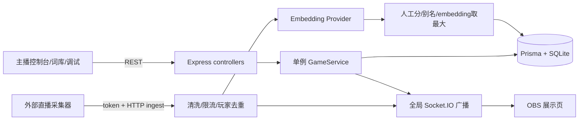
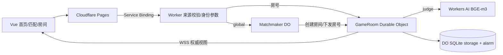
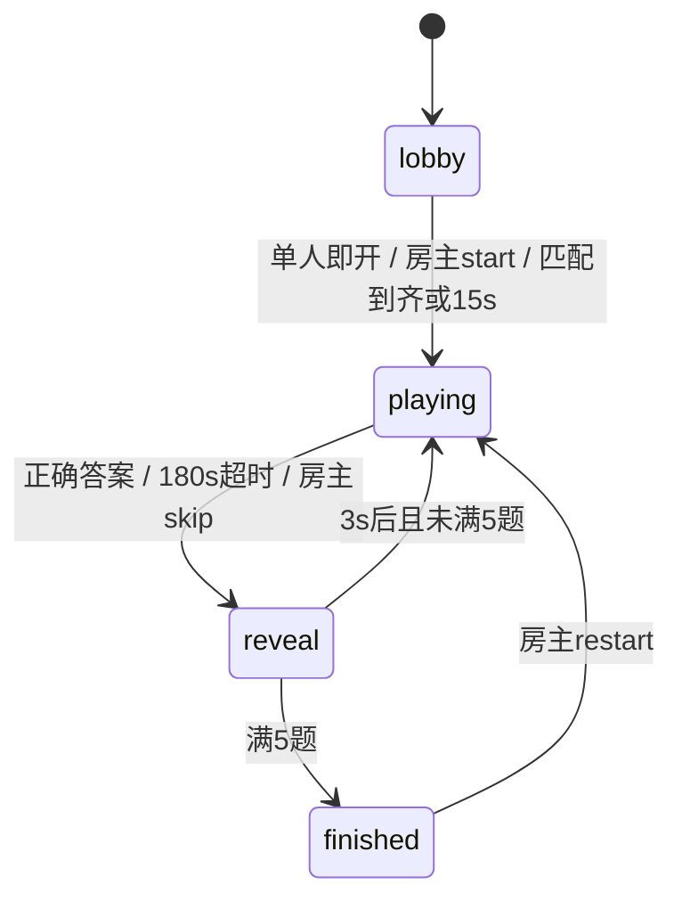

# Web 直播与联机项目：源码审计

审计日期：2026-10-25。方式：已连接 GitHub 的公开资源只读 fetch，冻结默认分支后按 commit 读取源码；未 clone、安装依赖、运行项目、调用模型、接入直播平台或验证在线站点。页面元素与视觉结论来自模板、组件和样式源码，不等同于实机截图验收。作者标注的免费额度、性能和实测分布只视为作者自述，未作为容量或收入事实。

## 0. 冻结版本与总判断

| 项目 | 冻结 main HEAD | 真实定位 | 主要可借鉴 |
|---|---|---|---|
| LightningFlashEvE/guess-danmaku-game | `ee8eff55885535a6b1b3dee9146b2e5bbf23857a` | 单进程、单局的直播猜词演示骨架，OBS + 主播操作 + 词库工作台 | 直播页面结构、运营工具、标准弹幕入口、人工题库校准 |
| PlutoKeating/Project.WordToFlush | `c445715ecf1c31241e54fcd932651d8b40945c8f` | 当前是 Cloudflare 网页单人/好友房/随机匹配；直播系统已归档 | 权威房间状态、服务端计时、断线恢复、语义反馈与猜中分离、字位点亮 |

必须避免混淆：Pluto 根 README 明写 `website/` 是当前项目，`legacy/` 是“已归档…仅供参考，不再维护”；其开发规则也禁止把 legacy 作为新功能依赖。[当前/归档边界](https://github.com/PlutoKeating/Project.WordToFlush/blob/c445715ecf1c31241e54fcd932651d8b40945c8f/README.md#L1-L13)；[归档依赖禁令](https://github.com/PlutoKeating/Project.WordToFlush/blob/c445715ecf1c31241e54fcd932651d8b40945c8f/AGENTS.md#L26-L30)。

两个仓库的完整递归树均未发现 LICENSE/COPYING/NOTICE 文件，GitHub 仓库元数据均返回 `license: null`。这只能证明本次未发现明确许可，不能把公开可读等同于已获商用、复制代码、分发字体或素材许可；建议借鉴产品/技术思路，代码复用前向作者确认许可。固定版本目录：[Lightning](https://github.com/LightningFlashEvE/guess-danmaku-game/tree/ee8eff55885535a6b1b3dee9146b2e5bbf23857a)、[Pluto](https://github.com/PlutoKeating/Project.WordToFlush/tree/c445715ecf1c31241e54fcd932651d8b40945c8f)。

## 1. Lightning：解决什么问题，实际价值在哪里

主播启动一轮，服务端抽一个隐藏的两字词，观众发词语弹幕，系统给接近度、榜单与积分，OBS 浏览器源把游戏反馈放到直播画面。主要价值是把“弹幕 → 可视化反馈 → 再猜一次”做成循环，并给主播和题库维护者现成操作台；仓库不提供实际收入、付费转化、直播留存或生产容量的验证。选题实际只允许两字词，而非任意字数。[定位与分层](https://github.com/LightningFlashEvE/guess-danmaku-game/blob/ee8eff55885535a6b1b3dee9146b2e5bbf23857a/README.md#L1-L18)；[仅两字选题](https://github.com/LightningFlashEvE/guess-danmaku-game/blob/ee8eff55885535a6b1b3dee9146b2e5bbf23857a/apps/server/src/modules/game/game.service.ts#L24-L73)。

### 1.1 架构、依赖与模块通信

- 前端依赖 React 18.3、React Router 6.28、Zustand 5、Socket.IO Client 4.8；开发/构建用 Vite 6、TS 5.7、Tailwind 3.4。后端用 Express 4.21、Socket.IO 4.8、Prisma 5.22、SQLite，测试命令为 Vitest。版本为 package.json 的声明范围，未安装锁定后实测。[前端依赖](https://github.com/LightningFlashEvE/guess-danmaku-game/blob/ee8eff55885535a6b1b3dee9146b2e5bbf23857a/apps/web/package.json#L12-L30)；[后端依赖](https://github.com/LightningFlashEvE/guess-danmaku-game/blob/ee8eff55885535a6b1b3dee9146b2e5bbf23857a/apps/server/package.json#L18-L37)；[SQLite](https://github.com/LightningFlashEvE/guess-danmaku-game/blob/ee8eff55885535a6b1b3dee9146b2e5bbf23857a/apps/server/prisma/schema.prisma#L1-L8)。
- REST 处理主播命令、词库、配置、弹幕；Socket.IO 下发完整 state、roundStarted/Ended、guessAdded、榜单、timer。HTTP + Socket.IO 共用 Node HTTP server，socket 新连接即同步 state。[HTTP入口](https://github.com/LightningFlashEvE/guess-danmaku-game/blob/ee8eff55885535a6b1b3dee9146b2e5bbf23857a/apps/server/src/app.ts#L11-L30)；[连接初始化](https://github.com/LightningFlashEvE/guess-danmaku-game/blob/ee8eff55885535a6b1b3dee9146b2e5bbf23857a/apps/server/src/index.ts#L8-L28)；[推送协议](https://github.com/LightningFlashEvE/guess-danmaku-game/blob/ee8eff55885535a6b1b3dee9146b2e5bbf23857a/apps/server/src/modules/game/game.gateway.ts#L18-L43)。
- `GameService` 是导出的单例，只有一个 `runtime`；网关用全局 `io.emit`，没有按直播房间分组。ingest 的 comment 解析没有将 roomId 写入 DanmakuMessage。因此 query 中出现 platform/roomId 也不能证明已实现多房间隔离。[单一runtime](https://github.com/LightningFlashEvE/guess-danmaku-game/blob/ee8eff55885535a6b1b3dee9146b2e5bbf23857a/apps/server/src/modules/game/game.service.ts#L28-L37)；[全局广播](https://github.com/LightningFlashEvE/guess-danmaku-game/blob/ee8eff55885535a6b1b3dee9146b2e5bbf23857a/apps/server/src/modules/game/game.gateway.ts#L18-L43)；[comment映射](https://github.com/LightningFlashEvE/guess-danmaku-game/blob/ee8eff55885535a6b1b3dee9146b2e5bbf23857a/apps/server/src/modules/danmaku/danmaku.controller.ts#L77-L91)。
- 持久化模型有 Word、GiftEvent、Player、GameRound、Guess、GameConfig；向量以 JSON 字符串存在 Word.embedding。回合运行状态、定时器、最近题目、已猜集合在内存，启动代码没有加载未完成回合的恢复流程。数据库保留记录不等于回合能恢复。[数据模型](https://github.com/LightningFlashEvE/guess-danmaku-game/blob/ee8eff55885535a6b1b3dee9146b2e5bbf23857a/apps/server/prisma/schema.prisma#L10-L133)；[内存状态](https://github.com/LightningFlashEvE/guess-danmaku-game/blob/ee8eff55885535a6b1b3dee9146b2e5bbf23857a/apps/server/src/modules/game/game.service.ts#L28-L37)；[启动流程](https://github.com/LightningFlashEvE/guess-danmaku-game/blob/ee8eff55885535a6b1b3dee9146b2e5bbf23857a/apps/server/src/index.ts#L8-L34)。

### 1.2 AI 判定与校准，不要把 mock 当语义模型

默认 provider 是 mock。实现为 128 维字符散列和 L2 归一化，注释明确“不是真正的语义模型”；同字较高并不能代表同义、常识关联正确。local 也不包含本地推理引擎，只 POST 到配置 baseUrl 的 `/embeddings`，输入为 OpenAI 风格 `{model,input}`；这不能证明对任意 Ollama 原生接口即插即用。openai provider 是带 Bearer 的同格式 HTTP 客户端，具体服务和模型支持还需实测。[默认mock](https://github.com/LightningFlashEvE/guess-danmaku-game/blob/ee8eff55885535a6b1b3dee9146b2e5bbf23857a/apps/server/src/config.ts#L11-L16)；[伪向量实现](https://github.com/LightningFlashEvE/guess-danmaku-game/blob/ee8eff55885535a6b1b3dee9146b2e5bbf23857a/apps/server/src/modules/embedding/providers/mock.provider.ts#L3-L30)；[local只是HTTP客户端](https://github.com/LightningFlashEvE/guess-danmaku-game/blob/ee8eff55885535a6b1b3dee9146b2e5bbf23857a/apps/server/src/modules/embedding/providers/local.provider.ts#L9-L40)；[兼容API客户端](https://github.com/LightningFlashEvE/guess-danmaku-game/blob/ee8eff55885535a6b1b3dee9146b2e5bbf23857a/apps/server/src/modules/embedding/providers/openai.provider.ts#L14-L41)。

展示分 = max(答案100、别名98、人工相似词分、分段归一化 embedding 0–95)，相似词支持 JSON 或 `词:分|词`。归一化阈值的注释以 bge-m3 分布为依据，但默认配置的模型名是 text-embedding-3-small，换模型必须重做标定，不能照抄数值。猜中还允许 `similarity >= correctThreshold`；管理页阈值可滑到50%，意味着强关联词可被运营误设成“正确”，与精确同义词命中应分开。[分段归一化与max规则](https://github.com/LightningFlashEvE/guess-danmaku-game/blob/ee8eff55885535a6b1b3dee9146b2e5bbf23857a/apps/server/src/utils/closeness.ts#L53-L101)；[猜中判定](https://github.com/LightningFlashEvE/guess-danmaku-game/blob/ee8eff55885535a6b1b3dee9146b2e5bbf23857a/apps/server/src/modules/danmaku/danmaku.service.ts#L89-L105)；[可调猜中阈值](https://github.com/LightningFlashEvE/guess-danmaku-game/blob/ee8eff55885535a6b1b3dee9146b2e5bbf23857a/apps/web/src/pages/AdminPage.tsx#L321-L327)。

内存缓存为不设上限的 `Map<text,vector>`，没有模型/版本 namespace、TTL、并发同词请求合并；API fetch 未设超时和重试。Word 已持久化向量也没有 model/version 字段。更换模型时 UI 提供全量重算，但运行态缓存、失败重算、维度一致性和模型版本仍需工程化处理。[无界词向量缓存](https://github.com/LightningFlashEvE/guess-danmaku-game/blob/ee8eff55885535a6b1b3dee9146b2e5bbf23857a/apps/server/src/modules/embedding/embedding.service.ts#L21-L40)；[fetch策略](https://github.com/LightningFlashEvE/guess-danmaku-game/blob/ee8eff55885535a6b1b3dee9146b2e5bbf23857a/apps/server/src/modules/embedding/providers/openai.provider.ts#L23-L41)；[无模型版本字段](https://github.com/LightningFlashEvE/guess-danmaku-game/blob/ee8eff55885535a6b1b3dee9146b2e5bbf23857a/apps/server/prisma/schema.prisma#L10-L31)；[全量重算](https://github.com/LightningFlashEvE/guess-danmaku-game/blob/ee8eff55885535a6b1b3dee9146b2e5bbf23857a/apps/web/src/pages/WordsPage.tsx#L93-L98)。

### 1.3 用户故事与实际交互

| 角色 | 故事与交互 | 当前限制 |
|---|---|---|
| 主播 | 设分类、难度上下限、时长 → 开局 → 观测状态/榜单 → 手动结束或跳过 → 可开自动下一轮 | 单全局回合；无登录/角色控制 |
| 观众 | 在直播间发两字词 → 经外部采集器 ingest → 过滤/接近度 → OBS 看到昵称、猜词、接近度、积分/段位 | 仓库未附真实抖音采集实现 |
| 题库维护者 | 搜索分类 → 增改启停词条/别名/人工相似词/提示 → CSV 导入导出 → 生成或重算向量 | 没有校准评测台、版本审批、质量统计 |
| 调试者 | 选模拟昵称 → 发猜测 → 看接受/过滤原因、分数与猜中结果 | debug 接口跳过限流且无鉴权 |

操作台证据：[主播全部控制](https://github.com/LightningFlashEvE/guess-danmaku-game/blob/ee8eff55885535a6b1b3dee9146b2e5bbf23857a/apps/web/src/pages/AdminPage.tsx#L153-L339)；词库证据：[词库操作](https://github.com/LightningFlashEvE/guess-danmaku-game/blob/ee8eff55885535a6b1b3dee9146b2e5bbf23857a/apps/web/src/pages/WordsPage.tsx#L140-L302)；弹幕链路：[观众处理链](https://github.com/LightningFlashEvE/guess-danmaku-game/blob/ee8eff55885535a6b1b3dee9146b2e5bbf23857a/apps/server/src/modules/danmaku/danmaku.service.ts#L56-L132)。

### 1.4 完整页面与元素清单（当前路由）

| 页面 | 实际页面元素与行为 | 复用价值 |
|---|---|---|
| `/obs` | 标题“弹幕猜词王”；礼物区；倒计时水位背景；上轮赢家/答案；分类胶囊、空字槽、最接近词；本轮接近度榜、总积分榜、玩法；猜中时庆祝覆盖层、撕纸揭晓 | 信息层级齐全，可改成直播竖屏模板 |
| `/admin` | OBS预览/词库导航；开始、结束、跳过、清排行；状态ON AIR/IDLE、分类、字数、模型、运行状态、查看答案；分类选择、难度上下限、30–600s滑条；模拟弹幕昵称/内容/发送；提示开关、自动下一轮、猜中阈值；积分榜预览与快捷入口 | 主播后台功能最完整 |
| `/admin/words` | 词/别名搜索、分类筛选；新增、CSV导入/导出、补全向量、全量重算；表格列词/分类/别名/难度星级/向量有无/启停/操作；编辑/生成/删除；总条数与分页；弹窗可改词、分类、子类、别名、人工相似词、三条提示、难度、启用 | 可借鉴为题库生产工作台 |
| `/debug/danmaku` | 当前题目掩码/字数/剩余秒；6个预设昵称与自定义昵称；猜词输入、回车/发送；接受分数/猜中/过滤原因日志；服务端实时猜测列表；返控制台 | 适合脱离真实直播做逻辑联调 |

路由：[四个路由](https://github.com/LightningFlashEvE/guess-danmaku-game/blob/ee8eff55885535a6b1b3dee9146b2e5bbf23857a/apps/web/src/App.tsx#L1-L24)；OBS：[完整画面](https://github.com/LightningFlashEvE/guess-danmaku-game/blob/ee8eff55885535a6b1b3dee9146b2e5bbf23857a/apps/web/src/pages/ObsPage.tsx#L90-L159)；Admin：[完整控制台](https://github.com/LightningFlashEvE/guess-danmaku-game/blob/ee8eff55885535a6b1b3dee9146b2e5bbf23857a/apps/web/src/pages/AdminPage.tsx#L118-L377)；Words：[完整词库页](https://github.com/LightningFlashEvE/guess-danmaku-game/blob/ee8eff55885535a6b1b3dee9146b2e5bbf23857a/apps/web/src/pages/WordsPage.tsx#L112-L310)；Debug：[完整调试页](https://github.com/LightningFlashEvE/guess-danmaku-game/blob/ee8eff55885535a6b1b3dee9146b2e5bbf23857a/apps/web/src/pages/DebugDanmakuPage.tsx#L38-L104)。

需剔除“看起来已有”的能力：
- 礼物事件确实可入库，但 OBS 的 GiftRecordPanel 始终写死“暂无送礼记录”，没有礼物列表订阅或查询；不能说已实现实时礼物展示/贡献榜。[礼物入库入口](https://github.com/LightningFlashEvE/guess-danmaku-game/blob/ee8eff55885535a6b1b3dee9146b2e5bbf23857a/apps/server/src/modules/danmaku/danmaku.controller.ts#L95-L115)；[静态礼物占位](https://github.com/LightningFlashEvE/guess-danmaku-game/blob/ee8eff55885535a6b1b3dee9146b2e5bbf23857a/apps/web/src/components/CurrentWordCard.tsx#L10-L30)。
- 当前题卡的“提示”开关只控制分类胶囊，组件未渲染 hint1/2/3；不能把后台“根据接近度解锁提示”的文字视为已完成该机制。[实际题卡渲染](https://github.com/LightningFlashEvE/guess-danmaku-game/blob/ee8eff55885535a6b1b3dee9146b2e5bbf23857a/apps/web/src/components/CurrentWordCard.tsx#L66-L110)。
- OBS 常量是1080×1920、当轮8行、积分前5；榜单 compact 字号有8–11px，手机压缩后可读性需重新验收，源码注释“读清”不是结果证据。[版式常量](https://github.com/LightningFlashEvE/guess-danmaku-game/blob/ee8eff55885535a6b1b3dee9146b2e5bbf23857a/apps/web/src/lib/obs-layout.ts#L1-L14)；[实际字号](https://github.com/LightningFlashEvE/guess-danmaku-game/blob/ee8eff55885535a6b1b3dee9146b2e5bbf23857a/apps/web/src/components/RankingList.tsx#L33-L68)。

可借鉴的视觉语言：纸卡字槽、撕开谜底、榜单热度/百分比、名次/段位徽章、倒计时水位、庆祝覆盖层。用少量主视觉强化“越来越近”和“揭晓”两种反馈。实际页面混用玻璃面板、渐变、霓虹和纸卡，不宜照搬所有装饰；优先保证字号和直播安全区。

### 1.5 核心技术难点与落地阻塞

1. **真实接入缺失**：douyin adapter 的 connect 直接抛“未实现”；外部 HTTP ingest + token 只是接收契约。不能把截图/控制台演示当作已获平台授权且稳定采集。[抖音占位](https://github.com/LightningFlashEvE/guess-danmaku-game/blob/ee8eff55885535a6b1b3dee9146b2e5bbf23857a/apps/server/src/modules/danmaku/adapters/douyin.adapter.ts#L1-L23)；[外部采集契约](https://github.com/LightningFlashEvE/guess-danmaku-game/blob/ee8eff55885535a6b1b3dee9146b2e5bbf23857a/apps/server/src/modules/danmaku/danmaku.controller.ts#L49-L92)。
2. **管理鉴权与答案泄露**：app 直接挂载 game/words/config 路由；game/start/end/skip/answer 未见登录中间件，`/answer` 向调用者直接返回谜底；debug 无token并跳过限流。CORS 不能作为服务端调用者鉴权。仅 ingest/gift 有 token。[直接挂载](https://github.com/LightningFlashEvE/guess-danmaku-game/blob/ee8eff55885535a6b1b3dee9146b2e5bbf23857a/apps/server/src/app.ts#L11-L30)；[控制与答案无鉴权](https://github.com/LightningFlashEvE/guess-danmaku-game/blob/ee8eff55885535a6b1b3dee9146b2e5bbf23857a/apps/server/src/modules/game/game.controller.ts#L9-L55)；[ingest鉴权与debug绕限流](https://github.com/LightningFlashEvE/guess-danmaku-game/blob/ee8eff55885535a6b1b3dee9146b2e5bbf23857a/apps/server/src/modules/danmaku/danmaku.controller.ts#L10-L45)。
3. **异步回合污染风险（静态推断，未复现）**：receiveMessage 开头抓 round，随后多次 await，再写guess/广播，没有再次确认该 round 仍在running。可能在超时/手动换题后落入旧轮、污染当前最高分或广播；不同玩家并发也会交错。[异步处理全过程](https://github.com/LightningFlashEvE/guess-danmaku-game/blob/ee8eff55885535a6b1b3dee9146b2e5bbf23857a/apps/server/src/modules/danmaku/danmaku.service.ts#L56-L129)。
4. **结算原子性不足（静态推断）**：endRound 先同步设置ended可挡重复结束，但随后逐玩家更新积分、guess分、round状态，未事务包裹。崩溃时可能部分写入。Guess 无 `(roundId,playerId)` 唯一约束，createOrUpdate 是先查再写；并发同玩家不同词存在重复/覆盖风险。[结束顺序](https://github.com/LightningFlashEvE/guess-danmaku-game/blob/ee8eff55885535a6b1b3dee9146b2e5bbf23857a/apps/server/src/modules/game/game.service.ts#L195-L227)；[逐条结算](https://github.com/LightningFlashEvE/guess-danmaku-game/blob/ee8eff55885535a6b1b3dee9146b2e5bbf23857a/apps/server/src/modules/game/game.service.ts#L269-L295)；[查后写](https://github.com/LightningFlashEvE/guess-danmaku-game/blob/ee8eff55885535a6b1b3dee9146b2e5bbf23857a/apps/server/src/modules/guesses/guesses.service.ts#L19-L43)；[Guess约束](https://github.com/LightningFlashEvE/guess-danmaku-game/blob/ee8eff55885535a6b1b3dee9146b2e5bbf23857a/apps/server/prisma/schema.prisma#L99-L118)。
5. **限流不是容量保障**：有每用户1/s、5/10s、重复3s、全局200/s的内存窗口，并非队列/背压；users Map 无清退，debug可绕过，未见在途AI并发限制。200条只是配置阈值，非吞吐实测。[限流实现](https://github.com/LightningFlashEvE/guess-danmaku-game/blob/ee8eff55885535a6b1b3dee9146b2e5bbf23857a/apps/server/src/modules/danmaku/rate-limiter.ts#L14-L62)。
6. **可恢复性和多租户**：需要持久化状态机、服务器时间deadline、受控自动下一局任务、房间分区、模型版本和消息id幂等，现版本不能直接照搬为多主播服务。

## 2. Pluto：当前网页游戏与归档直播版要分开评估

### 2.1 当前 website 的问题与价值

当前版本解决“无需安装即可练习/拉好友/随机匹配语义猜词”的问题。用户输入与答案等长的1–4字词，获得语义热度、正确字位点亮、他人猜测、积分。价值在低门槛可玩的联机闭环和更清楚的公平规则，当前没有主播管理、直播采集、OBS专页、词库后台、支付/收益模块。三模式与玩法由首页和共享规则直接体现。[首页三模式与规则](https://github.com/PlutoKeating/Project.WordToFlush/blob/c445715ecf1c31241e54fcd932651d8b40945c8f/website/apps/web/src/views/HomeView.vue#L48-L84)；[完整规则](https://github.com/PlutoKeating/Project.WordToFlush/blob/c445715ecf1c31241e54fcd932651d8b40945c8f/website/packages/shared/src/rules.ts#L3-L26)。

### 2.2 架构与依赖

前端是 Vue3.5 + Vite5.4，使用自写 hash 路由和 Vue refs，没有当前 React、Pinia、Tailwind 或 Electron 依赖；Worker 依赖共享包和 Cloudflare 运行时，开发工具 Wrangler4.137、TS5.6。Pages Functions 通过 Service Binding 同源代理 API/WS，Worker 路由分到每房间 GameRoom DO 和全局 Matchmaker DO；AI binding 调用 Workers AI BGE-m3。[真实前端依赖](https://github.com/PlutoKeating/Project.WordToFlush/blob/c445715ecf1c31241e54fcd932651d8b40945c8f/website/apps/web/package.json#L1-L21)；[Worker依赖](https://github.com/PlutoKeating/Project.WordToFlush/blob/c445715ecf1c31241e54fcd932651d8b40945c8f/website/apps/worker/package.json#L1-L12)；[hash路由](https://github.com/PlutoKeating/Project.WordToFlush/blob/c445715ecf1c31241e54fcd932651d8b40945c8f/website/apps/web/src/lib/router.ts#L1-L20)；[AI/DO绑定](https://github.com/PlutoKeating/Project.WordToFlush/blob/c445715ecf1c31241e54fcd932651d8b40945c8f/website/apps/worker/wrangler.jsonc#L1-L24)；[Worker分发](https://github.com/PlutoKeating/Project.WordToFlush/blob/c445715ecf1c31241e54fcd932651d8b40945c8f/website/apps/worker/src/index.ts#L1-L91)。

房间数据序列化进 ctx.storage；WebSocket attachment保存uid/name，使用 Hibernation API；alarm 负责超时、3s揭晓后下一题、匹配房15s等人。alarm发现无人在线会deleteAll房间，故这是活动房间恢复机制，不是永久对局档案。前端25s心跳、最多5次重连、按服务端now/deadline校正倒计时。[存储与alarm](https://github.com/PlutoKeating/Project.WordToFlush/blob/c445715ecf1c31241e54fcd932651d8b40945c8f/website/apps/worker/src/room.ts#L62-L80)；[休眠连接](https://github.com/PlutoKeating/Project.WordToFlush/blob/c445715ecf1c31241e54fcd932651d8b40945c8f/website/apps/worker/src/room.ts#L139-L147)；[无人房清空](https://github.com/PlutoKeating/Project.WordToFlush/blob/c445715ecf1c31241e54fcd932651d8b40945c8f/website/apps/worker/src/room.ts#L198-L214)；[重连和时钟校正](https://github.com/PlutoKeating/Project.WordToFlush/blob/c445715ecf1c31241e54fcd932651d8b40945c8f/website/apps/web/src/lib/useRoom.ts#L7-L87)。

### 2.3 AI与题库：可复用的关键取舍

- 默认真实判定调 Workers AI `@cf/baai/bge-m3`；仅显式 `JUDGE_PROVIDER=mock` 时走64维字符伪向量。开发示例默认mock，线上部署是否实际使用真实模型本次未测。[真实与mock分支](https://github.com/PlutoKeating/Project.WordToFlush/blob/c445715ecf1c31241e54fcd932651d8b40945c8f/website/apps/worker/src/judge.ts#L17-L51)；[本地mock说明](https://github.com/PlutoKeating/Project.WordToFlush/blob/c445715ecf1c31241e54fcd932651d8b40945c8f/website/README.md#L29-L39)。
- 正确答案/别名字面命中直接 solved；其余向量只给0–0.99热度，不允许“很相关”自动算猜中。这比可任调向量阈值更适合公平竞赛。每题baseline取该答案对20个无关词的平均余弦，`(cos-base)/(0.85-base)` 拉伸；旧题缺baseline回退0.466。更换模型必须重算baseline，作者分布和额度估算不当作本次实测。[校准定义](https://github.com/PlutoKeating/Project.WordToFlush/blob/c445715ecf1c31241e54fcd932651d8b40945c8f/website/apps/worker/src/judge.ts#L1-L5)；[判定公式](https://github.com/PlutoKeating/Project.WordToFlush/blob/c445715ecf1c31241e54fcd932651d8b40945c8f/website/apps/worker/src/judge.ts#L66-L74)。
- 缓存上限2000，miss时把答案和猜词合并一次批请求；代码删除最早插入项，命中时不刷新次序，准确说是有界FIFO，文档写LRU偏强；无in-flight合并、全局AI预算/并发/队列。[缓存与批请求](https://github.com/PlutoKeating/Project.WordToFlush/blob/c445715ecf1c31241e54fcd932651d8b40945c8f/website/apps/worker/src/judge.ts#L20-L51)。
- 题库为worker打包JSON，非运行时后台；含14分类、baseline、aliases。题库上线需要改文件并重新部署。[题库加载](https://github.com/PlutoKeating/Project.WordToFlush/blob/c445715ecf1c31241e54fcd932651d8b40945c8f/website/apps/worker/src/puzzles.ts#L1-L35)；[题库位置](https://github.com/PlutoKeating/Project.WordToFlush/blob/c445715ecf1c31241e54fcd932651d8b40945c8f/website/README.md#L15-L24)。

### 2.4 用户故事、规则与回合状态

| 角色 | 交互故事 | 规则 |
|---|---|---|
| 单人玩家 | 首页填昵称 → 单人练习 → 进入即开局 → 输入等长中文词 → 看热度/字位 → 放弃或猜中 → 5题后再来 | 每题180s，揭晓3s |
| 好友房主 | 创建房间 → 分享6位房号/链接 → 等人 → 开始 → 可跳题/重开 | ≤8人，房主控制 |
| 好友玩家 | 输入房号加入 → 等房主 → 看所有人实时猜词并抢答 → 看积分 | 正确+100，其余按本题最高热度给安慰分 |
| 随机玩家 | 随机匹配 → 显示排队人数/倒数 → 分到房号 → 到齐或等15s开局 | 队列4人即成局；≥2人等30s可成局 |

精确规则见 [共享常量](https://github.com/PlutoKeating/Project.WordToFlush/blob/c445715ecf1c31241e54fcd932651d8b40945c8f/website/packages/shared/src/rules.ts#L3-L26)，房主控制见 [控制事件](https://github.com/PlutoKeating/Project.WordToFlush/blob/c445715ecf1c31241e54fcd932651d8b40945c8f/website/apps/worker/src/room.ts#L167-L184)，队列见 [匹配调度](https://github.com/PlutoKeating/Project.WordToFlush/blob/c445715ecf1c31241e54fcd932651d8b40945c8f/website/apps/worker/src/matchmaker.ts#L62-L106)。

服务端在await judge返回后复核 `phase === playing && puzzle.id相同`，并在endRound首次await前把phase改reveal，因此可挡旧题结果和多数双赢家结算交错。它比Lightning的异步链路严谨；但不应据此宣称已经通过并发压力或崩溃恢复测试。[结算与异步复核](https://github.com/PlutoKeating/Project.WordToFlush/blob/c445715ecf1c31241e54fcd932651d8b40945c8f/website/apps/worker/src/room.ts#L276-L339)。

### 2.5 当前完整页面与视觉元素

| 当前页面/状态 | 元素与行为 |
|---|---|
| 首页 | WordToFlush霓虹标题/一句玩法；昵称；单人、随机、创建好友房；输入6位房号/加入；错误提示；5条玩法说明 |
| 匹配页 | spinner；正在匹配/断开；队列人数/4；≥2人显示开局倒数，否则“至少2人”；返回首页 |
| 房间通用 | 返回箭头、房号、连接状态点、多人邀请按钮；连接中/致命错误卡/返回；toast错误 |
| 房间lobby | 房号/复制邀请；房主开始按钮（人数）；其他人等待；积分榜/在线状态 |
| 房间playing/reveal | 谜题板：第几题/5、倒计时及最后18s颜色、分类、1–4字槽点亮；当前最高关联度/上题答案；揭晓时答案与猜中者/无人猜中；等长输入和“猜”；揭晓时禁用；热度/最新tabs；合并同词×N、最早猜出者、自己的高亮、热力底条/百分比；多人积分榜；房主放弃/跳过 |
| 房间finished | 本局结束、末题谜底、第一名/分数、房主再来一局、他人等待、返回首页、积分榜 |

页面证据：[首页](https://github.com/PlutoKeating/Project.WordToFlush/blob/c445715ecf1c31241e54fcd932651d8b40945c8f/website/apps/web/src/views/HomeView.vue#L48-L84)；[匹配页](https://github.com/PlutoKeating/Project.WordToFlush/blob/c445715ecf1c31241e54fcd932651d8b40945c8f/website/apps/web/src/views/MatchView.vue#L39-L54)；[房间全部状态](https://github.com/PlutoKeating/Project.WordToFlush/blob/c445715ecf1c31241e54fcd932651d8b40945c8f/website/apps/web/src/views/RoomView.vue#L49-L125)；组件证据：[题板](https://github.com/PlutoKeating/Project.WordToFlush/blob/c445715ecf1c31241e54fcd932651d8b40945c8f/website/apps/web/src/components/PuzzleBoard.vue#L21-L47)；[猜测排序与热力](https://github.com/PlutoKeating/Project.WordToFlush/blob/c445715ecf1c31241e54fcd932651d8b40945c8f/website/apps/web/src/components/GuessFeed.vue#L9-L51)；[积分榜](https://github.com/PlutoKeating/Project.WordToFlush/blob/c445715ecf1c31241e54fcd932651d8b40945c8f/website/apps/web/src/components/Scoreboard.vue#L8-L20)。

视觉可借鉴：560px单列手机优先、safe-area内边距、暗色卡片、青/粉/紫强调、热度色阶、56×64字位卡、点亮/答案放大、自己的记录识别、在线灰显、房主皇冠。最值得复用的是“同位置汉字点亮 + 热度条 + 共享猜测”，能同时给拼字线索和语义线索。[主题与手机布局](https://github.com/PlutoKeating/Project.WordToFlush/blob/c445715ecf1c31241e54fcd932651d8b40945c8f/website/apps/web/src/styles.css#L1-L57)；[字位动效](https://github.com/PlutoKeating/Project.WordToFlush/blob/c445715ecf1c31241e54fcd932651d8b40945c8f/website/apps/web/src/components/PuzzleBoard.vue#L76-L98)。

### 2.6 当前版的上线阻塞与边界

1. **匿名uid不是账户鉴权**：uid在localStorage随机生成，并放进WS查询串；Worker只校验格式，房主授权就是hostUid相等，而uid会随players下发。由此静态推断，知道房内uid的客户端可自报该uid连接、替换旧连接，甚至冒充房主；不能用于有奖/付费身份或主播管理。[客户端匿名身份](https://github.com/PlutoKeating/Project.WordToFlush/blob/c445715ecf1c31241e54fcd932651d8b40945c8f/website/apps/web/src/lib/identity.ts#L22-L40)；[仅格式校验](https://github.com/PlutoKeating/Project.WordToFlush/blob/c445715ecf1c31241e54fcd932651d8b40945c8f/website/apps/worker/src/index.ts#L29-L36)；[同uid替换连接](https://github.com/PlutoKeating/Project.WordToFlush/blob/c445715ecf1c31241e54fcd932651d8b40945c8f/website/apps/worker/src/room.ts#L130-L147)；[房主判断](https://github.com/PlutoKeating/Project.WordToFlush/blob/c445715ecf1c31241e54fcd932651d8b40945c8f/website/apps/worker/src/room.ts#L219-L222)；[公开玩家视图](https://github.com/PlutoKeating/Project.WordToFlush/blob/c445715ecf1c31241e54fcd932651d8b40945c8f/website/apps/worker/src/room.ts#L349-L369)。
2. **答案边界相对正确**：客户端playing视图只得题id/字数/分类/点亮位，reveal/finished才有答案；但这保护不了可猜中规则、公开题库逆向、匿名冒充或恶意AI消耗。[答案过滤](https://github.com/PlutoKeating/Project.WordToFlush/blob/c445715ecf1c31241e54fcd932651d8b40945c8f/website/apps/worker/src/room.ts#L344-L369)。
3. **限流/去重有限**：每uid1.5s cooldown仅内存；重复检查只对保留最近60条的guesses，超过窗口可再猜。没有房间总请求速率、创建房间速率、全局AI并发/预算；多人/多房攻击可绕单uid限制。[仅60条](https://github.com/PlutoKeating/Project.WordToFlush/blob/c445715ecf1c31241e54fcd932651d8b40945c8f/website/apps/worker/src/room.ts#L26-L28)；[限流去重](https://github.com/PlutoKeating/Project.WordToFlush/blob/c445715ecf1c31241e54fcd932651d8b40945c8f/website/apps/worker/src/room.ts#L292-L337)；[创建房间入口](https://github.com/PlutoKeating/Project.WordToFlush/blob/c445715ecf1c31241e54fcd932651d8b40945c8f/website/apps/worker/src/index.ts#L54-L59)。
4. **恢复≠永久运营数据**：在线回合可从DO storage读回；无人在线到alarm即清空，没有账户累计积分、赛季、题库后台、审计账本、长期战绩。免费额度/成本随用量和服务策略变化，仓库自述不能替代预算测试。
5. **部署依赖Cloudflare生态**：Pages、Functions Service Binding、Worker、DO SQLite migration、Workers AI binding和origin白名单必须配齐；国内直播面向用户的时延、稳定性、模型可达与平台接入本次均未测。源码能说明依赖，不能证明国内可用性。[必需绑定](https://github.com/PlutoKeating/Project.WordToFlush/blob/c445715ecf1c31241e54fcd932651d8b40945c8f/website/apps/worker/wrangler.jsonc#L1-L24)；[部署与换模型](https://github.com/PlutoKeating/Project.WordToFlush/blob/c445715ecf1c31241e54fcd932651d8b40945c8f/website/README.md#L41-L62)。

### 2.7 legacy 归档直播版：参考价值与不能冒充当前能力的部分

归档版是 Vue + Pinia显示层、Python FastAPI WS游戏层、Flask admin采集层、Ollama向量接口，附Electron窗口脚本。与当前website不是同一运行时/同一协议/同一部署。旧README写Redis缓存/队列，但实际 VectorCalculator 用两个上限500的进程内dict，SessionManager用内存_rooms；不能把旧README架构图当成已实现Redis持久化/排队。[真实缓存](https://github.com/PlutoKeating/Project.WordToFlush/blob/c445715ecf1c31241e54fcd932651d8b40945c8f/legacy/backend/app/core/vector_calculator.py#L8-L35)；[关联度缓存](https://github.com/PlutoKeating/Project.WordToFlush/blob/c445715ecf1c31241e54fcd932651d8b40945c8f/legacy/backend/app/core/vector_calculator.py#L47-L65)；[真实会话存储](https://github.com/PlutoKeating/Project.WordToFlush/blob/c445715ecf1c31241e54fcd932651d8b40945c8f/legacy/backend/app/core/session_manager.py#L5-L33)。

真实接入程度：旧版存在抖音网页访问/WSS握手/签名/Protobuf解析代码，B站也有room/getDanmuInfo、WBI、buvid、WS认证解析，**不是单纯占位**；但这只证明实现尝试存在，没有本次当前平台连通成功证据，也不等于官方开放平台授权SDK。抖音签名函数是对拼接字符串MD5，依赖平台细节，维护稳定性需单独验证。[抖音协议路径与签名](https://github.com/PlutoKeating/Project.WordToFlush/blob/c445715ecf1c31241e54fcd932651d8b40945c8f/legacy/backend/admin/danmaku/douyin.py#L38-L69)；[连接实现](https://github.com/PlutoKeating/Project.WordToFlush/blob/c445715ecf1c31241e54fcd932651d8b40945c8f/legacy/backend/admin/danmaku/douyin.py#L141-L227)；[B站网页接入实现](https://github.com/PlutoKeating/Project.WordToFlush/blob/c445715ecf1c31241e54fcd932651d8b40945c8f/legacy/backend/admin/danmaku/bilibili.py#L128-L218)。

桥接根据 `platform:room:userName` 生成短hash用户id，向GLOBAL_ROOM发送guess；不是可靠平台用户主键且不是多房直播隔离，可能昵称碰撞、hash碰撞、重启变化。其docstring称“不限流”，实际又有last_sent间隔过滤，说明旧版注释也有漂移。[旧桥接身份与全局房间](https://github.com/PlutoKeating/Project.WordToFlush/blob/c445715ecf1c31241e54fcd932651d8b40945c8f/legacy/backend/admin/app.py#L181-L240)。

旧判定直接 raw cosine+WIN_AFFINITY_THRESHOLD，按每次affinity累计分，await后没有新版phase/puzzle复核；不要把这套计分/并发处理照搬。[旧游戏判定](https://github.com/PlutoKeating/Project.WordToFlush/blob/c445715ecf1c31241e54fcd932651d8b40945c8f/legacy/backend/app/core/game_master.py#L44-L102)。

归档页面也确实存在，但不属于当前website：
- Admin登录：用户名/密码/登录/错误提示。[旧登录](https://github.com/PlutoKeating/Project.WordToFlush/blob/c445715ecf1c31241e54fcd932651d8b40945c8f/legacy/backend/admin/templates/login.html#L52-L59)。
- Admin仪表盘：退出、自动猜词开关、抖音/B站房号、开始采集/停止/状态、实时弹幕流（SSE）。[旧采集后台](https://github.com/PlutoKeating/Project.WordToFlush/blob/c445715ecf1c31241e54fcd932651d8b40945c8f/legacy/backend/admin/templates/dashboard.html#L86-L137)。
- 直播游戏画面：9:16单屏，连接状态/局数/换题，分类、字位、最高热度、倒计时/上题答案，竞猜榜与总积分榜两栏。[旧画面框架](https://github.com/PlutoKeating/Project.WordToFlush/blob/c445715ecf1c31241e54fcd932651d8b40945c8f/legacy/frontend/src/App.vue#L16-L26)；[旧顶部](https://github.com/PlutoKeating/Project.WordToFlush/blob/c445715ecf1c31241e54fcd932651d8b40945c8f/legacy/frontend/src/components/TopBar.vue#L17-L30)；[旧谜题区](https://github.com/PlutoKeating/Project.WordToFlush/blob/c445715ecf1c31241e54fcd932651d8b40945c8f/legacy/frontend/src/components/DecryptZone.vue#L87-L117)。
- 附带dy参考采集器页面：主播封面/标题/头像/昵称/关注与人气数据、房号连接、WS转发地址、聊天/礼物主流、关注点赞进场副流、状态、保存弹幕、投喂弹窗和SidTool；这是legacy/admin/dy下独立参考工具，不应包装成当前游戏正式功能。[独立参考采集UI](https://github.com/PlutoKeating/Project.WordToFlush/blob/c445715ecf1c31241e54fcd932651d8b40945c8f/legacy/backend/admin/dy/src/views/IndexView.vue#L1-L58)。

## 3. 给统一落地方案的取舍建议

以下是基于上述源码证据的工程判断，不代表已授权开发或平台接入：

| 能力 | 建议 | 不可照搬的原因 |
|---|---|---|
| OBS与主播工作台 | 借Lightning的信息结构：开局/暂停结束/换题/题库/调试/连接状态/揭晓 | 管理路由需独立鉴权，礼物和提示占位需做实；手机字号重做 |
| 房间引擎 | 借Pluto当前版：权威状态、deadline、alarm/调度器、await后轮次复核、重连同步 | 不必绑定Cloudflare；无认证uid不能承载主播或权益 |
| 语义玩法 | 精确答案/审核别名决定正确，embedding只给热度；加字位点亮可作可选模式 | 不用“相似度高即猜中”的可调阈值；人工分不能掩盖模型失真 |
| 题库校准 | 借baseline与人工相似词思路；形成模型版本、分布标定、相关/无关/同义评测集 | 不跨模型复用阈值、向量、baseline；需要题目来源/审核/版本 |
| 弹幕适配 | 以外部采集器→统一消息契约→游戏事件为边界；消息带平台稳定uid、roomId、messageId、时间、签名 | Lightning采集空缺；Pluto旧版协议抓取不维护；禁止用昵称hash作身份 |
| 防刷与容量 | 统一messageId幂等、房间分区、单用户/全局速率、有限队列、AI超时/预算/并发、缓存single-flight | 两项目现有限流均不能证明直播峰值容量 |
| 结算与恢复 | 持久化roundId/version、条件状态转换、事务/幂等结算、启动恢复、可审计事件 | Lightning逐条结算和内存timer；Pluto无人房自动删除且无运营账本 |
| 代码商用 | 概念和交互可以研究，直接复制/分发先明确许可证及嵌入资产许可 | 两仓库未发现明确许可；legacy参考工具含字体与其他素材来源需再核 |

建议统一产品先闭合单主播、单房间、真实受控输入、模型校准、可靠结算和可读OBS，再考虑多人网页、随机匹配、多主播SaaS。两项目均不能据源码推出“睡后收入”；无人值守运营还缺平台规则、内容审核、故障告警、自动停机、成本预算、收益归因和实际直播验证。

