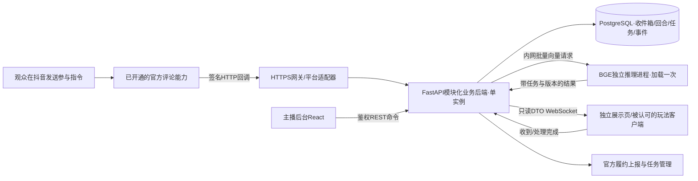
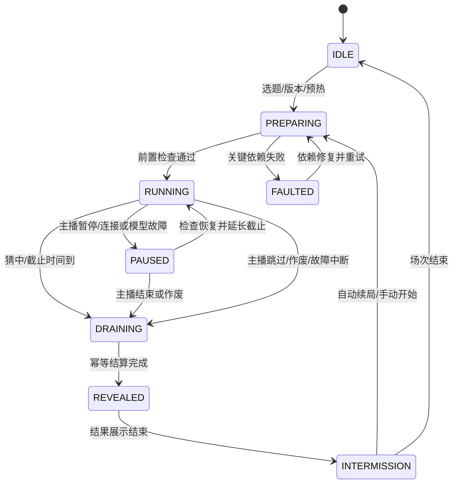
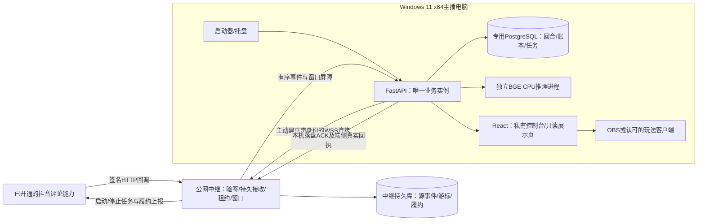

# 中文直播语义猜词：项目研究与落地解决方案

归档说明（2026-10-25）：资料迁入词温WordHeat Live仓库；本次仅整理路径、链接和来源摘要，架构、接口与验收语义不变。

版本：1.1 · 研究与修订日期：2026-10-25 · 首期对象：抖音、中文、单直播间。

本版新增“Windows原生本地部署＋轻量公网中继”：安装包、启动器、专用数据库、离线模型、双端消息与时间边界、升级恢复和专项验收。保留远端核心部署，二者共享业务规则，但必须分别通过部署验收。本次更新的是设计文档与阅读版，尚未制作Windows安装包或完成实机测试。

本文件是源码研究和拟实施设计，不是已经开发、接通或通过直播验收的软件。页面示意使用合成数据；性能、工期和效果指标均标明为设计目标或估算。

## 01｜结论与必须先验证的条件

**建议用 React + TypeScript 构建主播后台与独立直播展示端，FastAPI 承担模块化业务后端，独立 Python 推理进程运行中文 BGE，PostgreSQL 保存消息、回合、任务和结果。** 每个权威回合实例采用一个业务后端进程与一个模型工作进程。Windows本地版另设公网中继，仅承担平台接入和可靠投递，不承担判题；两种形态均不需要向量数据库、RAG、Redis、Kafka或微服务治理平台。

六个样本已经覆盖了页面、词向量、排行榜、多人同步和弹幕入口等不同部分，但没有一个可据本次源码核查直接认定为“接入完整、评分可信、回合可靠、授权清晰”的中文直播成品。最有价值的是组合其中已验证的设计思想，并重新实现缺失的核心契约；商业代码复用必须先解决对应许可，不能直接拼接无许可证仓库。

### 完成条件

观众按规则发词后，系统能接收、识别、评分并在直播画面反馈；猜中或超时只结算一次；断线、推理失败、重复弹幕、刷新页面和重启服务都有确定行为。主播能够独立准备、开局、暂停、换题和结束。此链路需要通过真实直播测试，手动输入和模拟回放只证明各自覆盖的环节。

### 首期的三道关键验证

| 验证 | 必须得到的证据 | 未通过时的处理 |
|---|---|---|
| G0 平台输入与发布形态 | 指定玩法实际权限；参与指令能否保留自由后缀词；包体/非Unity接入方式；题库能力适用口径 | 继续交付人工辅助工具或经确认的有限词表模式；自动直播能力保持“未接通”，不把第三方抓取当作默认替代 |
| G1 中文评分质量 | 固定模型与词库，盲评相关/无关词排序、歧义词和分数分布；目标机器吞吐 | 更换模型或剔除题目、调整校准；禁止静默切换成字符匹配或随机分数 |
| G2 真实直播闭环 | 多用户真实评论、重复/延迟消息、OBS恢复、猜中/超时、履约上报的可追踪记录 | 不对外宣称直播验收通过，按失败环节修复后重测 |

G0应在正式后台和视觉效果大量开发前完成。页面与核心引擎可以用回放推进，但不能消除平台可行性问题。[官方评论能力](https://developer.open-douyin.com/docs/resource/zh-CN/interaction/jierushuoming/hudongshuju/pinglunshuju)与[创建玩法说明](https://developer.open-douyin.com/docs/resource/zh-CN/interaction/introduction/zn/toybox-start)是本次接入依据。

## 02｜研究方法与证据范围

本轮使用GitHub连接器读取仓库元数据、分支提交、第一方目录和关键源码，并核对抖音、BGE、OBS等官方资料；没有运行六个项目、安装其依赖、下载模型或连接真实直播间。源码中的测试文件说明项目有测试意图，不代表本次运行通过。作者给出的收入、转化率、性能和在线地址均不作为本方案效果证明。

| 编号 | 仓库与本次冻结提交 | 本轮定位 |
|---|---|---|
| R1 | [handsomeDragon0/guessword · 40b175d](https://github.com/handsomeDragon0/guessword/tree/40b175d785d798ad09ff478c08f0fd00b4f5f192) | Java直播业务与React展示样本 |
| R2 | [LiMCZJY/semantic-guessword · 938d16a](https://github.com/LiMCZJY/semantic-guessword/tree/938d16a6fd79337b9784dcfa55a432b94cd27781) | 本地BGE与PyQt双窗口样本 |
| R3 | [LightningFlashEvE/guess-danmaku-game · ee8eff5](https://github.com/LightningFlashEvE/guess-danmaku-game/tree/ee8eff55885535a6b1b3dee9146b2e5bbf23857a) | OBS页、主播台、词库和HTTP弹幕入口样本 |
| R4 | [PlutoKeating/Project.WordToFlush · c445715](https://github.com/PlutoKeating/Project.WordToFlush/tree/c445715ecf1c31241e54fcd932651d8b40945c8f) | 当前网页联机与已归档直播版本对照 |
| R5 | [ispacekid/chinese-semantle · 9313d3a](https://github.com/ispacekid/chinese-semantle/tree/9313d3a340eb61d28d55b002ee0cd06afbe355b7) | 中文词向量、预计算、每日题与分享样本 |
| R6 | [rberenguel/quid · 357285d](https://github.com/rberenguel/quid/tree/357285d2d9638314b5540326d0cd261b540c1530) | MIT纯浏览器语义猜词与PWA样本 |

项目逐项技术栈、依赖版本、完整页面控件、功能及缺陷的固定提交源码引用，分别见本目录的三份“源码审计”附录。这里的“已实现”只表示代码路径存在；“拟实现”均属于本方案。

## 03｜六个项目的技术与实际价值

### R1：Java直播项目

解决的是“把弹幕中的两字中文词转成分数和直播展示”。后端Java 17/Spring Boot 3.2，通过WebSocket桥接程序接收弹幕；React前端通过服务端消息更新猜词历史、排行榜和语义雷达图，SQLite保存业务记录。词向量来自外部JSON数据，桥接依赖仓库携带但未见源码的Windows二进制程序。

可用价值是完整直播业务结构与展示组件。主要限制是：向量文件不在仓库；名为余弦的函数实际直接点积，正确性依赖作者所称“外部向量已归一化”，本次无法验证该数据；调试谜底会返回前端；全局单房间和并发集合缺少足够的回合一致性保障。其功能思路可借鉴，核心状态、权限和数据装载应重新设计。[评分源码](https://github.com/handsomeDragon0/guessword/blob/40b175d785d798ad09ff478c08f0fd00b4f5f192/backend/src/main/java/com/guessword/service/VectorService.java#L161)

### R2：本地BGE桌面项目

解决的是“本地语义打分、原生滚动榜单和主播台/直播屏分离”。Python使用Sentence Transformers加载中文BGE，PyQt6渲染双窗口，支持主题、积分、提示和雷达图。模型在本地就绪后可离线推理。

可用价值是本地中文评分验证及轻量展示参考。实际弹幕输入仍主要是手动；`danmaku.py`负责动画；依赖清单未完整声明强制BGE启动所需包。猜中续局与超时处理不对称，异步批次可能跨轮写入。窗口捕获必须严格选直播屏。它适合技术验证和人工辅助形态，不能直接当自动抖音接入成品。[打分与回合源码](https://github.com/LiMCZJY/semantic-guessword/blob/938d16a6fd79337b9784dcfa55a432b94cd27781/engine.py#L124)

### R3：Web直播骨架

解决的是“将展示、主播控制、词库与弹幕处理分层”。React/TypeScript/Vite前端包含OBS、后台、词库和调试页；Express/TypeScript后端使用Socket.IO同步，Prisma/SQLite存储，embedding provider可替换。评分还融合人工相似词、别名与校准规则。

可用价值是页面信息架构和弹幕入口协议。真实抖音适配器明确未实现，默认mock只是字符分桶；管理与调试访问隔离不足，异步评分和逐条结算存在跨轮、部分成功风险。不能以“有OBS页”判断已接入平台。[占位适配器](https://github.com/LightningFlashEvE/guess-danmaku-game/blob/ee8eff55885535a6b1b3dee9146b2e5bbf23857a/apps/server/src/modules/danmaku/adapters/douyin.adapter.ts#L4)

### R4：联机版与历史直播版

当前维护的`website/`解决单人、房号联机和随机匹配；Vue前端、Cloudflare Worker和Durable Object承载权威房间状态，BGE-m3提供向量判定。`legacy/`才是FastAPI/Ollama/直播接入路线，作者已经归档。

可用价值是服务端房间计时、持久化和异步结果回合复核，当前方案优先参考这些机制。随机匹配、多端房间不是首期直播必需功能；Cloudflare部署也不能直接推定国内网络适用。客户端自报身份、短历史去重等限制需要另外处理。[当前目录定位](https://github.com/PlutoKeating/Project.WordToFlush/blob/c445715ecf1c31241e54fcd932651d8b40945c8f/README.md)

### R5：中文Semantle

解决“中文每日猜词、分享同一谜底、提示与排行榜”。FastAPI提供API，静态前端呈现，QQ机器人复用API。Local引擎用腾讯词向量即时计算；Light引擎查预计算Top-3000邻居，降低在线计算依赖。

可用价值是中文词库工程、相似词排名和预计算思路。Light模式下Top-3000之外没有精细分数梯度；公开的code→word与邻居数据不能用于保护正式直播谜底。排行榜签名不等于防重放，前端提示开关也不等于后台权限。它是中文游戏内核参考，直播输入、展示隔离和竞赛可信性需另建。[引擎接口](https://github.com/ispacekid/chinese-semantle/blob/9313d3a340eb61d28d55b002ee0cd06afbe355b7/backend/app/engine.py#L128)

### R6：Quid

解决无需业务服务器的个人随机语义猜词。浏览器下载fastText量化词向量，本地计算余弦并排序；支持历史、提示、难度/语言选择、PWA和本地存储。现成语言为ca/de/en/es/fr/it，没有中文；本次源码未见每日题或成绩分享功能。

可用价值是低成本前端交互与可视化，代码MIT许可清晰。前端持有模型和谜底，适合个人小游戏，不适合需要防泄题的权威直播竞赛；换中文还需要中文词表、模型和分数校准。代码许可与词向量数据许可必须分别核对。[代码许可](https://github.com/rberenguel/quid/blob/357285d2d9638314b5540326d0cd261b540c1530/LICENSE)

### 复用决策

| 候选 | 采用的设计 | 首期不照搬的部分 |
|---|---|---|
| R1 | 弹幕→业务→展示链路、历史榜与主题布局 | 无源码桥接二进制、公开调试答案、全局并发状态 |
| R2 | 本地BGE、主播/直播分屏、榜单增量刷新 | 桌面窗口作为唯一产品形态、锁外读写回合、手动礼物模拟 |
| R3 | OBS独立路由、控制台、词库、provider接口 | 默认mock、未完成平台adapter、无权限管理路由 |
| R4 | 权威房间、持久化、评分返回后的回合校验 | 随机匹配、历史直播包直接复活、客户端自报身份 |
| R5 | 中文词库和离线构建、分数与接近排名分离 | 公开答案映射、用低相似哨兵值冒充精确得分 |
| R6 | 简洁冷热反馈、历史和无构建交互思路 | 前端决定谜底与胜负、大模型文件发给观众 |

R1–R5本次均未见项目LICENSE；主方案默认独立实现设计，不直接复制这些代码或视觉素材。R6若复用，遵守代码许可并另核词向量及其他资源条款。

### 已有能力横向对照

下表按固定源码判定：✓＝存在相应实现，△＝依赖外部组件、存在限制或仅局部能力，—＝本次未见实现；均不表示本次运行验证通过。R4列默认指当前website，历史直播能力单独注明。

| 能力 | R1 Java直播 | R2 PyQt桌面 | R3 Web直播 | R4 网页联机 | R5 中文Semantle | R6 Quid |
|---|---|---|---|---|---|---|
| 中文词语输入与玩法 | ✓ 两字 | ✓ | ✓ 两字 | ✓ | ✓ | — |
| 真实语义评分路径 | △ 外部向量 | ✓ 本地BGE | △ 默认mock、可换服务 | ✓ Workers AI | △ Local/Light/Mock有区别 | ✓ fastText |
| 抖音弹幕接入 | △ 依赖二进制桥接 | — | — 仅入口 | △ 仅legacy | — | — |
| 独立直播展示页/窗口 | △ 网页整体 | ✓ LiveWindow | ✓ OBS路由 | — 普通联机页 | — 普通游戏页 | — 普通游戏页 |
| 主播操作台 | — 仅主题切换 | ✓ MainWindow | ✓ 独立后台 | △ 房主控制 | — | — |
| 题库图形化维护 | — 文本/数据文件 | △ 选择与手动出题 | ✓ CRUD/CSV | — JSON文件 | — 白名单/构建脚本 | — 词向量词库 |
| 页面内手动试词 | — 仅HTTP提交接口 | ✓ | ✓ 调试页 | ✓ 游戏输入 | ✓ 游戏输入 | ✓ 游戏输入 |
| 独立房号多人同步 | — | — | — 单全局局 | ✓ | △ QQ群协作 | — |
| 词语相似度与历史展示 | ✓ | ✓ | ✓ | ✓ | ✓ | ✓ |
| 场次玩家积分/排行榜 | ✓ | ✓ | ✓ | △ 房间分数 | △ 每谜底榜 | — 公榜 |
| 每日题与日期回溯 | — | — | — | — 本次未见 | ✓ | — |
| 分享同题或房间 | — | — | — | ✓ 房间 | ✓ 同谜底新局 | — 本次未见分享按钮 |
| 服务端活动轮持久恢复 | △ 历史存储 | — 内存 | — 内存 | ✓ DO存储 | — GameStore内存 | — 无服务端 |
| 浏览器/本地个人存档 | — 服务端历史 | — 内存记录 | — 服务端历史 | △ 房间存储 | ✓ localStorage | ✓ IndexedDB |
| 未揭晓答案隔离 | — 调试字段 | △ 需正确捕获窗口 | — 开放管理入口 | △ DTO隔离、身份仍弱 | — 公开映射 | — 客户端持有 |
| 代码许可证明确 | — | — | — | — | — | ✓ MIT；资源另核 |

完整现有功能、页面控件、交互状态和具体源码证据仍以附录逐项清单为准；此表用于快速比较，不把相似外观当作相同能力。

## 04｜用户、场景与用户故事

角色可以由同一个人兼任，但权限和界面仍分开。观众在直播间参与，首期不要求注册、跳转独立网页或安装客户端。

| 故事 | 角色与情景 | 交互与完成条件 |
|---|---|---|
| U01 | 新主播首次准备 | 选择输入模式→完成连接试词→模型就绪→选题库→预览直播页→开始；任何关键项失败都显示明确原因 |
| U02 | 观众中途进入 | 首屏看到“本轮猜什么类型、如何发词、分数越高越近”；不依赖口播补全规则 |
| U03 | 观众首次猜词 | 发送参与指令；画面出现昵称缩写、词语和反馈；自己能辨认结果 |
| U04 | 两人猜同一词 | 同一词复用评分计算，两人各自记录有效参与；词榜合并，用户贡献不合并 |
| U05 | 同一人反复刷同词 | 重复不叠加积分；后台解释原因，展示按规则给必要反馈 |
| U06 | 观众输入错格式 | 可识别的参与指令得到格式反馈；普通聊天不进入猜词榜 |
| U07 | 多人同时猜中 | 按服务端已接收并排序的有效输入判首位；只产生一个获胜结算，其余记录为同时段参与 |
| U08 | 猜词越来越接近 | 新纪录触发短暂高亮与文字反馈，观众能据现有猜词继续联想 |
| U09 | 全场卡住 | 主播发布经过预审的分类或拼音提示；系统记录提示使用，不突然改分 |
| U10 | 本轮超时 | 服务端关闭输入、处理已接收任务、揭晓答案和解释，自动进入下一轮倒计时 |
| U11 | 主播临时暂停 | 停止新猜词入场、冻结剩余时长，画面显示暂停；恢复后延长截止时间 |
| U12 | 主播跳题 | 二次确认，旧轮作废并注明原因；不会给作废轮的获胜积分 |
| U13 | 弹幕断线 | P-A按核心暂停；P-W先进入有界重连冻结提交，达到13节故障判据才终结旧轮；恢复消息按原窗口分类 |
| U14 | 模型异常 | 新局不可开始；已开始轮暂停并提示，允许恢复或作废，禁止给假语义分 |
| U15 | OBS隐藏或刷新 | 恢复时取最新服务端快照，不重置回合、不重复播放历史胜利动画 |
| U16 | 服务重启 | 恢复场次与任务，活动轮进入待恢复；主播确认继续，恢复前不接纳新猜词 |
| U17 | 运营维护题库 | 草稿录入→别名/提示→语义质检→审核发布；开播轮使用冻结版本 |
| U18 | 运营发现坏题 | 关闭未来抽取并记原因；正在进行的轮由主播选择继续或作废，不中途替换谜底 |
| U19 | 主播复盘 | 查看参与人数、有效猜词、每轮耗时、完成率与异常；测试回放不混入正式统计 |
| U20 | 运维定位漏词 | 从消息ID查看接收、过滤、排队、打分、提交、下发和端侧确认；明确未知上游丢失 |
| U21 | 主播换直播场次 | 结束旧场、停止数据任务、保留记录，明确新场积分清零；不会沿用旧场权限链接 |
| U22 | 严格回合模式参与 | 屏幕给本轮短码，观众发“猜 A7 苹果”；旧短码被拒绝，解决延迟弹幕跨轮归属 |
| U23 | 人工辅助演练 | 主播输入合成昵称和词语；全页明显标记演练，不调用平台能力，不计正式指标 |
| U24 | 内容不适合上屏 | 文本过滤后不上榜，记录处理原因；昵称和猜词按纯文本渲染，避免注入 |
| U25 | 主播首次安装Windows本地版 | 安装器检查依赖、建立专用数据库与模型包；日常以普通用户启动，无需安装开发环境 |
| U26 | 主播双击开播入口 | 启动器检查版本、数据库、模型和中继，分别显示“可演练”与“可正式开播”；重复双击仅唤起现有实例 |
| U27 | 家用网络暂时中断 | 画面明确暂停；中继保留已收到消息，恢复后按回合与连接代次分类，旧输入不补入新轮 |
| U28 | Windows重启或睡眠恢复 | 数据恢复后进入待主播确认；不无提示恢复正式接收、计时或补发获胜积分 |
| U29 | 主播升级或换模型 | 停播备份→安装新版本→迁移/校验→预热→自检；不兼容旧数据库时不能仅换回EXE |
| U30 | 主播换电脑或卸载 | 备份与授权分别处理；新机器重新绑定，旧实例停止；默认保留数据，首版不支持跨电脑无缝接管 |

### 输入方式与使用边界

| 模式 | 观众/主播动作 | 价值与限制 |
|---|---|---|
| 官方自动模式 | 拟采用关键词“猜”＋自由词；严格模式再带本轮短码 | 正式目标，必须先通过G0；公开文档不能替代真实词语回传验证 |
| 授权桥接模式 | 已确认来源与权限的采集器向标准入口投递 | 作为适配扩展；需要稳定用户ID、消息ID、时间和实际连续性证据，不默认分发现有exe |
| 人工辅助模式 | 主播选择观众评论手动提交 | 可先验证玩法与视觉，不能宣称自动接收所有评论 |
| 回放模式 | 导入脱敏、已授权记录或合成事件 | 验证去重、乱序、断线、负载与回合，不能证明真实平台接通 |

首期仅“协作猜一个谜底”模式。礼物改变胜负、付费提示、随机匹配、跨直播间对抗、赛季与商业分账不进入核心范围；官方接入所需的礼物/点赞接收和上报能力按平台要求实施，但不自动扩展为影响评分的玩法。

## 05｜完整功能清单

P0＝完整闭环必需；P1＝闭环稳定后的体验/运营增强；P2＝扩展。清单是拟实施功能，现有项目覆盖证据见附录，不能将本表标成已完成。

| ID | 功能 | 级别 | 页面/入口与验收要点 |
|---|---|---|---|
| F01 | 创建、结束直播场次 | P0 | 主播台；一场一个明确积分周期 |
| F02 | 开播准备向导 | P0 | 准备页；数据、模型、题库、展示均就绪 |
| F03 | 官方平台能力配置状态 | P0 | 设置页；展示申请/接通/异常，不伪造成功 |
| F04 | 启停/查询数据推送任务 | P0 | 接入模块；幂等与停止后的存量处理 |
| F05 | 回调验签和来源校验 | P0 | 服务端；错误签名拒绝并记录 |
| F06 | 原始消息持久接收 | P0 | 收件箱；成功应答前落盘 |
| F07 | 稳定消息ID去重 | P0 | 数据模块；重投不重复计数 |
| F08 | 稳定用户身份映射 | P0 | 服务端；昵称相同仍为不同人 |
| F09 | 指令与猜词提取 | P0 | 规则配置；普通聊天不误判 |
| F10 | 长度、字符、空白规范化 | P0 | 输入模块；规范化口径全链路一致 |
| F11 | 参与格式与失败原因反馈 | P0 | 直播页/主播台；不把拒绝显示成低分 |
| F12 | 用户/全局限流与有界队列 | P0 | 接入与任务；拥塞有可见状态 |
| F13 | 手动试词与回放输入 | P0 | 演练入口；与正式场次隔离 |
| F14 | 输入模式切换 | P0 | 准备页；活动轮不无提示热切换 |
| F15 | 本轮短码与旧消息隔离 | P0 | 规则栏；严格模式旧码拒绝 |
| F16 | 模型离线包校验与预热 | P0 | 启动检查；失败阻止开局 |
| F17 | 词语向量与成对评分缓存 | P0 | 推理模块；包含模型/词库/校准版本 |
| F18 | 真实语义余弦计算 | P0 | 推理模块；显示分与原分分开 |
| F19 | 每题分数校准 | P0 | 评分实验室；缺校准题不能发布 |
| F20 | 答案/审核别名精确判胜 | P0 | 引擎；高相似不等于猜中 |
| F21 | 相关词热度反馈 | P0 | 直播页；分数、文字和形状共同表达 |
| F22 | 题库草稿与编辑 | P0 | 题库页；答案、分类、别名、提示等完整 |
| F23 | 题库CSV导入与验证报告 | P0 | 题库页；错误行不部分静默发布 |
| F24 | 题目审核、发布、禁用 | P0 | 题库页；版本可追踪 |
| F25 | 分类与难度选题 | P0 | 主播台；只抽已发布题 |
| F26 | 避免近期重复出题 | P0 | 选题模块；无题时明确提示 |
| F27 | 手动指定题目 | P0 | 主播台；不得绕过发布质检 |
| F28 | 开局冻结模型和题目版本 | P0 | 回合模块；中途配置不改变评分 |
| F29 | 权威计时与倒计时 | P0 | 服务端/直播页；刷新不重置 |
| F30 | 暂停、恢复、跳过、作废 | P0 | 主播台；动作可审计并有幂等键 |
| F31 | 预审提示分阶段发布 | P0 | 主播台；显示使用过的提示 |
| F32 | 猜中/超时/取消状态机 | P0 | 引擎；唯一终结原因 |
| F33 | 并发首位判胜 | P0 | 引擎；按服务端入场序号确定 |
| F34 | 待评分任务截止结算 | P0 | 引擎；有界收尾，旧任务不进新局 |
| F35 | 单轮与场次积分 | P0 | 榜单；不奖励重复刷词 |
| F36 | 结算和积分原子提交 | P0 | 数据模块；重复请求不重复发分 |
| F37 | 揭晓、解释和下一轮倒计时 | P0 | 直播页；猜中和超时均可续局 |
| F38 | OBS独立只读展示路由 | P0 | 展示页；不带管理控件和未揭晓答案 |
| F39 | 规则栏、词格、计时、分类 | P0 | 展示页；新观众可直接理解参与方式 |
| F40 | 接近词榜与个人最佳 | P0 | 展示页；词与玩家两个维度不混淆 |
| F41 | 最新猜词可识别反馈 | P0 | 展示页；高峰期合并展示并统计未展示数 |
| F42 | 新纪录和获胜动画 | P0 | 展示页；不遮挡必要规则，事件不重播 |
| F43 | 竖屏/横屏与安全区预览 | P0 | 预览页；目标推流分辨率检查 |
| F44 | 连接、暂停、故障画面 | P0 | 展示页；不在断线时继续显示正常运行 |
| F45 | 快照＋增量事件＋断线恢复 | P0 | 前后端；seq缺口触发重新同步 |
| F46 | 展示端接收和渲染完成回执 | P0 | 客户端；用于真实履约链路 |
| F47 | 官方履约上报与重试 | P0 | 平台模块；HTTP确认与履约分开 |
| F48 | 主播与运营身份、权限隔离 | P0 | 后台；只读链接不能调用管理接口 |
| F49 | 展示票据创建、轮换、撤销 | P0 | 设置页；范围限定场次与只读操作 |
| F50 | 答案与私有字段隔离 | P0 | DTO/API；公开包/日志/网络不泄题 |
| F51 | 文本安全渲染与导出转义 | P0 | 全页面；词语、昵称、CSV均处理 |
| F52 | 消息状态与原因追踪 | P0 | 诊断页；一条消息有完整处理路径 |
| F53 | 运行健康与错误提示 | P0 | 控制台；区分数据连接和模型异常 |
| F54 | 回合快照与重启恢复 | P0 | 服务端；重启进入待恢复状态 |
| F55 | 数据备份与恢复流程 | P0 | 运维；真实恢复演练后才验收 |
| F56 | 操作日志和配置版本 | P0 | 后台；知道谁何时改了什么 |
| F57 | 场次基础复盘 | P0 | 统计页；有效参与、猜词、完成率等 |
| F58 | 模拟/测试/正式数据隔离 | P0 | 全链路；正式指标剔除演练 |
| F59 | 反馈事件保留与去重 | P0 | 展示端；刷新不重复发奖/放动画 |
| F60 | 活动轮内参数变更约束 | P0 | 设置页；新版本下一轮才生效 |
| F61 | 多套主题与自定义配色 | P1 | 样式页；首期只做好一套高可读主题 |
| F62 | 段位、徽章和累计成就 | P1 | 榜单；先验证平台用词与用户价值 |
| F63 | 拼音渐进提示 | P1 | 提示面板；揭示节奏和信息量经过测试 |
| F64 | 人工审核相似词修正规则 | P1 | 评分实验室；版本化并避免中途改分 |
| F65 | 可解释语义雷达图 | P1 | 预览/揭晓页；锚点含义清楚，活动轮不画谜底轮廓 |
| F66 | 历史场次趋势与对照分析 | P1 | 统计页；相同口径对比而非宣传增长 |
| F67 | 题目难度自动建议 | P1 | 题库页；基于足够样本再采用 |
| F68 | OBS展示录制片段标记 | P1 | 复盘页；不额外自动录制用户内容 |
| F69 | 音效开关和独立音量 | P1 | 样式页；素材来源明确 |
| F70 | 平台头像和昵称展示配置 | P1 | 样式页；先核使用与缓存权限 |
| F71 | 快捷键与外接控制器 | P1 | 主播台；避免误触破坏回合 |
| F72 | B站等第二平台适配 | P2 | 接入模块；独立完成能力与可靠性验收 |
| F73 | 多直播间隔离 | P2 | 服务端；房间锁、身份、权限、资源配额均隔离 |
| F74 | 网页房号协作 | P2 | 观众网页；与直播弹幕场景分开评估 |
| F75 | 自由短语和更长答案 | P2 | 题库/模型；重新做模型、内容和交互验证 |
| F76 | 知识解释与RAG提示 | P2 | 提示服务；附来源，不参与权威判胜 |
| F77 | 礼物特效 | P2 | 平台玩法；先满足规则与真实履约，再设计效果 |
| F78 | 商业化、授权和结算 | P2 | 独立产品范围；本方案不承诺收益 |
| F79 | 多语言 | P2 | 词库和模型；不得只翻译页面文案 |
| F80 | 多实例和高可用 | P2 | 部署架构；需要分布式调度与事件广播机制 |

F01–F60构成首期完整性清单，但可按后文阶段顺序实现；P0是最终闭环必需，不表示全部必须在第一周完成。

### Windows部署专项功能

以下W项为选用Windows本地版时必须交付的部署能力，补充80项通用功能，不改变原有F编号；均为拟实施设计。

| ID | 专项功能 | 完成条件 |
|---|---|---|
| W01 | Windows x64安装包与依赖锁 | 干净机无Python/Node/Docker可安装，版本和摘要可核对 |
| W02 | 专用PostgreSQL实例 | 服务、端口、数据目录和角色独立，不接管已有实例 |
| W03 | 启动器与单实例托管 | 互斥锁、端口归属、Job Objects和真实就绪检查完整 |
| W04 | 模型离线部署与预热 | 完整模型目录、本地加载、版本/维度检查；失败不能正式开局 |
| W05 | 程序/数据/凭据权限隔离 | 日常普通用户运行；平台密钥不随安装包分发 |
| W06 | 设备绑定与唯一运行者租约 | 房间只授权一个本机回合实例，旧generation不能继续正式处理 |
| W07 | 公网验签与持久收件箱 | HTTP成功确认前中继落盘，过载/落盘失败不虚假应答 |
| W08 | 主动WSS与断点补投 | 本机无公网入站端口，按stream_seq补发并持久去重 |
| W09 | 回合窗口、截止屏障与时间来源 | 中继固定消息轮次和截止边界，本机时钟回拨不延长正式回合 |
| W10 | 断流暂停与积压隔离 | 故障后新epoch，离线补投不追记实时分 |
| W11 | 传输ACK与履约分离 | persisted ACK、客户端收到和处理完成分别记录与重试 |
| W12 | 启动器状态与修复入口 | 检查/预热/可演练/可开播/暂停/维护/停止均有明确反馈 |
| W13 | 停播、升级与受控回滚 | 先关窗口和任务、排空备份；schema不兼容时独立恢复后切换 |
| W14 | 模型、校准与题库联合切换 | 同一评分清单，不能只换模型文件而沿用旧校准 |
| W15 | 卸载与跨机恢复 | 默认保留数据；DPAPI凭据跨机需重绑，禁止无缝抢占旧房间 |
| W16 | OBS共机资源约束 | CPU线程、批次、队列受限，真实编码下联合压测 |
| W17 | 双端诊断和积压缺口告警 | 云端/本机/展示三段轨迹可对账，gap不可静默跳过 |
| W18 | 安装包与平台EXE双交付 | 自有安装器、正式玩法包体各有清单和验收，不混为一个通过结果 |

## 06｜页面、展示元素与视觉设计

| 页面 | 使用者 | 必备元素 | 主要状态与操作 |
|---|---|---|---|
| P01 开播准备 | 主播 | 场次名称、输入模式、连接状态、试词反馈、模型状态、题库版本、直播画面预览、开始按钮 | 未配置/检测中/就绪/失败；失败可重试或切换人工演练 |
| P02 直播展示 | 观众/OBS | 参与规则、本轮短码、分类、字数格、计时、已发布提示、接近词榜、最新猜词、场次前三、系统状态 | 待开始/运行/暂停/结算/揭晓/故障；无任何管理按钮 |
| P03 主播控制台 | 主播 | 当前谜底遮罩、当前轮、倒计时、开始/暂停/恢复/跳过、提示发布、输入健康、消息处理概况、榜单、下一题预览 | 谜底默认遮罩；跳题/作废需确认；清场积分与换题区分 |
| P04 题库管理 | 运营 | 搜索、分类/难度/发布状态筛选、题目表、答案/别名/提示编辑、版本、质检结果、导入错误报告 | 草稿/待质检/待审核/已发布/已禁用；批量操作结果明确 |
| P05 评分实验室 | 运营/研发 | 目标词、对照词、原始余弦、展示分、校准版本、模型ID、正负样本排行、人工评级、批准发布 | 空/计算中/异常/待复核/通过；不会修改正在进行的轮 |
| P06 运行诊断与回放 | 运维 | 过滤原因、消息ID、处理时间线、连接重试、队列、渲染确认、回放控制、错误详情 | 正式只读追踪与演练回放明确分区；敏感字段默认隐藏 |
| P07 场次复盘 | 主播/运营 | 参与人数、有效独立猜词、每分钟参与、每轮完成率、提示率、延迟分位数、异常轮、导出 | 无数据/进行中/已结束；不把昵称数量当真实观看人数 |
| P08 设置与展示预览 | 主播/管理员 | 字号、配色、安全区、布局、显示票据、角色、模型与题库版本、自动续局时长、备份状态 | 当前轮冻结、下一轮生效；凭证不进入OBS URL日志 |

### 直播画面层级

建议以1080×1920作为首张竖屏设计画布，另提供1920×1080布局。它们是本方案制作尺寸，不代表所有手机或平台界面的固定标准。预览工具叠加可调顶部、右侧和底部遮挡区；最终在实际直播伴侣与代表性手机上检查，而不是仅看桌面截图。

1. **第一层：参与规则与最新反馈。** 用一行展示“发送：猜 A7 苹果”；最新词语大字号、昵称可辨认、分数与“很接近”等文字同时出现。
2. **第二层：共同进展。** 接近词榜最多展示8条，每行包含词语、首提者简称、关联度和稳定长度的条形；同词合并并显示参与人数。
3. **第三层：回合信息。** 分类、字数、倒计时、已公开提示固定位置，避免新词动画挤动布局。
4. **第四层：荣誉与揭晓。** 场次前三缩小展示；揭晓时显示答案、解释、首位猜中者和下一轮时间，完成后自然退出。

### 可视化效果的取舍

| 效果 | 用户价值 | 首期实现与约束 |
|---|---|---|
| 冷热关联度条 | 低门槛理解方向 | 连续条长＋文字标签；颜色不作为唯一信息；0–99.9分不是概率 |
| 新纪录高亮 | 鼓励继续联想 | 300–600ms边框或位置标记；稳定key增量更新，榜单不反复整体重建 |
| 最新猜词卡 | 让观众知道自己的参与被接收 | 词语、昵称、时间和结果；高峰使用合并队列，避免每条弹幕飞屏堵满画面 |
| 排名变动 | 看清共同逼近过程 | 用克制的位移动画；首提者和后续参与分别记录，不因重复刷屏抢位置 |
| 揭晓仪式 | 完成情绪闭环 | 1–2秒轻量庆祝＋持续可读结果；支持减少动态效果，刷新不重播 |
| 雷达图 | 展示可解释的类别关系 | P1；固定人工锚点、解释计算方法。活动轮不展示谜底画像，避免额外泄题 |
| 语义地图/词云 | 探索和复盘 | P2或研发页；降维距离会失真，不把位置当精确语义证据 |
| 多主题与大量粒子 | 氛围 | P1；先验证手机可读性和OBS帧率，再增加装饰 |

本目录“页面参考”中的概念图为本方案新绘制，展示示例数据和状态，不是六个项目的运行截图，也不是已经接通直播的产品原型。

## 07｜技术路线选择与前后端架构

### 三条可行路线

| 路线 | 优点 | 成本与边界 | 判定 |
|---|---|---|---|
| A React + FastAPI + 独立BGE进程 | Python原生模型生态；Web跨主播设备；业务层与评分复用同一语言；可直接管理词库与评测 | 团队要维护TS和Python；真实回调需要可达服务；模型要预热和限资源 | **推荐**，适合先完整跑通一间直播 |
| B React + Node/Express + Python评分服务 | 前后端TS契约接近R3；Node擅长事件入口；模型仍独立 | 同时维护Node业务与Python评分两套服务契约；不因为套用R3而省去状态与权限重建 | 团队已有成熟Node后端基础时可选 |
| C PyQt桌面工具 | 本地部署、窗口捕获直接、人工辅助启动快 | 包体大、跨平台打包与升级复杂；正式HTTP回调仍要服务端，真实弹幕并未自动解决 | 只作为人工辅助与离线验证产品路线 |

上述A/B/C比较的是软件组织方式；部署位置另分P-A“远端核心＋Windows主播端”与P-W“Windows原生核心＋轻量公网中继”。P-W仍采用推荐的React/FastAPI/BGE/PostgreSQL技术栈，不等于改用PyQt方案，也不需要主播安装WSL2/Docker。两种部署不能让同一房间同时运行两个权威回合实例。

推荐A的依据是首期的核心难点集中在中文模型、题库、消息与回合正确性，Python承担业务可减少评分服务之外的跨语言后端成本。React相对Vue不是算法优势，是沿用直播样本页面和团队协作的常规选择；若实施团队已有Vue标准，替换前端不会改变后端协议。

### 部署与信任边界



这一图表示P-A远端核心形态。P-W将权威业务、模型、数据库和展示移到Windows，新增仅负责接入、窗口与投递的中继，详见13节。若采用普通OBS浏览器源，OBS只负责展示；正式小玩法的认可客户端、挂载和履约路径需要G0确认，不能把普通网页访问自动算作官方包体发布完成。官方数据输入到服务端走HTTP回调；服务端到展示端的WebSocket是另一段通信。[数据开放说明](https://developer.open-douyin.com/docs/resource/zh-CN/interaction/develop/server/live-room-scope/data-open/data-open-desc)、[履约要求](https://developer.open-douyin.com/docs/resource/zh-CN/interaction/jierushuoming/pingtaijichu/msg-ack-ability)

### 基线技术栈

| 部分 | 选择 | 原因与版本策略 |
|---|---|---|
| Web | React、TypeScript、Vite；CSS变量与轻量SVG | 展示和后台独立构建入口；锁文件冻结版本，不复制旧项目依赖范围 |
| 前端状态 | TanStack Query管理HTTP；Zustand保存场景快照；原生WebSocket | 服务端权威，浏览器不计算胜负；REST/WS契约由OpenAPI和JSON Schema生成类型 |
| 业务后端 | Python 3.12、FastAPI、Pydantic 2、SQLAlchemy 2、Alembic、psycopg | 模块化单体；输入严格校验、事务和迁移明确；实现阶段锁具体兼容补丁 |
| 数据库 | PostgreSQL 16受支持补丁 | 同一持久层负责幂等、并发裁决、恢复和事件；本参考部署不引入第二套SQLite语义 |
| 模型 | BAAI/bge-small-zh-v1.5 + Sentence Transformers | 先做CPU中文词对基线；与腾讯词向量、BGE-m3做同集比较，质量和容量合格才定最终模型 |
| 推理进程 | 同代码仓库的独立内部HTTP进程；批量编码、单模型实例 | 不阻塞业务事件循环；不对公网暴露；API进程不重复加载模型 |
| 反向代理 | Caddy或既有Nginx，优先沿用部署环境 | TLS、静态文件、WS升级与请求大小；只部署一个公网入口 |
| 构建/交付 | Node 24 LTS构建前端；Python依赖锁和镜像摘要 | 不依赖主播机器现场安装开发工具；模型包包含revision和校验摘要 |
| 测试 | Pytest/HTTPX、前端组件测试、Playwright | 覆盖真实数据库事务、事件恢复和OBS尺寸，不用mock评分替代模型验收 |

版本表是推荐基线，不是本次安装兼容性结果。Node和PostgreSQL支持状态见[Node官方版本政策](https://nodejs.org/en/about/previous-releases)及[PostgreSQL版本政策](https://www.postgresql.org/support/versioning/)。FastAPI多worker不会共享内存，也会造成模型重复占用，因此初版仅一个业务实例；扩容不能只加`--workers`。[官方部署说明](https://fastapi.tiangolo.com/deployment/concepts/)

### 拟建项目结构

```text
wordheat-live/
  apps/
    windows-launcher/            # P-W安装、托盘入口、版本/进程/恢复控制
    relay/                       # P-W公网回调、持久投递、租约、窗口、履约任务
    web/                         # TS前端工程
      src/
        app/                     # 路由、登录、错误边界
        pages/{setup,studio,obs,words,scoring,replay,analytics,settings}/
        features/{round,guesses,ranking,hints,connection}/
        components/{ui,charts,feedback}/
        stores/                  # 仅客户端展示状态
        api/                     # 生成的HTTP客户端与事件解析
        styles/                  # 主题、字体、推流安全区
    api/
      app/
        main.py                  # FastAPI装配，不放业务规则
        modules/
          auth/                  # 会话、角色、只读票据
          connectors/            # 官方平台、桥接、人工、回放
          inbox/                 # 验签、幂等、标准化、入场排序
          sessions/              # 场次与房间
          rounds/                # 状态机、裁决、结算
          guesses/               # 输入验证、玩家去重、评分任务
          scoring/               # 模型客户端、校准、缓存
          wordbank/              # 草稿、审核、发布、版本
          ranking/               # 积分账本、投影
          realtime/              # 快照、事件、渲染回执
          analytics/             # 指标与脱敏导出
          operations/            # 诊断、恢复与审计
        infrastructure/{db,queue,outbox,clock,telemetry}/
      migrations/
      tests/{unit,contracts,integration,replay}/
    scorer/
      app/{main,model_loader,encoder,batcher,cache,health}.py
      tests/
  packages/
    contracts/                   # OpenAPI/JSON Schema、生成TS类型、事件样例
    evaluation/                  # 脱敏词对、标注说明、评测脚本
  resources/
    model-manifest.json          # revision、license、维度、摘要
    wordbank/                    # 自有/获授权题库源与校准产物
  deploy/
    remote-core/                 # P-A镜像、代理、备份恢复
    windows-native/              # P-W安装清单、签名、PG服务、模型与卸载流程
    public-relay/                # P-W中继部署、TLS、保留期与恢复
  docs/                          # 接口、开播手册、恢复手册、验收记录
```

后端依赖方向为“路由/平台适配 → 应用用例 → 领域规则 → 存储与推理接口”。模型进程只编码，不持有谜底或决定积分；展示端只消费脱敏投影；平台模块不直接操作榜单。目录为未来工程设计，本轮没有生成该产品代码。

## 08｜核心流程、状态机与并发规则

### 开播和参与链路

1. 服务启动，校验数据库迁移、模型manifest、词库/校准版本；推理进程预热成功才提供“模型就绪”。
2. 主播完成平台试词或选人工演练，创建场次，绑定唯一房间，建立展示连接；正式模式需确认挂载、任务与端侧履约路径。
3. 选题并冻结题目、别名、模型、校准和计分版本。新一轮生成随机`round_id`与短码，记录开始/截止时间。
4. 回调验签、批量有界解析并持久化收件箱；成功应答后再做耗时处理。数据库故障时不得先成功确认再丢入内存。
5. 单房间入场处理器按持久序号处理，去重、清洗、验证短码/活动窗口、分配`admission_seq`；拒绝也有状态记录。
6. 答案及审核别名精确匹配在入场阶段判定，不等待模型。非命中词进入有界、可恢复的评分任务，模型返回后校验轮次和版本再提交。
7. 数据事务提交分数、最佳记录、必要积分与事件，outbox再向展示端发送；不会出现前端已获胜但数据库尚未结算。
8. 猜中或时间到进入收尾，处理截止前已持久接收的入场消息与任务，结算一次，揭晓并进入间歇，再开始新轮。

### 回合状态



| 关键规则 | 明确处理方式 |
|---|---|
| 接收时点 | 以服务端验证并持久接收时点为业务边界；平台发送时间只作诊断/过期校验，不能承诺平台原始发送先后绝对公平 |
| 截止 | 到时即停止新消息绑定旧轮，并冻结收尾序号；已绑定且在截止前接收的消息继续入场处理。不能因后台定时器慢执行而延长活动窗口 |
| 并发猜中 | 入场按房间串行排序；按最小有效`admission_seq`判首位。答案精确匹配无需模型，所以不受缓存命中或推理快慢影响 |
| 收尾 | 先处理截止序号以内的入场记录，避免尚未解析的正确词被超时抢先结算；非命中评分允许最多2秒收尾目标，超时任务明确标失败，不生成假分 |
| 暂停 | 停止新猜词入场，冻结剩余时长。暂停前已受理的非命中评分可回填同轮；恢复时更新截止时间，旧暂停期输入不补计 |
| 异步评分 | 携带round_id、round_epoch、target_version、model_revision、calibration_version、guess_id；结果仅能落到原轮。新轮/作废改变epoch，旧结果被丢弃并记原因 |
| 结算 | 锁定回合行，校验状态与版本；终结结果、积分账本、榜单投影、事件同一事务；round_settlements.round_id唯一 |
| 新局 | 旧轮完成结算后才启动；数据库约束同一房间只能有一个活动轮，操作命令具备幂等键和expected_version |
| 重启 | 活动轮恢复为待恢复暂停态；保留实际剩余时长/停机信息，主播确认后继续或作废，不无提示补发离线期间得分 |
| 故障 | 持久层或推理不可用则暂停，不切mock；若丢失的是上游尚未推送的评论，系统不能恢复未知内容 |

**提交顺序的实现约束：**每房间接收事务、暂停、恢复和关闭窗口命令共享同一场次行锁或等价单写者边界；统一按“场次→回合→账本”顺序加锁。持锁时校验时间窗口、绑定轮次、分配房间内序号、写收件箱并更新`last_committed_inbox_seq`，一起提交。事务回滚时序号计数一起回滚。不能把PostgreSQL sequence/IDENTITY的分配顺序当成提交顺序，否则较早分号但较晚提交的正确词可能被跳过。

消费者区分“已持久接收水位”“已完成入场处理水位”和“已终态评分水位”，只推进连续已处理记录。截止/暂停在同一锁内冻结相应水位；猜中时`close_seq`取获胜消息对应序号，随后同批或在途更高序号的词只记录为本轮已关闭，不再计参与或获胜分。截止收尾先完成水位内的入场解析，再有界等待模型结果。数据库模型的live_sessions需保存这三个水位；它们是恢复和公平裁决的一部分。

本节默认P-A在同一权威服务内接收和裁决。P-W增加传输层：中继负责平台接收时点、stream_seq及窗口屏障，本机负责规则、判胜和积分。正式接收时间改用可信的relay_received_at，不能以晚到的local_persisted_at重新获得入场资格；本机按stream_seq推进连续水位，控制帧也进入relay_deliveries。模型等待仍有界，断网缺少屏障或水位不连续则进入中断处理，不能按正常超时结算。13节给出这组覆盖规则，避免两个部署形态混用时钟与序号。

### 两类“跨轮消息”必须区分

本系统已接收的任务可以用固定round_id/epoch严格隔离；平台延迟送达的评论若没有轮次标记，无法只凭接收时刻百分之百知道用户在猜哪轮。正式自动模式建议使用短码“猜 A7 苹果”；旧码拒绝。低门槛“猜 苹果”模式可用时间戳和轮间静默期降低误归属，但必须接受并标明残余歧义，不能声称完全消除串局。短码长度和参与损耗应在真实观众测试后取舍。

### 积分规则：首期固定、可解释

- 每位用户每轮同一规范词只计一次参与；无效、重复和测试消息不加分。
- 首次有效非命中猜词记1参与分，每轮最多5分。另取本轮成功评分的非命中猜词最高分`best_non_solved`，达到50、70、85三个固定档位时各记2分，每档一次、合计最多6分；一次跨过多档补齐对应档位，避免奖励受异步评分返回顺序影响。
- 猜中答案独立记20分，仅首位获胜；参与分与猜中分分别入账。若采用全场协作荣誉，不在直播页宣称多人都首位。
- 超时轮保留已产生的有效参与分；作废轮统一冲销该轮账本，不直接覆盖历史总分；提示面向全场，不给付费用户秘密优势。
- P-W故障中断终结为INTERRUPTED，保留中断前已提交的参与/档位分，取消未提交结果且不产生新的获胜分；与VOID整轮冲销区分。若中断前已原子结算，则保持原结果。
- 档位账本以(round_id,participant_id,threshold)唯一约束。同一组有效成功评分以不同顺序返回，档位总分必须相同；最终收尾后冻结。失败/超时任务没有虚构分数，作废轮统一冲销。
- 以上数值是首轮试验参数，版本化冻结；目标是避免刷词获利，并非已经验证最优。主播台显示规则，运营不能中途调分。

## 09｜中文评分、词库与模型方案

### 计算与判胜必须分离

语义分服务回答“词语有多相关”；规则服务回答“是否命中谜底”。BGE等模型学习语料中的关联，不能天然保证同义关系、事实真伪或人的全部常识。多义词如“苹果”也可能与水果、公司、手机形成关联，题库要限定题意并做实际词对评测。

```text
canonical_guess = normalize(parsed_guess, normalization_version)
solved = canonical_guess in frozen_answer_and_approved_aliases
u = normalize_l2(encode(canonical_guess, model_revision))
v = frozen_answer_vector
raw_similarity = dot(u, v)
display_score = 100                    if solved
display_score = min(99.9, calibrated(raw_similarity, calibration)) otherwise
```

非命中分无论多高都不判胜；不以四舍五入后的100分或可调相似度阈值代替答案判定。首期只接受2–4字中文词，词长按Unicode字符校验；先去指令和短码，再做NFKC、首尾空白等确定处理。繁简、谐音、拼音及错别字是否等价只通过审核别名规则，不能临场让模型自由裁决。

### 模型路线比较

| 方案 | 实际优点 | 主要限制 | 本方案位置 |
|---|---|---|---|
| 腾讯等静态中文词向量 | 查表快、成本可预测、便于全量预计算 | 词表外无法处理；模型来源/许可需核实；关联和语境有限 | 对照基线，不默认使用不明派生向量 |
| BGE-small中文 | 本地可运行，可编码未登录短词，集成成本较低 | 也会给生造词向量；语义质量、歧义和分数分布要测；CPU吞吐不能凭模型大小估计 | 首个候选，G1通过后锁定 |
| BGE-m3 | 可覆盖更广文本和语言 | 模型和资源成本较高；多语言/长文本能力不等于中文两字词更好 | 质量对照，首期无必要不切换 |
| 审核词表全量预计算 | 在线查分稳定、避免重复推理 | 词表覆盖与更新成本；公开产物会泄题；Top-K截断会丢失冷词梯度 | 热点优化，必须有真实模型兜底或明确不支持词 |

本任务是对称词对相似度，不直接套用“查询检索相关文章”的非对称instruction。BGE官方也提示相似度分布需要按场景评估；不会把通用阈值或某仓库分段当作跨模型通用标准。[BGE官方说明](https://github.com/FlagOpen/FlagEmbedding/tree/master/research/baai_general_embedding)

### 题目校准与批准流程

每题准备约5–10个相关对照词、至少100个无关词和若干同字异义难例；数量为初始工程预算，题意覆盖比凑数量更重要。对固定模型计算分布，选定该题背景基线b和相关区间上界u，用单调函数映射到0–99.9。示例设计为`99.9 × clip((raw-b)/(u-b),0,1)^gamma`；b、u、gamma需要从标注集选择，不预先写死0.4、0.85或某个百分位就宣称可靠。若相关和无关分布明显重叠，直接淘汰或改写题意，不靠拉伸分数掩盖坏题。

评分实验室同时显示原始余弦、展示分、排序和人工标签；前端观众只显示关联度和解释性标签。分数相同只表示同一展示精度，不代表模型认为完全等价。

题库发布字段至少包括答案、分类、难度、审核别名、分阶段提示、揭晓解释、内容来源、模型revision、校准版本、状态、创建/审核人及时间。谜底可以存在服务端私有题库，但未揭晓答案、向量、完整近邻表及目标索引不得打入前端静态包。首期人工审核100题足以验证流程，扩到更多题目前先看真实解题率和卡题原因。

### 缓存、批处理与失败

向量缓存键包含`model_revision + tokenizer_revision + normalization_version + text_hash`；成对评分缓存再加`target_version + calibration_version`。同词并发请求合并，预计算谜底和已知热点；有界LRU按字节和条数约束。batch建议起点为8–32词、20–50ms聚合窗口，均为待测参数；CPU线程和队列上限可配置，不允许无限积压。

HTTP超时、维度不一致、非有限值或向量范数为零应明确失败；最多有界重试，不能让重试超过活动轮收尾时限。模型版本变化时先离线重做评测和校准，下轮生效，缓存按版本自然隔离。推理服务只接受内部编码请求，不能由观众直接请求任意谜底对照。

### G1质量验收设计

先用20题、约200词对做方向试验；再用100题、约1000词对进行双人独立标注和分歧复核。测试集与校准样本分离，覆盖同义/同类/场景相关/同字异义/无关/生造词，按类别报告而不只给平均值。建议目标是人工确认相关词高于无关词的成对排序正确率≥90%，每题至少能形成可解释的多级接近路径；这是待达成目标，不是本次测量结果。 exact/alias判胜、无效输入与重复规则另做确定性100%通过验收。质量未过时，模型、题库和交互范围一起收敛。

RAG只在P2知识提示中作为可选模块，必须有来源和内容审核，不进入权威判胜链路；没有检索后生成的系统不称为RAG。[原始论文](https://arxiv.org/abs/2005.11401)

## 10｜接口、标准事件与前后端契约

### 平台输入标准事件

以下为内部结构示例，所有ID与用户均为合成占位。适配器先完成来源验证和字段映射；协议中不携带客户端自行声明的“已经猜中”。

```json
{
  "schema_version": 1,
  "platform": "douyin",
  "room_id": "room_demo",
  "source_message_id": "msg_demo_001",
  "message_type": "comment",
  "participant_key": "server_mapped_participant",
  "nickname": "小林",
  "content": "猜 A7 橘子",
  "provider_timestamp_raw": "provider_value",
  "provider_timestamp_unit": "configured_ms",
  "received_at": "2026-10-25T10:00:00.000+08:00",
  "bound_round_id": "round_demo_007",
  "source_mode": "official",
  "is_test": false
}
```

`participant_key`由服务端根据平台稳定标识映射，不相信昵称或普通客户端传来的uid。所有平台大整数ID保留字符串；适配器把时间单位与时钟偏差单独验证，不凭示例位数悄悄转换。P-A的`bound_round_id`和`received_at`由核心服务写入；P-W正式模式由中继在窗口锁内写入轮次、relay_received_at和stream_seq，本机另记local_persisted_at，不能覆盖原始接收时点。第三方桥接若无法提供这些保证，需要单独降低可信等级并显示来源。

### HTTP接口清单

| 方法与路径 | 调用者 | 作用与核心契约 |
|---|---|---|
| POST `/api/v1/auth/sessions` | 主播/运营 | 登录；限速、角色、HttpOnly会话 |
| DELETE `/api/v1/auth/sessions/current` | 已登录人员 | 退出并使相关会话失效 |
| GET `/api/v1/health/live` | 运维 | 进程存活，不等于可开播 |
| GET `/api/v1/health/ready` | 主播/运维 | DB、模型、词库版本、展示连接等细分状态 |
| POST `/api/v1/live-sessions` | 主播 | 创建场次；指定房间和输入模式 |
| GET `/api/v1/live-sessions/{id}` | 主播/运营 | 私有场次状态与诊断，不向展示票据开放 |
| POST `/api/v1/live-sessions/{id}/commands` | 主播 | start/end/recover等；Idempotency-Key、expected_version |
| POST `/api/v1/rounds` | 主播 | 指定场次创建轮；只用已发布题和固定版本 |
| POST `/api/v1/rounds/{id}/commands` | 主播 | pause/resume/skip/void/reveal_hint；CAS冲突返回409 |
| GET `/api/v1/rounds/{id}/private-state` | 主播 | 私有答案与配置，独立DTO、独立权限 |
| GET `/api/v1/display/sessions/{id}/snapshot` | 展示端 | 只读脱敏快照＋as_of_seq＋server_time |
| POST `/api/v1/display-tickets` | 主播 | 创建有范围、有期限、可撤销的只读引导票据 |
| POST `/api/v1/display-sessions` | 展示端 | 一次性票据兑换展示会话；不获得管理权限 |
| DELETE `/api/v1/display-tickets/{id}` | 主播 | 撤销票据及所关联展示会话 |
| POST `/api/v1/display/receipts` | 展示端 | 按delivery_id上报received/processed，服务端映射平台消息 |
| POST `/api/v1/connectors/douyin/callback` | 已配置平台 | 验签和持久接收批量消息，快速HTTP确认 |
| POST `/api/v1/connectors/{id}/commands` | 主播/管理员 | connect/start/stop/query；不允许任意外部URL抓取 |
| POST `/api/v1/rehearsal/guesses` | 演练权限 | 人工试词，仅写演练场次 |
| POST `/api/v1/replays` | 运维 | 上传经授权脱敏记录、创建隔离回放 |
| GET/POST/PATCH `/api/v1/puzzles[/{id}]` | 运营 | 搜索、创建、编辑草稿；发布版本不可原地修改 |
| POST `/api/v1/puzzle-imports` | 运营 | 导入校验报告；显式确认发布有效行 |
| POST `/api/v1/puzzles/{id}/commands` | 审核角色 | evaluate/approve/publish/disable；记录来源和理由 |
| POST `/api/v1/scoring-evaluations` | 运营/研发 | 固定模型的批量词对评测，限额与任务状态 |
| GET `/api/v1/messages/{id}/trace` | 运维 | 脱敏处理轨迹与失败原因 |
| GET `/api/v1/live-sessions/{id}/analytics` | 主播/运营 | 当前定义下的正式场次指标 |
| POST `/internal/v1/embeddings` | 业务后端 | 内部鉴权的批量编码，附model_revision与deadline |

命令幂等键按操作者、资源与请求内容绑定：同键同内容返回原结果，同键不同内容返回409。导入、回放和评测采用任务ID，避免HTTP长连接承担全部耗时。错误码至少区分`INPUT_INVALID`、`ROUND_CLOSED`、`ROUND_VERSION_CONFLICT`、`RATE_LIMITED`、`SCORER_NOT_READY`、`RESULT_STALE`和`DISPLAY_UNAUTHORIZED`；P-W增加`RELAY_GAP`、`LEASE_EXPIRED`、`WINDOW_VERSION_CONFLICT`与`INSTALLATION_MISMATCH`。前端提供面向用户的对应说明。

### 展示事件与恢复

WebSocket路径为`/api/v1/display/ws`，鉴权范围仅为一个场次。事件类型包括`round.started`、`round.paused`、`guess.feedback`、`ranking.updated`、`hint.revealed`、`round.revealed`、`intermission.started`和`connection.status`。

```json
{
  "schema_version": 1,
  "event_id": "event_demo_1042",
  "session_id": "session_demo",
  "round_id": "round_demo_007",
  "seq": 1042,
  "server_time": "2026-10-25T10:00:01.000+08:00",
  "type": "guess.feedback",
  "delivery_ids": ["delivery_demo_001"],
  "payload": {
    "word": "橘子",
    "display_name": "小林",
    "display_score": 82.4,
    "solved": false,
    "feedback": "很接近",
    "is_example": true
  }
}
```

示例分数仅用于解释协议，未运行模型得出。`seq`在场次内单调递增，快照含一致的`as_of_seq`。客户端先取快照，再从该游标请求事件；服务端用持久outbox补齐订阅窗口，不能在取快照和订阅之间漏一段。保留窗口之外直接重取快照。重复event_id去重；客户端不重播快照之前的短动画。倒计时根据server_time与deadline估算，定时校准，不按浏览器加载时刻重新起表。

公开DTO按白名单构建。运行态不下发answer、aliases、target_vector、完整邻居、私有题库ID、raw平台标识、调试答案或管理凭证；揭晓事件才允许发送该轮答案和解释。仅把这些字段在DOM隐藏不合格。

### 履约链路

HTTP 2xx、客户端收到、客户端处理完成是三个不同状态。官方消息到达后先落收件箱；客户端收取delivery_id回执，再在对应反馈实际处理/渲染后确认；后端映射为平台要求的两阶段上报，并通过持久任务重试。合并展示仍需保留事件与源消息映射。未到展示端、过载丢弃或仅DB落盘的记录不得伪报“渲染完成”。输入过滤、点赞和礼物的有效反馈形式要按G0确认的玩法规则实现，不能自行假定丢弃即已履约。

P-W的中继HTTP确认、本机persisted ACK、展示端received、展示端processed、平台履约上报结果五个状态分别保留。中继不能把本机落盘ACK直接转换成平台处理完成，离线补投也不自动获得正式计分资格。具体帧、租约和屏障契约见13节。

## 11｜数据模型与一致性设计

| 表/实体 | 核心字段 | 必要约束与用途 |
|---|---|---|
| operators / roles | id、credential_hash、role、disabled_at | 后台身份，不与观众昵称混用 |
| live_sessions | id、room_id、mode、status、started_at、ended_at、rules_version、三阶段inbox水位 | 正式/演练来源固定；同一房间最多一个活动场次；接收与关闭窗口共用锁边界 |
| connector_states | platform、room_id、task_id、status、last_received_at | 持久化真实连接与任务状态，不仅内存绿点 |
| inbox_messages | platform、room_id、type、source_message_id、raw_ref、received_at、bound_round_id、inbox_seq、status、reason | 唯一(platform,room_id,type,source_message_id)；去重在本系统首次接收边界实现 |
| participants | id、session_id、platform_identity_hash、display_name | 唯一(session_id,identity_hash)；昵称可变，同名不合并 |
| puzzle_versions | puzzle_id、version、answer、aliases、category、difficulty、hints、explanation、source、status | 发布版不可变；答案属服务端私有数据 |
| model_versions | model_id、revision、tokenizer_revision、dimension、license_ref、sha256 | 模型可追踪且不静默漂移 |
| calibrations | id、puzzle_version、model_revision、parameters、eval_result、approved_by | 当前轮冻结；禁止混模型维度和标定 |
| rounds | id、session_id、epoch、version、puzzle_version、model_revision、calibration_id、status、opened_at、deadline、remaining_ms、winner_id | 同房间最多一个活动轮；状态更新CAS与行锁 |
| guesses | id、round_id、participant_id、normalized_word、inbox_id、admission_seq、status、raw_score、display_score、solved | 唯一(round_id,participant_id,normalized_word)；状态区分排队/成功/拒绝/失败/过期 |
| score_jobs | guess_id、input_versions、status、lease_until、attempt、deadline | 持久租约和幂等，崩溃后可恢复，不重复落结果 |
| round_settlements | round_id、reason、winner_id、closed_at、version | round_id唯一，防重复结算 |
| points_ledger | id、round_id、participant_id、reason、reference_id、delta、reverses_id | 幂等唯一键；作废用冲销，不随意覆盖余额 |
| outbox_events | session_id、seq、event_id、type、public_payload、private_ref、published_at | 业务事务同写；seq唯一，持久补发，公开载荷不得含答案 |
| render_receipts / ack_jobs | delivery_id、client_instance、stage、client_time、platform_ack_status | 每阶段幂等；只接受绑定展示实例，真实完成后上报 |
| operation_audits | operator、action、resource、before_version、after_version、reason、time | 管理行为可追溯，凭证与私有答案不进入普通日志 |

内存缓存与榜单是投影，不是唯一事实来源。持久分数账本与回合约束在PostgreSQL；不能把“SQLite里存过历史”或“前端localStorage有记录”当成服务重启恢复。队列由score_jobs和收件箱驱动，初版不需要Celery/Redis；领取任务使用可过期租约，结果提交校验原轮与唯一键。未来多实例时再引入房间所有权、分布式事件通知与配额，不能直接复制内存连接表。

P-W使用两个独立持久边界：本机专用PostgreSQL保存上述权威业务表；中继持久库只保存路由/所有权/窗口、源消息与传输/履约状态。中继不存答案、向量、校准参数或积分账本。本机新增relay_deliveries和relay_checkpoints保存连续投递与ACK水位，rounds补stream_id、owner_generation、window_epoch、relay_open_at/deadline_at及close_seq；不能以共享一个数据库连接字符串来省略两端确认。

所有备份包含数据库、题库、校准产物、模型manifest及必要的安全配置恢复方式；模型权重可由经过校验的独立包重建。保留周期作为可配置运营参数：初版建议原始评论7天、脱敏处理轨迹30天、聚合场次指标90天，属于设计建议而非平台强制要求。只保留与功能有关的标识和内容，导出默认脱敏，删除流程要覆盖备份保留策略。

## 12｜技术难点与解决路径

| 难点 | 项目证据或具体风险 | 解决设计 | 验收方式 |
|---|---|---|---|
| D01 自由猜词的输入能力 | 官方按指令匹配；R2/R3没有真实自动采集 | G0真账号验证、标准adapter与清晰模式 | 同一玩法下多词/多用户完整回传，记录不能只靠截图 |
| D02 平台丢失/重复/乱序 | 官方不承诺评论绝对可靠 | 消息幂等、服务端入场序、上游/内部指标分开 | 重投和乱序回放，已入库消息不双计；未知上游丢失不报0 |
| D03 回调超时与熔断 | 不能同步等待CPU推理 | 持久收件箱、快速应答、推理异步 | 冷模型/高负载时回调仍达目标；DB失败不会虚假确认 |
| D04 真实语义与mock混淆 | R3字符向量、R5可回mock | 启动readiness检查真实provider，演练显式标记 | 模型缺失时正式开局失败，不能仍显示正常评分 |
| D05 中文短词与多义词 | 向量关联不等于同义或事实 | 题意限定、标注集、模型对照、题目淘汰 | 按词对类别验收，不能只给平均分 |
| D06 展示分与判胜混用 | R2/R3存在舍入/阈值判胜风险 | exact/approved-alias独立判定 | 高分非答案永不触发solved；别名命中确定一致 |
| D07 冷词分数缺梯度 | R5 Light Top-K外信息截断 | 真实模型兜底或明确词表边界 | 已支持词得到稳定分；不支持词显示原因，不塞-1进排名 |
| D08 异步评分跨轮 | R1/R2/R3状态与await竞态 | 固定round_id/epoch/版本、结果CAS | 慢任务跨越跳题/作废/新局后不能污染新局 |
| D09 并发猜中与重复结算 | 同时输入、计时与人工命令竞争 | 入场串行判胜、数据库事务与唯一约束 | 并发100个正确输入只一个settlement、一个获胜账本 |
| D10 延迟弹幕真实归属 | 无轮码时来源只知道发送内容 | 严格短码；低门槛模式标明残余歧义 | 旧短码、时钟异常、换局边界消息按规则拒绝/隔离 |
| D11 答案泄露 | R1调试字段；R5公开映射；R6前端谜底 | 公私DTO分离、后端独占目标、只读票据 | 活动轮抓包/静态资源检查无答案与映射；读票据无法管理 |
| D12 榜单身份和重放 | R4自报uid；R5 token未消费 | 平台稳定身份、幂等ledger、后台独立认证 | 同名不同人、改昵称、消息重发、命令重试结果正确 |
| D13 OBS刷新、断线和动画重播 | 浏览器源可能卸载；内存页面非权威 | snapshot+seq+outbox，事件播放游标 | 刷新/隐藏/重连不丢状态、不重发积分、不重放旧获胜 |
| D14 高峰推理和画面拥塞 | 无界cache/队列会积压；观众看不清 | 批处理、缓存合并、有界排队、合并反馈 | 最坏独立词负载测试；拥塞真实可见，内存有界 |
| D15 数据与模型版本不一致 | 同维度也可能不同模型；旧缓存错用 | manifest、版本化缓存、不可变题目 | 换模型不能复用旧向量；中途改题不影响已开局 |
| D16 重启、恢复与补发 | 样本多数只保留内存活动局 | DB快照、任务租约、outbox、恢复暂停 | 事务前后kill进程，恢复后无双结算与静默丢已接收记录 |
| D17 履约与展示真实性 | HTTP确认不代表客户端已处理 | delivery映射、两阶段端侧回执、重试任务 | 模拟客户端离线，不得上报已渲染；恢复后可追踪 |
| D18 许可、词库和平台发布 | 五仓库未见许可，模型资源另有条件 | 独立实现或取得许可；自有/授权题库；G0确认发布形态 | 发布包、依赖与数据来源清单可核查，无来源不明二进制 |

这些难点优先于主题数量、段位和粒子效果。首期最重要的工程产物是可验证的接入、评分、回合和恢复契约。

## 13｜部署、容量与运行方案

### P-A远端核心参考部署

正式官方回调模式需要平台可达的HTTPS服务。参考在一台境内Linux主机运行反向代理、业务后端、模型进程与PostgreSQL，主播电脑仅打开控制台并配置OBS/认可客户端。公网只暴露HTTPS入口；数据库和推理端口仅内部可达；管理入口需要认证。单机不等于高可用，主机故障应明确暂停，P2再做跨实例容灾。

初始压测预算为4 vCPU、8GB内存及足够的模型、日志和备份空间；它是待测起点，不是采购规格或已证明容量。模型CPU占用、直播软件是否共机、词库体积和消息独立词比例都影响资源。推荐将推流电脑和后端分开，防止推理争抢主播编码资源。人工演练可本地使用同一应用架构；本方案不维护正式SQLite与PostgreSQL两套不同事务实现。

交付包需要包含前端构建产物、后端与推理镜像/可运行包、锁定依赖、版本manifest、数据库迁移、配置模板、健康检查、回滚与恢复说明。模型预先准备并核验，直播开场不临时联网下载。容器仅为拟定交付方式，本轮未创建或启动容器。

### Windows 原生本地交付设计

本节为拟实施设计，尚未构建安装器、安装依赖、下载模型或完成 Windows 实测。目标为仍在微软支持期内的 Windows 11 x64；首期不承诺 Windows ARM、32 位、Windows Server、旧版 Windows 或虚拟机环境。React 使用预构建静态产物，业务采用 Python 3.12/FastAPI/Uvicorn，独立进程运行 BGE-small/Sentence Transformers/PyTorch，PostgreSQL 16 使用受支持补丁版本，OBS 使用官方 Windows 发行版。主播无需现场安装 Node、Python 开发环境、WSL2 或 Docker。

Windows 原生运行具有技术可行性，但组件支持不代表本项目通过测试。PyTorch 当前主站包含 Python 3.12 的 Windows 支持范围；旧文档入口存在陈旧范围，实施时必须冻结实际可用的 Windows x64 wheel、Python 与依赖组合。Uvicorn 固定使用 asyncio，生产关闭 reload，业务进程保持一个；不使用 Windows 不支持的 uvloop 或照搬 Unix 信号托管。评分进程只加载一个模型。[PyTorch 安装](https://pytorch.org/get-started/locally/)、[Uvicorn 设置](https://uvicorn.dev/settings/)、[Windows spawn 支持](https://uvicorn.dev/deployment/)

本地业务、数据库、模型与 OBS 组成主播端；轻量公网中继负责平台可达入口，通信、重投、时间与实例所有权遵循中继专项契约。本节不另设第二套协议。后台和展示页通过本地 HTTP/WS 访问，业务、评分及数据库仅绑定回环地址；正式自动模式仍依赖联网及平台授权。本地模型可离线运行，不等于整场正式直播可以离线。

#### 安装包与目录

采用 Windows x64 原生构建的 PyInstaller onedir 加自有安装器，先保证目录包正确，再评估单文件。onefile 会解压依赖并增加启动及临时磁盘成本，不默认把模型塞进 EXE。Nuitka standalone 可作为经同等验收的替代，不能预设能降低模型包体或提高推理速度。Windows 产物在 Windows 构建；CI 冻结编译/打包工具及依赖，保存构建报告、依赖清单、许可证、签名与摘要。[PyInstaller 平台限制](https://pyinstaller.org/en/stable/)、[onedir/onefile 原理](https://pyinstaller.org/en/stable/operating-mode.html)、[Nuitka 手册](https://nuitka.net/user-documentation/user-manual.html)

| 内容 | 存放与约束 |
|---|---|
| 启动器、API/评分运行包、React 产物、PG 二进制、迁移脚本 | Program Files 下产品专属版本目录；普通用户只读/执行，不在运行时 pip 安装或写程序目录 |
| 模型与发行 manifest | ProgramData 下专属模型版本目录；安装/更新程序写入，运行用户只读；含权重、tokenizer、配置，禁止只复制权重文件 |
| PostgreSQL 数据 | ProgramData 下独立实例目录；服务身份与管理员访问，普通运行用户不能直接改数据文件；不得放桌面、临时目录或云盘同步目录 |
| 用户配置、日志、缓存与凭据密文 | LocalAppData 下当前用户专属目录；日志轮换并脱敏，不能把用户可写文件作为提权服务的可执行入口 |
| 备份 | 独立可写备份目录，权限只授予授权操作用户；显示位置、时间和校验结果，允许另存至外部介质 |

通过 Known Folders API 定位目录，不假定系统盘或用户名；安装器显式设置子目录 ACL，不因放在 ProgramData 就假设已有隔离。发行 manifest 记录应用/前端/协议/数据库 schema 兼容范围、Python与完整依赖版本、架构、文件摘要、模型 revision/维度/归一化/评分校准及词库版本。健康检查报告实际加载版本；总包体、安装/升级临时空间、运行内存分别实测，不能用约96MB模型权重替代整包容量。

自有安装器负责本地运行环境；正式平台 EXE 包负责平台认可的玩法入口和发布要求。两者不是同一验收物：自有安装器能启动 OBS 页面，不能证明平台包体审核、挂载或履约已经通过。可选 WebView2 壳只改善控制台入口；安装器检测 Evergreen Runtime，离线场景附完整安装器。OBS 使用 CEF，仍需单独验证。[WebView2 分发](https://learn.microsoft.com/en-us/microsoft-edge/webview2/concepts/distribution)、[OBS 浏览器源](https://obsproject.com/kb/browser-source)

#### 专用 PostgreSQL 与权限

安装器只创建本产品专用 PostgreSQL 16 实例：独立服务名、实例标识、端口、数据目录和最小权限服务身份。安装前核对已有服务、端口与目录；冲突时报告并另选本产品配置，绝不停止、升级、接管或删除已有 PostgreSQL。实例清单须可核对服务二进制、数据目录及实例标识，不能仅凭服务名判断归属。官方提供 Windows 二进制与服务注册能力，但本项目 Win11 组合仍需干净机验收。[Windows 发行包](https://www.postgresql.org/download/windows/)、[pg_ctl](https://www.postgresql.org/docs/16/app-pg-ctl.html)

服务在系统启动后独立托管；数据库角色区分运行账号与迁移账号，运行账号无超级用户和建表权限。管理员只用于注册/移除服务、写受保护程序目录及授权维护，日常开播不要求提权；不向普通用户开放服务配置修改或执行任意程序的权限。启动器只查询数据库就绪；服务未运行时给出修复入口，不反复弹 UAC 或擅自更改系统服务。[Windows 服务权限](https://learn.microsoft.com/en-us/windows/win32/services/service-security-and-access-rights)

中继设备凭据、运行数据库凭据采用当前用户 DPAPI 或 Windows 凭据存储；由普通用户首次运行时建立，避免在另一管理员身份下加密后无法读取。明文不得进入命令行、OBS URL、manifest 或日志。用户级 DPAPI 通常绑定用户与机器，跨机恢复需重新授权；若必须使用机器级保护，还须以严格 ACL 限制密文读取，不能把机器级 DPAPI 当成用户隔离。平台服务端密钥留在拥有它的服务端，不随主播安装包分发。[DPAPI](https://learn.microsoft.com/en-us/windows/win32/api/dpapi/nf-dpapi-cryptprotectdata)

首次安装明确记录目标未提权交互用户SID；即使用另一管理员账号完成UAC，日常用户仍是该SID。提权维护组件创建运行角色后，通过仅允许该SID访问、校验对端身份的一次性本机命名管道，将运行角色凭据交给未提权伴随进程；由后者立即DPAPI保护、确认并销毁引导材料。引导超时或中断进入安装修复，不落明文文件、不用命令行传密码、不设置trust认证。迁移账号只留在受限维护通道，运行账号不持有其权限或凭据；不能把管理员身份加密出的密文直接交给普通用户。

迁移仅在维护状态执行并记录版本，失败不开播。升级前暂停业务写入，生成 pg_dump 自定义格式备份、角色重建信息、配置/题库/模型版本清单；核对退出状态与摘要，再在独立实例演练恢复。禁止复制正在运行的数据目录冒充一致备份；单库 dump 不包含所有全局角色。恢复不覆盖正在使用的实例，先恢复到新目录/新实例验明，再受控切换。凭据密文不视为可移植授权备份。[pg_dump](https://www.postgresql.org/docs/16/app-pgdump.html)

#### 启动器与资源管理

| 状态 | 进入条件与动作 |
|---|---|
| 未启动→检查 | 获取安装实例级命名互斥锁并核对本地控制端身份；第二次启动只唤起现有界面，不按占用端口杀进程 |
| 数据就绪 | 检查专用数据库身份、可连接性与 schema；版本不兼容转维护，禁止在每次开播时自动迁移 |
| 启动中→预热 | 启动 API、评分和本地连接组件，逐一等待真实健康与版本响应；进程存在、端口可连都不足以认定就绪 |
| 可演练/可开播 | 模型离线自检完成才可演练；正式模式另须满足平台、中继与展示端就绪条件，控制台分别显示 |
| 故障/待恢复 | 停止新输入、明确暂停；有限退避重启，数据库恢复账本，活动轮须主播确认，不能静默续局 |
| 停止中→已退出 | 先停接收和场次，再有界处理在途任务、刷日志、关闭子进程；数据库服务独立保留运行 |

启动器以 Windows Job Objects 管理其 API/评分/本地连接子进程，创建后先归入 Job 再恢复运行，禁止任意 breakaway；设置最后 Job 句柄关闭时终止成员，避免启动器崩溃留下孤儿。PostgreSQL 服务和用户已有 OBS 不归入此 Job。正常退出先走应用级排空，超时才终止自有子进程；Job 终止不是事务提交保证，恢复仍依赖数据库。Windows spawn 入口与冻结后的 freeze_support 必须验证，禁止 import 时再次启动整套程序。[Job Objects](https://learn.microsoft.com/en-us/windows/win32/procthread/job-objects)、[关闭 Job 时终止成员](https://learn.microsoft.com/en-us/windows/win32/api/winnt/ns-winnt-jobobject_basic_limit_information)、[冻结多进程](https://pyinstaller.org/en/stable/common-issues-and-pitfalls.html)

以下仅为初始设计值：API 启动等待30秒、模型预热等待120秒；失败按1/2/4秒退避，连续3次失败进入需人工处理状态；正常排空上限15秒。可配置并记录实际耗时，磁盘/权限/缺文件等确定失败不循环重试。睡眠、休眠、重启和恢复连接均进入待恢复；提醒主播安排系统更新与电源策略，不静默修改全局策略或关闭杀毒软件。

模型包从固定本地目录加载、禁止开播临时下载；校验摘要后用固定中文词对预热并检查维度、有限数值与模型版本。CPU 推理起始线程数设计为2，可按目标机在1–4范围调优；保持一个评分进程，不自动抢占 OBS 使用的 GPU。实测须同时记录独立词比例、批量、缓存、CPU/内存、GPU/显存和 OBS 渲染/编码丢帧，达到既定性能目标后才声明容量。[OBS 资源竞争说明](https://obsproject.com/kb/encoding-performance-troubleshooting)

#### 升级、回滚与卸载

仅停播维护时更新；先验签/摘要和空间、备份、停止自有进程，再安装新版本目录、迁移、预热和自检，最后切换活动版本。模型变更须匹配校准/词库版本，在轮次间暂停后切换，不影响已冻结回合。保留上一组模型及应用，失败回退也必须验证版本兼容。

数据库按前向迁移设计，不默认提供破坏性自动降级。旧应用若不兼容新 schema，不能只换 EXE；恢复备份必须说明将丢失备份后记录，完成显式选择后在独立实例恢复和切换。PostgreSQL 大版本升级另立维护流程，不直接以新版二进制打开旧数据目录。卸载只停止并移除可证明属于本安装实例的服务与程序，默认保留数据库、备份、模型和用户配置，展示保留位置；删除数据是单独、明确选择，不扫描清理其他产品实例。

### P-W拓扑与责任边界

P-W面向“主播在一台Windows电脑运行完整猜词核心”的交付目标：本机保留权威回合、谜底、模型、校准、积分和数据库；公网中继只承担平台接入、路由、投递、窗口时序和履约任务。中继不计算语义分、不决定赢家、不保存谜底，也不是把整套业务再次放到云端。它仍有持久库、TLS、监控、备份与运维成本，“轻量”指职责和计算负担较小，不表示无数据库或零成本。



公网只暴露中继HTTPS入口；主播电脑的API、推理和数据库只监听回环地址，不要求家庭路由器端口映射或将数据库开放到公网。本机主动连接中继，可以适应常见NAT网络，但仍须验证防火墙、代理和WSS长连接稳定性。中继可以运行于境内支持该栈的云环境，操作系统不是业务协议的硬依赖；不以临时内网穿透地址作为正式交付的固定可用性保证。

平台服务端凭证留在中继。设备首次绑定使用短期、一次性配对流程，绑定installation_id、允许的app/room/session和角色；运行凭据保存在Windows受保护存储中，可撤销。客户端不靠自报room_id或昵称取得房间控制权。正式平台启动参数中的短期token只用于服务端核验直播信息，禁止进入日志、OBS地址或发行清单。普通OBS展示与平台认可的EXE客户端仍分别验收。

### 中继接入、持久投递与五种确认

1. 中继校验官方签名、应用/房间、大小与消息格式，在单房间事务锁内写源消息并分配stream_seq，绑定当时的round_id、window_epoch与owner_generation，提交后才给平台HTTP成功响应。唯一(app_id,room_id,msg_type,source_msg_id)防重；数据库或容量失败不先确认再丢入内存。
2. Windows通过WSS请求从本机持久游标之后补投；投递至少一次，可能重复。本机将消息和控制帧写入relay_deliveries，校验不可变内容摘要，事务提交后才发送persisted ACK；同一序号内容不同直接隔离并暂停。
3. `persisted_ack_seq`只表示本机连续落盘到某序号。中继丢失ACK可以补发；本机重投只返回既有状态，不重复评分或发积分。游标是持久事实，不能只存在启动器内存或浏览器localStorage。
4. 本机业务按同一stream_seq顺序完成入场，评分可异步，但仍受原轮/版本和账本唯一约束；展示端收到与处理完成分别回报。本机将这两类端侧回执持久存入ack_outbox，再由中继幂等提交官方履约；平台失败重试不能导致重播获胜动画。
5. 中继HTTP确认、本机落盘ACK、端侧received、端侧processed、官方履约结果五个状态分别记录。任何一项都不能通过较早阶段推定。拒绝/过期/暂停等输入的反馈方式应通过G0确认；如果没有实际处理/渲染证据，保持未完成并告警，不伪报已履约。

恢复补投不等于演练回放。短时重投只有在同一有效窗口、租约与回合连续、没有触发中断、截止边界可证明时才能继续处理；故障宣布中断之后的积压仅补齐日志和诊断状态，不追记实时分。人工回放始终进入独立replay场次。

### 正式回合的时间、窗口与截止屏障

P-W正式输入以中继的可信接收时间为准；平台源时间作诊断，本机local_persisted_at只测传输耗时。Windows系统时钟不裁决正式入场，回拨或调整时区不能延长回合。控制台倒计时使用中继时差估计与本机单调时钟，仅用于展示；时差不确定超过设计阈值500ms时暂停并重新同步。此阈值与下文超时均为待压测的初值。

本机先保存PREPARING回合，再发送`window.open`；中继验证当前租约，在与回调相同的房间锁内生成open_at、deadline_at、window_epoch和开启屏障，确认后本机才显示RUNNING。窗口只保存不含答案的轮次、持续时长与状态；本机预热或页面尚未就绪时不得先打开平台计分窗口。

接收数据、开关窗口、手动暂停和超时关闭在中继使用同一行锁与事务计数器。stream_seq覆盖数据与控制帧，不能使用PostgreSQL sequence分配顺序冒充提交顺序。本机只推进连续已持久/已入场/已终态水位；模型结果必须匹配原轮、epoch和评分版本。

- **到时关闭**：中继在截止后不再将新数据标为该轮可入场，并写带close_seq的`window.closed`屏障。定时器滞后也不能延长窗口；若接收事务先发现已过deadline，应先关闭。屏障前已接收的输入仍有入场资格，不以本机晚到时刻重新筛选。
- **收尾**：本机先收到并落盘关闭屏障、完成close_seq以内的连续入场，再有界等待非命中评分。运输水位等待目标上限5秒，评分等待仍按核心规则最多2秒；缺屏障、缺序号或超过运输上限则按中断处理，不能宣称“超时无人猜中”。
- **猜中**：答案/审核别名仍由本机按有序入场记录精确判定。获胜记录的序号是winner_seq，更高序号不再加分；本机发送带winner_seq的幂等关闭命令。中继即使在命令到达前又收到输入，也不能让本机把这些高序号词计入已结束回合。
- **到时关闭与合法赢家的竞争**：中继关闭屏障只冻结传输入场，不是宣判“无人猜中”。本机在有界收尾内解析到原window/epoch内、序号不超过该截止close_seq的合法精确命中，仍可按最早winner_seq结算。中继若已关闭，旧expected_version的关闭请求应返回该原窗口的规范终态/屏障；本机校验后幂等确认winner_seq，无须重开窗口，也不因版本409而使合法赢家失效。越界序号、错误epoch或已故障中断的轮才拒绝。传输关闭原因TIMEOUT与本机业务终结SOLVED可同时成立，各自留痕；中继只确认输入引用，不重新判题。
- **普通人工暂停**：先完成中继暂停屏障，确认此前入场水位；允许已受理非命中任务在原轮提交，剩余时长按中继时点冻结。未获确认前显示暂停处理中，不伪称两端已一致。

### 连接所有权、断流与缺口处理

同一(app_id,room_id)只有一个活动运行租约/窗口所有者；session_id只是该所有者当前绑定的场次字段，不能放进唯一键后允许同房间不同场次并行。中继维护installation_id、lease_id、owner_generation和到期时刻；设备绑定身份与运行租约分开。首期设计心跳2秒、连续6秒无有效通信即暂停输入窗口、租约15秒到期。两端都按保守期限停止正式处理，本机用最近确认的TTL减安全余量并以单调时钟检查，不能因系统时钟回拨继续使用过期租约。提前撤销先关旧窗口；只有旧实例已确认停止，或旧租约及其保守可提交期限已失效，才给新持有者授予可提交期；不能只换generation就让两台电脑同时认为有权提交。换场也先关闭并释放旧场。

控制命令、投递ACK、端侧回执带当前delivery_generation。事件原先绑定的owner_generation/window_epoch是不可变入场证据，不能在重投时被改成新代次；新代次只是当前连接授权。过期连接、并发旧进程或错误代次的命令被拒绝。本机每次提交正式结果前也检查自身租约与回合栅栏，不能只在连接建立时检查一次。

检测到WSS断开先进入传输态RECONNECTING：冻结本机正式提交，暂存已计算结果，不延长原截止；画面显示“数据重连中，回合时间继续”。若在6秒内恢复，且租约、原窗口/epoch和连续水位均仍有效，可按原中继接收时间复核并处理短期重投。不是一断开就无条件终结，也不能重连后不校验就继续。

达到连续6秒无有效通信、运输收尾超过5秒、休眠/重启、租约过期或不可补齐gap才触发**故障中断**：立即使旧窗口失效，取消未提交任务；已提交的参与/档位分保留，不产生新的获胜积分。该轮经DRAINING进入REVEALED，终结原因为INTERRUPTED；它与主动VOID冲销整轮不同。若该轮此前已原子结算为猜中，恢复时保持原结果，不再改写。重连后先对齐游标、屏障、租约和最终状态，再由主播确认开始新轮及新短码；首期故障路径不无缝续接旧轮，避免补投追记和重复猜词规则歧义。

同机短时重连可在尚未中断且租约有效时复用当前generation；租约过期后重获授权必须增代并完成上述中断恢复。更换installation_id不自动接管本机数据库：先停旧实例、恢复受控备份并重绑，再开新场次。无共享业务库的首版不能提供跨电脑无缝接管或云端自动判胜。

中继保留策略初值为源事件最多24小时，同时每房间最多100万条或1GiB有效载荷，以先到者为准；正式容量由负载测试确定并告警。容量不足时不虚假成功确认；平台可能因此丢失尚未接收的评论，必须说明接收保障边界。到期/配额/损坏造成不可补齐序号时，下发`stream.gap`及原因，停止正式计分，禁止直接把游标跳到最新位置继续。

persisted ACK不承诺云端永久保留；本机备份恢复若落后于中继最早保留序号，不能恢复缺失区间，应终止旧场并明确数据缺口。云端持久接收、本机落盘和业务提交分别对账；中继与本机数据库均需备份，两个位置都不是对方完整业务库的替代。

### 中继接口与持久模型

| 接口或帧 | 必备信息与语义 |
|---|---|
| POST `/relay/v1/douyin/callback` | 官方验签；持久写入后HTTP确认；按配置隔离app/room |
| POST `/relay/v1/device-pairings` | 已登录主播发起一次性配对；绑定设备与允许房间，不接收自报权限 |
| POST `/relay/v1/leases` | 核验设备与房间，授予唯一运行者及generation/TTL |
| WSS `/relay/v1/streams` | 客户端主动连接；携带短期授权与本机游标，不把凭据放可记录的URL |
| `stream.event` / `stream.barrier` | protocol_version、stream_id、stream_seq、消息摘要、不可变原owner_generation、当前delivery_generation、round_id、window_epoch、relay_received_at/窗口时间及内容 |
| `transport.persisted` | stream_id、当前generation、连续persisted_ack_seq；仅确认本机事务落盘 |
| `window.open/pause/resume/close` | command_id、expected_window_version、lease/generation、round_id/epoch；close含winner_seq或关闭原因 |
| `display.received/processed` | 原delivery_id/源消息映射、客户端实例、实际阶段、当前代次；不携带猜词答案或管理员凭证 |
| `stream.gap` / `lease.expired` | 缺口范围/原因或失效代次；本机暂停并等待明确恢复选择 |

中继库至少有relay_streams、relay_inbox、relay_leases、relay_windows、relay_ack_jobs：分别记录路由/连续计数、不可变源事件、所有权、窗口版本与屏障、官方上报状态；relay_leases/活动窗口按(app_id,room_id)约束唯一活动所有者。本机relay_deliveries保存包含控制帧的不可变投递记录；relay_checkpoints保存已落盘/入场/终态水位、租约版本和最近屏障；ack_outbox保存未完成的端侧回执。业务rounds/guesses/score_jobs附原stream_seq与window_epoch以便拒绝过期结果。双方以幂等键和持久事务实现至少一次投递、业务效果一次，不宣传网络层“严格恰好一次”。

中继可采用同栈FastAPI与独立PostgreSQL持久库，首期一个中继实例并使用房间行锁，不新增Kafka/Redis。中继不是反向控制工具，不支持下发shell命令、任意程序或任意URL下载；版本更新走独立受签名的安装/维护通道。本机只接受预定义业务帧和严格大小/速率限制。

### 平台适用性与本地演练

正式接入继续验证G0，包括自由后缀词、短码、包体启动与履约。官方小玩法提供EXE与直播伴侣启动路径，但不能把自有Windows安装器直接认定为已审核包体；需要分别制作并测试。[官方EXE能力](https://developer.open-douyin.com/docs/resource/zh-CN/interaction/jierushuoming/pingtaijichu/zipmanage/)

本次读到的“直播互动工具”接入页写明暂不准入新插件，并对以游戏画面为主体的类型作了限制，因此不能用该页“全量评论”的说明代替当前小玩法能力申请。[互动工具当前说明](https://developer.open-douyin.com/docs/resource/zh-CN/live-interactive-tools/introduction/interactive-tools-guide)

模型离线并不等于自动直播离线；没有有效平台/中继授权时，只允许人工辅助或独立replay场次。P-W的上线验收要同时覆盖Windows、传输中继和真实平台三层。

### Windows停播与恢复操作流程

正常停播按“关闭中继窗口并取得屏障→本机停止入场并有界排空→幂等结算/归档→中继停止平台任务并确认状态→释放运行租约→关闭自有API/模型子进程”执行。PostgreSQL服务和用户的OBS保持各自生命周期。平台停任务失败时保留stop_job并重试，界面显示“停止待确认”，不能把本机界面关闭等同于平台已停止。

启动器崩溃或网络中断无法发出停止命令时，中继先按心跳关闭输入窗口，随后在租约失效/场次结束策略中停止平台任务；官方调用失败同样重试并告警。本机下次启动先核对中继任务/租约和旧轮终态，不直接启动新推送。持久流中的旧事件仍按原round/epoch处理，不能借停播重启洗成新消息。

### 性能目标与测量口径

| 指标 | 初版设计目标 | 测量边界 |
|---|---|---|
| 回调持久接收响应 | p95≤300ms，p99≤1s | 本服务收到HTTP到落盘应答；不包含平台产生评论的延迟 |
| 已入场猜词反馈 | p95≤1.5s | 服务器受理到展示端处理完成；真实模型、冷缓存场景分别报告 |
| 连接恢复 | 网络恢复后5s内重连并同步 | 不把上游未推送评论视为可恢复数据 |
| 持续负载 | 10个新独立有效词/秒，持续30分钟 | 重复词比例、命中缓存比例、batch与硬件必须一起记录 |
| 突发负载 | 100条输入事件/秒，持续10秒 | 包括过滤与重复；不等同100个独立模型请求/秒；有界队列且拒绝有反馈 |
| 输入与展示稳定性 | 目标画布30fps；榜单更新无大面积跳动 | 在主播OBS与代表手机上验收；桌面网页流畅不足以证明 |
| 已持久接收一致性 | 重试、断线、重启后不重复计分 | 以输入账本逐条对账；不对平台零漏词作承诺 |

以上是验收目标，不是本次测试结果。P-A按核心服务接收到展示端测量；P-W另记录中继接收→WSS传输→本机落盘→推理→展示各段，以及中继/数据库资源、Windows总资源与OBS丢帧。不能用远端4 vCPU/8GB预算直接代替Windows整机配置，也不能把中继响应快当作本机反馈快。达不到时先调整批处理、热点预计算、队列上限和推理资源；提高并发前重新测量。观众实际看到反馈还受平台评论推送和视频推流延迟影响，需要分别测出，不能把内部1.5秒宣传为观众端总延迟。

### 必要运行措施

- 准备页显示“数据连接、评分服务、题库、展示端”四类可理解状态，技术队列/重试细节放诊断页。
- 建立last_received_at、接收/拒绝/重复/任务超时、模型延迟、事件下发和端侧完成等指标；没有平台总评论分母时不计算虚假的漏词率。
- 服务启动自检、模型预热和数据库迁移分别报告；迁移失败不放行，升级前完成备份。
- 管理动作和展示票据可撤销；票据通过片段或一次性兑换传递后清理地址，禁止把管理员凭证放OBS URL。
- 备份先在隔离环境恢复验证；回滚应用需确认数据库和题库版本兼容，不能仅替换镜像就认为回滚完成。
- 停播时停止平台任务、完成在途记录、关闭场次和撤销展示会话；不因页面关闭就认为已停任务。

## 14｜分阶段实施、投入与决策

| 阶段 | 工程范围 | 交付和退出条件 | 粗估投入 |
|---|---|---|---|
| S0 可行性 | G0平台试词、包体/题库口径；中文模型小集比较 | 有真实输入证据和接入路径；若失败，明确只做辅助工具 | 3–5开发人日，外部审核等待另计 |
| S1 确定性内核 | 版本题库、评分、收件箱、回合、事务、重放 | G1初评通过，核心并发/重复/跨轮用例通过 | 10–15开发人日 |
| S2 可操作闭环 | 准备页、主播台、OBS、题库基础、快照事件 | 人工/回放完成从准备到多轮结束，手机和OBS基础可读 | 10–15开发人日 |
| S3 正式接入 | 官方任务、回调验签、真实评论、认可客户端与履约 | G2真实直播闭环；测试和正式数据隔离 | 8–12开发人日，平台等待另计 |
| S4 稳定与运营 | 质量集扩充、诊断、恢复、备份、复盘、负载 | 接收到账本逐条对账、恢复演练和完整验收记录 | 10–15开发人日 |

合计约41–62开发人日，为基于上述范围的初步估算，未包含平台审核等待、正式包体能力额外限制和代码许可谈判。按两名开发并行、配合内容审核与测试，日历时间仍需结合团队能力和G0结果重排，不能简单除以人数承诺上线日期。题目采集、标注、审核和主播演练是独立投入，不应隐含为开发者顺手完成。

该估算适用于原P-A范围，不能在新增Windows与中继后继续视为全部预算。若在已有稳定通用内核上增加P-W，初步另计：Windows安装/启动器/PG/模型交付8–12开发人日，中继持久流/租约/窗口/履约8–12开发人日，Windows联合压测与故障验收6–10开发人日，合计增量22–34开发人日。双形态完整维护的粗估因此为63–96开发人日；若仅建设P-W首发，通用工作与P-A存在重叠，应重新排期，不能机械相加。证书采购、平台审核、目标硬件差异与第三方来源处理另计。

P-W退出顺序为：冻结Windows发行/模型/数据库/协议清单→干净机安装与离线演练→测试环境中继重复/乱序/断流/时钟/租约用例→真实OBS共机负载→G0/G2平台与包体、履约真链路→完整备份恢复演练→主播按手册独立开停播。每阶段保存版本和实际证据，安装通过不能跳过平台验收。

可并行：S0平台验证与模型试验；S1内核与S2静态界面；题库准备与前后端开发。必须串行：真实接入证据→正式接入实现；固定候选→独立验收；未通过G0不得先承诺自动直播上线。P1功能在S4之后按真实卡点选择，P2另立需求。

### 持续成本的估算方法

不在缺少真实负载和供应商报价时给出虚假月费。自托管成本由主机、存储/备份、带宽、监控和运维构成；调用型embedding还要乘以“去重后的新词数量×每词token数×实际单价”。本地BGE没有逐请求API账单，但仍有CPU、内存和维护成本。题库审核和内容更新也计入长期成本。完成S0/S1压测后再用实际资源和报价核算。

### 产品效果验证

评论量增长是待验证假设。首期至少记录：正式参与者数、有效独立猜词数、人均有效猜词、单轮完成率、首个反馈时间、提示使用率、重复/无效占比和异常中断。观看人数、停留和流量指标需要平台提供可信数据才加入，不能以后台连接数或昵称数量代替。

对照相近时段、题目难度、主播和流量来源，比较有/无玩法或不同规则版本；同时观察无效刷词率和用户投诉。先小范围试播，效果不理想时分析是题太难、反馈慢、参与指令复杂还是流量差异，不直接归因算法。不得把样本仓库作者的“提升60%”等自述当作本方案收益预测。

## 15｜落地验收用例

所有用例都要记录输入、版本、预期、实际和证据；本节为待执行验收设计。真实平台用例与回放用例分别标注，不用回放结果冒充平台验收。

| ID | 用例 | 必须满足的结果 |
|---|---|---|
| T01 | 多个真实账号按确认的官方指令发不同词 | 自由词内容与稳定用户标识完整回传；G0/G2证据存在 |
| T02 | 不合法签名/错误房间/过大回调 | 拒绝，不计分；敏感配置不进入日志 |
| T03 | 同一消息重投100次 | 收件箱一次，业务效果一次，幂等结果可追踪 |
| T04 | 同昵称不同账号、同账号改昵称 | 身份统计和积分正确，昵称不作主键 |
| T05 | 同用户同轮同词、多用户同词 | 前者去重；后者分别参与而共用评分 |
| T06 | 高分相关词与准确答案/审核别名 | 相关词绝不判胜，精确命中确定判胜 |
| T07 | 模型缺失、加载失败、返回维度错/NaN | 正式开局失败或活动轮暂停，无mock假分 |
| T08 | 两个真实词但不在Top-K缓存 | 模型兜底或明确范围反馈，不用哨兵值伪造真实分 |
| T09 | 100个并发正确输入 | 仅一个首位、一次结算、一份获胜账本 |
| T10 | 最后时刻消息尚未解析、并发回调提交与截止竞争 | 共用房间锁和已提交水位；早分号晚提交不能被跳过，猜中后更高序号不加分 |
| T11 | 过期正确词、旧短码、时间单位错误 | 拒绝/隔离并有原因；不污染新轮 |
| T12 | 评分中跳过、作废或换局 | 旧结果不能落新局，旧账本按规则处理 |
| T13 | 猜中和超时分别进入下一局 | 两条终结路径都可自动续局 |
| T14 | 重试同一暂停/结算/开局命令 | 幂等；不同内容复用键或旧version返回冲突 |
| T15 | OBS刷新、隐藏、重连、乱序/重复事件 | 快照与seq恢复正确，不重播旧获胜、不丢当前计时 |
| T16 | 展示票据调用私有答案或管理命令 | 权限拒绝；公共资源抓包无未揭晓答案 |
| T17 | 昵称/词语含HTML、CSV公式、超长文本 | 纯文本/导出安全处理，布局不破坏 |
| T18 | 回调应答后立刻重启服务 | 已接收记录可恢复，任务有明确状态 |
| T19 | 结算事务前/后杀进程 | 原子结果或可重试，无部分积分或双结算 |
| T20 | DB不可用、模型慢、客户端离线 | 不虚假确认持久接收，不伪报渲染完成，故障明确 |
| T21 | 改模型/校准/题目后继续当前轮 | 当前轮版本不变，下轮才生效；旧缓存不会混入 |
| T22 | 持续/突发独立词负载 | 达到声明目标或明确缩减容量；资源有界且不静默丢已接收输入 |
| T23 | 数据库和配置从备份恢复 | 能重建场次记录、题库版本与积分，活动轮待确认恢复 |
| T24 | 在目标直播伴侣、OBS与代表手机查看 | 参与规则、最新猜词、榜单与状态可读，遮挡区正确 |
| T25 | 场次结束和重新开播 | 推送任务停止、在途消息收尾、新场积分和票据边界正确 |
| T26 | 正式数据与演练/平台测试消息混合 | 正式指标按来源过滤，不能用模拟互动制造增长 |
| T27 | 同人20/60/80/90分以不同顺序完成 | 相同成功评分集合的档位分恒为6；不因缓存/推理顺序多发少发，作废后完整冲销 |

T01/T24/T25及履约真链路必须真实环境验证；T07/T09/T10/T12/T18/T19/T27需要故障注入或实际事务，不只用单函数mock测试。题库质量按G1独立验收，不能用代码覆盖率代替玩法质量。

### Windows原生部署与中继专项验收

WT是新增的24项部署验收，与T01–T27并存；Windows版上线需通用27项和WT24项在相应真实/测试环境中完成，合计51项。下列均为待执行流程，不是本轮已运行结果。每次记录Windows版本、硬件、应用/协议/schema/模型/校准/OBS版本，以及输入、预期、实际、日志与端侧证据。

| ID | 场景 | 必须满足的结果 |
|---|---|---|
| WT01 | 干净Win11 x64，无Python/Node/Docker；中文/空格路径、离线安装 | 普通用户可启动并完成离线模型演练；界面不伪称自动直播已接通 |
| WT02 | 已有PostgreSQL、服务名/端口/目录冲突 | 只配置本产品专用实例，不停止、升级、接管或删除既有实例 |
| WT03 | 另一管理员UAC安装→目标普通用户首次启动；再换Windows用户 | 运行凭据仅经目标SID的一次性通道交接后DPAPI保护，日常无UAC；跨用户需重绑，不用trust或明文文件绕过 |
| WT04 | 缺模型/坏摘要/缺DLL/错误架构/断网 | 真实就绪失败且阻止开局，不自动下载、不回落mock、不混模型版本 |
| WT05 | 连续双击、多桌面会话、端口被未知程序占用 | 仅一套自有实例；不杀未知进程，不信任伪造健康接口 |
| WT06 | 强杀启动器/API/模型；冻结EXE的spawn分支 | 无无限拉起/孤儿进程，PG服务与OBS不被Job终止；恢复不重复结算 |
| WT07 | 服务未就绪、预热超时、连续崩溃 | 按有界退避与熔断处理，显示具体版本和原因；不会无限自动重启 |
| WT08 | OBS真实画布/编码与模型同时持续、突发运行 | 记录CPU/RAM/GPU/编码与渲染丢帧；达到声明容量或明确降低承诺 |
| WT09 | OBS隐藏卸载、场景切换、刷新与重连 | 快照/序号恢复正确，获胜动画不重播；CEF独立验证，不用WebView2结果代替 |
| WT10 | 睡眠/休眠/重启与Windows时钟回拨 | 旧正式窗口失效、进入待确认；本机时钟不延长中继窗口，不追记离线分 |
| WT11 | 升级/模型切换/schema迁移失败、磁盘不足 | 备份和新版本自检完整；不兼容schema不能仅换EXE回滚；当前数据不被静默覆盖 |
| WT12 | Defender扫描、卸载重装、跨机恢复 | 不要求关闭防护；默认保留数据并显示位置；跨机授权重绑且不自动抢占旧房间 |
| WT13 | 同room不同session/installation并发申请、提前撤销、租约失效 | 活动租约按app/room唯一；旧实例确认停或保守期限失效前无重叠提交期；旧代次不能推进游标或计分 |
| WT14 | 中继在落盘前/后崩溃，本机在persisted ACK前/后崩溃 | 五种确认不混淆；已确认持久边界可恢复，重投不双计 |
| WT15 | ACK丢失、跨重连重复投递、同序号不同内容 | 连续ACK正确；同内容幂等；内容冲突隔离并暂停，禁止覆盖既有原始消息 |
| WT16 | 开窗/暂停/截止与并发回调竞争；timeout先关闭、正确词后解析 | 同一房间事务序列化；保持连续水位；截止前且close_seq内合法命中仍可在有界收尾判胜，不因关闭version冲突丢赢家 |
| WT17 | 短断线重投、超过6秒失联、租约过期后恢复 | 短重投仅在原窗口仍连续有效时处理；故障中断后旧积压只归档，必须确认新轮/新短码 |
| WT18 | 中继保留期/配额到达、序号缺口、关闭屏障迟到 | 发出gap/中断告警，不静默跳到最新；5秒运输收尾未完成不假定无人猜中 |
| WT19 | 正确词后同批更多猜词、关闭命令重投/延迟/窗口已到时关闭 | winner_seq之后不再计分，一次结算；已关闭时幂等返回原屏障并确认合法赢家引用，不重开窗口或误拒绝 |
| WT20 | 本机已落盘但展示端未收到/未处理，官方履约请求失败 | persisted不冒充processed；端侧真实完成后幂等重试，失败不重播动画 |
| WT21 | 错误app/room、过期配对、伪造WSS帧/超大载荷/错误版本 | 身份与帧校验拒绝；不泄露平台密钥或本机答案，不执行任意命令/下载 |
| WT22 | 本机恢复较旧备份、relay最早序号已超过恢复点 | 明确RPO与缺口；不承诺云端重建全部业务库，旧场终止后受控新开场 |
| WT23 | 正常退出、强制退出、断网退出、平台停止接口失败 | 关闭窗口/结算/停任务/释放租约顺序正确；stop_job持久重试，界面不伪称已停成功 |
| WT24 | 正式Windows包体启动、真实多用户发词、停播与重开 | G0/G2授权、room核验、自由词/短码、接收/评分/画面/履约全部可追踪；安装器通过不替代包体验收 |

验收材料至少包括：发行manifest与安装日志；专用PG归属与恢复报告；模型固定样本/延迟/资源报告；中继与本机同一批源消息逐条对账；窗口/租约与故障时间线；OBS录屏和丢帧指标；平台测试/正式消息区分及履约记录；主播按开播/停播手册独立操作记录。出现gap、未知消息、无渲染证据或未过包体审核时，明确对应能力未通过，不以其他测试通过抵消。

## 16｜交付物、证据导航与当前边界

本次研究交付：

- 本解决方案v1.1：保留六项目研究，包含30个用户故事、80项通用功能＋18项Windows专项、8类Web页面与启动器状态、双部署架构、接口/事件/数据模型、27项通用＋24项Windows验收，及安装升级、开停播和恢复流程。
- 离线HTML阅读版：完整方案正文、目录/搜索、远端核心与Windows中继架构图、流程图、三张页面概念图，以及六项目审计全文附录；本版为1.1。
- [桌面与Java直播项目源码审计](../research/20261025%20-%20%E6%A1%8C%E9%9D%A2%E4%B8%8EJava%E7%9B%B4%E6%92%AD%E9%A1%B9%E7%9B%AE%20-%20%E6%BA%90%E7%A0%81%E5%AE%A1%E8%AE%A1.md)：R1/R2实际依赖、所有主要页面控件、业务链路和固定源码证据。
- [Web直播与联机项目源码审计](../research/20261025%20-%20Web%E7%9B%B4%E6%92%AD%E4%B8%8E%E8%81%94%E6%9C%BA%E9%A1%B9%E7%9B%AE%20-%20%E6%BA%90%E7%A0%81%E5%AE%A1%E8%AE%A1.md)：R3/R4当前页面、占位能力、状态、接入和归档边界。
- [中文语义与轻量内核源码审计](../research/20261025%20-%20%E4%B8%AD%E6%96%87%E8%AF%AD%E4%B9%89%E4%B8%8E%E8%BD%BB%E9%87%8F%E5%86%85%E6%A0%B8%20-%20%E6%BA%90%E7%A0%81%E5%AE%A1%E8%AE%A1.md)：R5/R6算法、用户故事、页面元素、模型与数据许可、评分路线。
- [平台接入与运行约束官方依据](../research/20261025%20-%20%E5%B9%B3%E5%8F%B0%E6%8E%A5%E5%85%A5%E4%B8%8E%E8%BF%90%E8%A1%8C%E7%BA%A6%E6%9D%9F%20-%20%E5%AE%98%E6%96%B9%E4%BE%9D%E6%8D%AE.md)：平台输入、回调、履约、OBS与运行边界。
- 三张独立SVG概念图及对应PNG预览：观众画面、主播控制台、评分实验室；可脱离HTML查看。
- Windows本地与公网中继架构SVG及PNG预览；持久阅读版构建器位于仓库scripts/docs/20261025-build-solution.cjs，便于后续按同一源文档重新生成HTML。

当前可以据此进入S0验证与研发排期；尚未获得指定账号/玩法的G0证据、模型实测G1、真实直播G2和Windows专项实机验收。Windows安装器、启动器、中继及模型包均为待实现交付物，本轮仅完善文档和阅读版，不能据此宣布自动直播系统已经可用。
